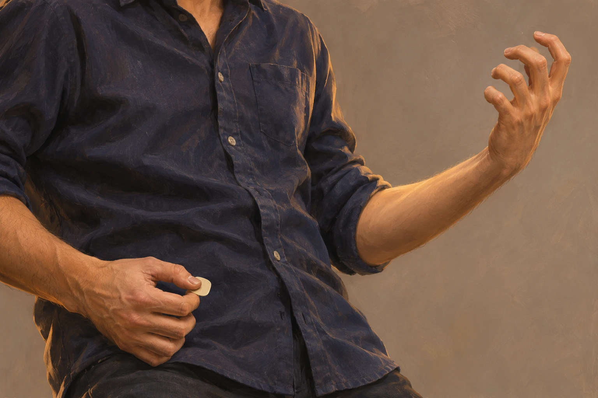
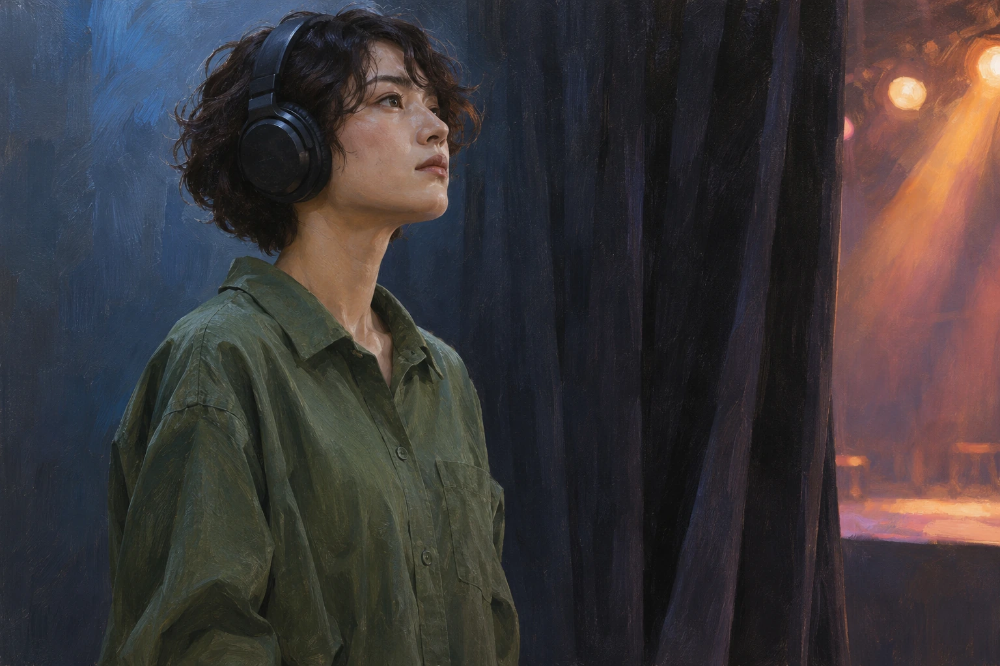

**曲に合わせた身体表現を競うのが、エアギターの世界大会です。** 本物のギターを使わずに演奏する姿を見せ、独創性や舞台での存在感などが審査されます。

舞台では音楽が流れ、その曲に合わせて見えないギターを演じます。1996年にフィンランドのオウルで始まった、実在する大会です。

## 競うのは、見えないギターをどう表現するか

主催者の世界決勝規則が挙げる審査項目には、独創性、音楽への没入、舞台上の存在感、技術、芸術的な印象などがあります。

音楽に合わせた動きから、そこにいるはずのギタリストを観客が想像できる。楽器がないぶん、演じる人そのものへ目が向くところが面白く感じます。

## 準備した曲と、その場で聴く曲

公表規則では、第1ラウンドは自分で選んだ60秒の曲。そこから上位8人が第2ラウンドへ進み、ラウンド開始直前に聴く主催者指定の曲を、同じく60秒で表現します。

*曲を聴く場面をイメージした参考イラストです。実際の大会での聴き方や機材を示すものではありません。*

練り上げた見せ場だけでなく、知らされた曲にどう応えるかも見られる構成です。ただし、ここで紹介しているのは現在の世界決勝規則で、過去のすべての大会が同じ日程・進行だったという意味ではありません。

## ギターは持てない。でも、ピックは使える

本物の楽器や、ギターの代わりにする小道具は禁止。一方、本物のピックを使うことは認められています。小道具すべてが禁止、というわけでもありません。

いかにも冗談のような競技に、こうした境目があるのがいいですね。「ギターは見えない」という大前提を守りながら、どう見せるかには工夫の余地が残されています。

## 大真面目に、平和を掲げる大会

主催者が掲げる合言葉は「Make Air, Not War」。世界平和を楽しく伝えることが、大会の理念です。1996年の最初の大会についても、主催者の発表では、創設者がオウルの開催場所を振り返っています。

エアギターの面白さは、ギターがないと全員が分かったうえで、それでも演奏する姿を楽しめるところにあるのかもしれません。そんな想像力を、本気で競う舞台です。
