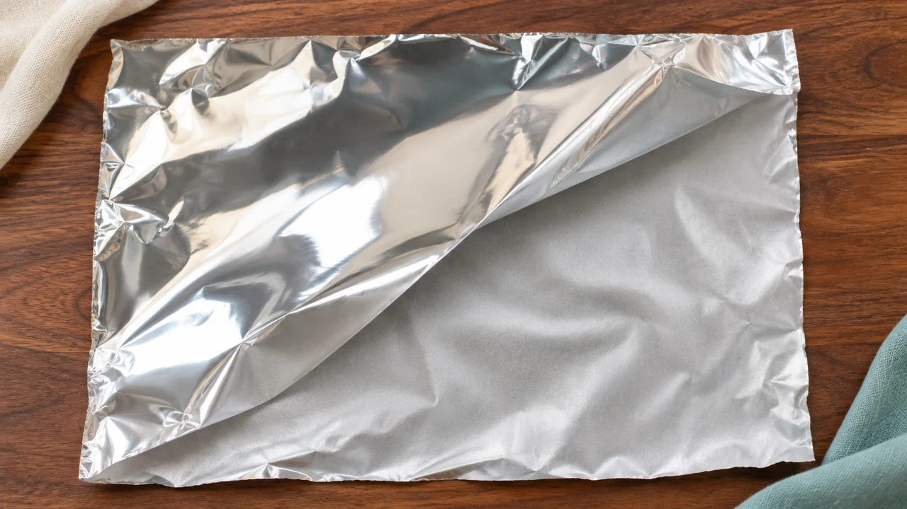

**ふつうの未加工アルミホイルなら、光る面とつや消しの面のどちらを食材に向けても使えます。** では、同じ一枚なのに、なぜ片面だけがピカッと光るのでしょう。

## 見た目の違いは、工場でつく

薄いアルミ箔は、仕上げで二枚重ねてローラーに通します。ローラーに触れた外側は光沢が出て、箔同士が接していた内側はつや消しになります。

使う面を区別するために色を付けたのではなく、作るときに触れた相手が違ったのです。東洋アルミの説明でも、一般的なアルミホイルには使い分けるための裏表はないとされています。

## ピカピカなら、返す光も多い？

光沢のある面は、角度によってぱっと明るく見えます。それだけ見ると、つや消しの面よりずっと多くの光を返していそうです。

市販のアルミホイルを測った研究では、光沢面は鏡のように決まった方向へ返す光の割合が高く、つや消し面は周囲に散らす光の割合が高くなりました。ところが、いろいろな方向へ返る光を合わせた反射率は、両面で近い値でした。

**違ったのは、返す光の総量というより、返す方向。** 目に入る光が集中するか、散らばるかで、見え方が変わるわけです。ただし、これは研究で使った試料の光学測定です。料理の焼け方や、火の通りを比べた実験ではありません。

ピカピカの面のほうが「よく働きそう」に見えるのに、見た目だけでは決められない。そこが、この身近な一枚の面白いところだと思います。箱から引き出したホイルに、工場でどう延ばしたかまで残っているのも意外です。

## 加工されたホイルは、箱の表示が優先

片面にくっつきにくい加工をしたホイルなどは、普段のホイルとは別に考えます。光沢の有無だけで判断せず、箱に「食材をのせる面」などの指定があれば、それに従ってください。

覚えておきたいのは、**ふつうのホイルの光沢差は製造の跡、加工品の使い方は製品の表示で確認する**ということ。毎回どちらを上にするか悩むより、「いつもの未加工品か、専用の加工品か」を確かめるほうが役に立ちます。
