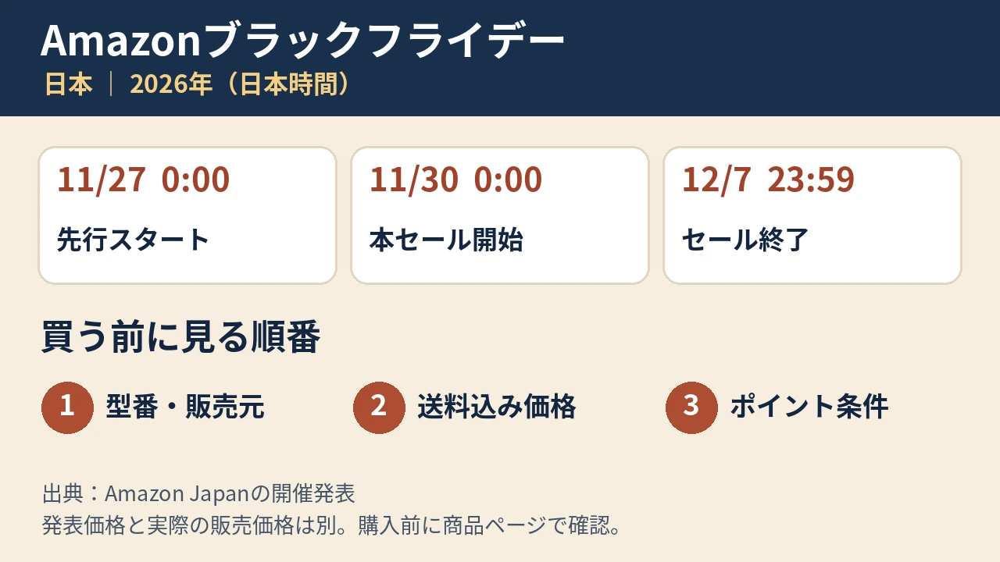

米Amazonが現地11月19日にブラックフライデー週を始め、日本のAmazon.co.jpでも**11月27日（金）0時に先行セール、11月30日（月）0時に本セール**が始まります。日本の先行は29日23時59分まで、本セールは12月7日（月）23時59分まで。時刻は日本時間です。

安いものから100個並べるのではなく、家事、通勤、作業、贈りものなど、実際の使い道で絞りました。Amazonか出店メーカーが日本のAmazon向けに対象を発表した100点を掲載。うち59点は発表価格（円）があります。試した商品のランキングではありません。対象が不明な製品、別店舗の価格、色違いだけの重複は数えていません。

### すぐ決めたい人の候補

- **3,000円までで使う理由があるもの**：読書灯A26は1,199円、Ankerの1.8m USB-Cケーブルは1,290円。すでに不便がなければどちらも買い足し不要。

- **充電器やイヤホンを替えるなら**：Ankerの3口充電器3,290円はPCとスマホをまとめたい人向け。Liberty 5の9,990円は通勤中の騒音が気になる人向け。1点だけだとポイントアップの1万円には10円足りません。

- **年末の集まりなら**：2～4人で遊ぶブロックスと、ルールを説明しやすいジェンガ。両方とも対象予定ですが、発表価格では比較できないので、当日の支払額で選びます。

*2026年、日本のAmazon.co.jp。時刻は日本時間。出典：Amazon Japanの開催発表。*

## 用途から探す

[家事・暮らし（21点）](#home) / [充電・スマホ周辺（8点）](#charging) / [イヤホン・スピーカー（13点）](#audio) / [PC・ゲーム・制作（16点）](#desk) / [おもちゃ・年末の集まり（17点）](#gifts) / [アウトドア・備え（9点）](#outdoor) / [室内運動（12点）](#fitness) / [パーソナルケア（4点）](#care)

商品ページやメーカーのリンクには、写真や詳しい仕様が載っているものがあります。セット内容や色は、リンク先で型番と合わせて確認してください。

価格欄の「発表」は販売前にメーカーなどが発表した特価（円）で、実際の支払額を見た値ではありません。「価格未確認」は、セール対象の発表は読めても金額を確認できなかった商品。「Amazon店併催」はブランド公式Amazon店の企画で、Amazon全体の期間・条件をそのまま当てはめないでください。

## 家事・暮らし（21点） {#home}

- **ブックマーク型読書灯 A26**：1,199円（発表）・11/27～12/7予定。紙の本を手元だけ照らしたい。手持ちの照明か画面付き電子書籍で十分。 [商品ページ](https://www.amazon.co.jp/dp/B0CHVVNLY6) [対象発表](https://prtimes.jp/main/html/rd/p/000000034.000184556.html)

- **Novilla「礎」ポケットコイルマットレス（厚さ24cm）**：15,920円（発表）・11/27～12/7予定。硬め寄りの寝床を新調し、フレームの幅と高さを確認できる。掲載価格は発表元が示したリンク先の案内値。別サイズにも当てはまるとは限らないので、幅、厚み、搬入経路を確認。 [商品ページ](https://www.amazon.co.jp/dp/B0HB4C8CJS) [対象発表](https://prtimes.jp/main/html/rd/p/000000023.000193323.html)

- **Dreame F20 Plus**：34,800円（発表）・11/27～12/7予定。日々の床の吸引とゴミ回収を任せたい。複雑な障害物が多い床、ドック用スペースがない。 [商品ページ](https://www.amazon.co.jp/dp/B0GVNN41NZ) [対象発表](https://prtimes.jp/main/html/rd/p/000000128.000116327.html)

- **Glocusent ブックマーク型読書灯 A106**：1,385円（11/23メーカー発表）・11/27～12/7予定。旅行で紙の本を読みたい場合に。USB-C充電と誤点灯を避けるトラベルロックが判断材料。 [対象発表](https://prtimes.jp/main/html/rd/p/000000034.000184556.html)

- **Glocusent ブックライト A40**：1,699円（発表）・11/27～12/7予定。光色の違う読書灯を比較したい人向け。既に光色を調整できるタイプなら買い増さない。 [商品ページ](https://www.amazon.co.jp/dp/B0FW4G86L7) [対象発表](https://prtimes.jp/main/html/rd/p/000000033.000184556.html)

- **ブックマーク型読書灯 A15**：1,709円（発表）・11/27～12/7予定。3色温度・5段階調光を使い分けたい。A26など簡単なライトで十分。 [商品ページ](https://www.amazon.co.jp/dp/B09W62FR1K) [対象発表](https://prtimes.jp/main/html/rd/p/000000034.000184556.html)

- **Glocusent ネックライト A105**：1,821円（発表）・11/27～12/7予定。読書だけでなく編み物など両手を使う場合に。机へ固定するタイプより装着感が重要。 [商品ページ](https://www.amazon.co.jp/dp/B0GRVD5JS1) [対象発表](https://prtimes.jp/main/html/rd/p/000000034.000184556.html)

- **Glocusent クリップライト A108**：1,899円（発表）・11/27～12/7予定。手元を照らす位置を固定したいときに。挟める厚さを先に測る。 [商品ページ](https://www.amazon.co.jp/dp/B0GQM58XNH) [対象発表](https://prtimes.jp/main/html/rd/p/000000033.000184556.html)

- **ネックライト A101**：2,177円（発表）・11/27～12/7予定。ソファなど据え置き照明なしで手元を見る。同用途なら既掲載A105との比較で十分。 [商品ページ](https://www.amazon.co.jp/dp/B0FL7KJXWJ) [対象発表](https://prtimes.jp/main/html/rd/p/000000034.000184556.html)

- **ネックライト（定番）**：2,256円（発表）・11/27～12/7予定。既知の定番型を買い替える。新規なら安価なA105で用途が足りる。 [商品ページ](https://www.amazon.co.jp/dp/B0B2J9D4PZ) [対象発表](https://prtimes.jp/main/html/rd/p/000000034.000184556.html)

- **Glocusent ホワイトノイズマシン N20**：2,564円（発表）・11/27～12/7予定。作業中に自然音などを流したい人向け。スマホや手持ちのスピーカーで足りるなら不要。 [商品ページ](https://www.amazon.co.jp/dp/B0GXZXFK2D) [対象発表](https://prtimes.jp/main/html/rd/p/000000033.000184556.html)

- **Glocusent 譜面台ライト A16**：3,599円（発表）・11/27～12/7予定。練習中に楽譜へ手を伸ばさず照らしたいときに。譜面台の縁に付けられるか確認。 [商品ページ](https://www.amazon.co.jp/dp/B09YRWWW7L) [対象発表](https://prtimes.jp/main/html/rd/p/000000033.000184556.html)

- **Avenco「星凪」ポケットコイルマットレス（厚さ26cm）**：28,693円（発表）・11/27～12/7予定。厚めのコイルマットレスに買い替え予定。掲載価格は発表元が示したリンク先の案内値。別サイズにも当てはまるとは限らないので、幅、厚み、搬入経路を確認。 [商品ページ](https://www.amazon.co.jp/dp/B0HB57W4TN) [対象発表](https://prtimes.jp/main/html/rd/p/000000024.000193323.html)

- **Dreame H12 Dual FlexReach**：34,800円（発表）・11/27～12/7予定。床の吸引・水拭きと車内などの手持ち掃除を兼用したい。専用機よりも軽さと単機能を重視。 [商品ページ](https://www.amazon.co.jp/dp/B0FMRSBW1M) [対象発表](https://prtimes.jp/main/html/rd/p/000000128.000116327.html)

- **Dreame T16**：39,800円（発表）・11/27～12/7予定。薄型ヘッドで家具の下を自分で水拭きしたい。床材が水拭き不可、手動で動かしたくない。 [商品ページ](https://www.amazon.co.jp/dp/B0GVYJQ7XQ) [対象発表](https://prtimes.jp/main/html/rd/p/000000128.000116327.html)

- **Dreame H15**：49,800円（発表）・11/27～12/7予定。硬い床の壁際を手動で水拭きしたい。軽い乾拭き用だけ探す。 [商品ページ](https://www.amazon.co.jp/dp/B0FQMJV474) [対象発表](https://prtimes.jp/main/html/rd/p/000000128.000116327.html)

- **Dreame L10s Ultra Gen2**：55,799円（発表）・11/27～12/7予定。水拭きとモップ手入れも自動化したい。水拭きできる床が少ない、基地を置けない。 [商品ページ](https://www.amazon.co.jp/dp/B0DBTHDHYS) [対象発表](https://prtimes.jp/main/html/rd/p/000000128.000116327.html)

- **Nebula Capsule 3＋公式プロジェクタージンバルスタンド ブラック**：57,990円（発表）。小さく持ち運べる映写機を使いたい人向け。投写距離と部屋を暗くできるかを先に確認。 [対象発表](https://corp.ankerjapan.com/news/659)

- **Anker Eufy Robot Vacuum Omni C30 Edge ブラック**：69,900円（発表）。初めて全自動型を置きたい人向け。高さ約31cmに加え本体やタンクの出し入れに必要な空間を確認。 [商品ページ](https://www.amazon.co.jp/dp/B0H6XHJH4Q) [対象発表](https://corp.ankerjapan.com/news/659)

- **Dreame L40s Pro Ultra**：99,799円（発表）・11/27～12/7予定。床の段差や壁際まで自動で掃除したい。高額な本体や基地を置くほど床掃除に困っていない。 [商品ページ](https://www.amazon.co.jp/dp/B0F2MZF2MT) [対象発表](https://prtimes.jp/main/html/rd/p/000000128.000116327.html)

- **Anker Eufy Robot Vacuum Omni E35 ブラック**：129,900円（発表）。床の水拭きを重視する人向けのローラーモップ機。適合する床材と交換用品を先に見る。 [対象発表](https://corp.ankerjapan.com/news/659)

## 充電・スマホ周辺（8点） {#charging}

- **Anker PowerPort III 3-Port 65W Pod ブラック**：3,290円（発表）。一つのコンセントで複数台を充電。ポート併用時の出力配分を確認。 [商品ページ](https://www.amazon.co.jp/dp/B09CH44769) [対象発表](https://corp.ankerjapan.com/news/659)

- **Anker PowerLine III Flow USB-C & USB-C ケーブル 1.8m ミッドナイトブラック**：1,290円（発表）。ベッド脇など距離があるとき向け。映像・高速データ用は対応規格を別途確認。 [対象発表](https://corp.ankerjapan.com/news/659)

- **CIO SMARTCOBY Ex04 Wireless2.2 CABLE SS5K ブラック（CIO-MB20W2C-SS5K-EX04-BK）**：5,920円（発表）・11/27～12/7予定、在庫限り。磁気対応のスマホを外出先で充電し、有線でも使いたい人向け。5,000mAhなので、容量を優先するなら別候補を。 [商品ページ](https://www.amazon.co.jp/dp/B0FTZ46NF8) [メーカーで写真・仕様を見る](https://connectinternationalone.co.jp/cioproduct/mobilebattery/smartcoby/cio-mb20w2c-ss5k-ex04/) [対象発表](https://connectinternationalone.co.jp/cionews/information/300878/)

- **SUNEAST 折りたたみ3in1ワイヤレス充電器 Qi2 25W ブラック（SE-WC025FC004BKF）**：5,980円（発表）。出張用の1台にまとめたい人向け。時計・イヤホンは自分の機種の対応を確認。 [対象発表](https://prtimes.jp/main/html/rd/p/000000224.000131068.html) [メーカーで写真・仕様を見る](https://suneast.co.jp/suneast/3in1_qi2_wireless_charger/)

- **Anker Nano Charging Station（7-in-1, 100W, 巻取り式USB-Cケーブル） ブラック**：7,490円（発表）。机に据えるなら電源と充電を集約しやすい。設置幅とコンセント位置を測る。 [対象発表](https://corp.ankerjapan.com/news/659)

- **Anker Power Bank（25000mAh, Built-In & 巻取り式USB-Cケーブル） ブラック**：10,790円（発表）。複数機器を外で使う人向け。内蔵ケーブルが便利でも携行重量を先に確認。 [対象発表](https://corp.ankerjapan.com/news/659)

- **Anker Prime Wireless Charging Station（3-in-1, MagGo, AirCool, Foldable） ブラック**：14,990円（発表）。スマホ・時計・イヤホンをまとめたい場合に。手持ち機種とケースで充電できるか確認。 [対象発表](https://corp.ankerjapan.com/news/659)

- **Anker Prime ドッキングステーション（14-in-1, 8K, Thunderbolt 5） グレー**：34,990円（発表）。複数の画面や機器を1本に集約する人向け。PC側のThunderbolt世代・画面出力数を確認。 [対象発表](https://corp.ankerjapan.com/news/659)

## イヤホン・スピーカー（13点） {#audio}

- **Soundcore Liberty 5 ミッドナイトブラック**：9,990円（発表）。通勤などノイズ低減を優先する人向け。複数端末を使う場合はマルチポイントが判断材料。 [商品ページ](https://www.amazon.co.jp/dp/B0DRVB48LJ) [対象発表](https://corp.ankerjapan.com/news/659)

- **Marshall MODE USB-C**：7,490円（発表）・11/27～12/7予定。無線の充電管理が面倒な人向け。端末がUSB-C音声出力に対応するか確認。 [商品ページ](https://www.amazon.co.jp/dp/B0G2TD1RSC) [対象発表](https://prtimes.jp/main/html/rd/p/000000045.000156717.html)

- **Marshall WILLEN II**：14,980円（発表）・11/27～12/7予定。小ささを優先する持ち運び用。自宅固定なら価格と大きさが違う同社機の必要性を比較。 [対象発表](https://prtimes.jp/main/html/rd/p/000000045.000156717.html)

- **Anker SoundCore 2 ブラック**：3,890円（発表）。スマホのスピーカーを手頃に補いたい人向け。購入画面で充電端子の仕様を確認。 [対象発表](https://corp.ankerjapan.com/news/659)

- **Soundcore AeroClip ホワイト＆ゴールド**：11,490円（発表）。耳を塞がずに聴きたい人向け。騒がしい電車での遮音より装着感と周囲音を重視。 [対象発表](https://corp.ankerjapan.com/news/659)

- **Soundcore Space 2 ブラック**：13,490円（発表）。イヤホンよりヘッドホン形状が好みの人に。持ち運びならサイズと重さを確認。 [対象発表](https://corp.ankerjapan.com/news/659)

- **Marshall MINOR IV**：15,480円（発表）・11/27～12/7予定。ノイズキャンセル前提のモデルと混同しない。耳に合う形状かを優先。 [対象発表](https://prtimes.jp/main/html/rd/p/000000045.000156717.html)

- **Marshall MAJOR V**：16,980円（発表）・11/27～12/7予定。折りたたんで持ち歩きたい人向け。耳の上に載せる着け心地が好みかを確認。 [商品ページ](https://www.amazon.co.jp/dp/B0D1VN2VB7) [対象発表](https://prtimes.jp/main/html/rd/p/000000045.000156717.html)

- **Soundcore Liberty 5 Pro ミッドナイトブラック**：21,490円（発表）。無印Liberty 5との1万円超の差は、欲しい追加機能がある場合だけ検討。 [対象発表](https://corp.ankerjapan.com/news/659)

- **Marshall EMBERTON III**：24,490円（発表）・11/27～12/7予定。屋外にも持ち出したい場合に。防塵・防水等級だけでなく必要な再生時間と持ち運びやすさも確認。 [商品ページ](https://www.amazon.co.jp/dp/B0DFHH1N33) [対象発表](https://prtimes.jp/main/html/rd/p/000000045.000156717.html)

- **Marshall MOTIF II A.N.C.**：24,980円（発表）・11/27～12/7予定。通勤でノイズキャンセル、仕事と私用でマルチポイントが欲しい場合に。 [商品ページ](https://www.amazon.co.jp/dp/B0CGZJDY84) [対象発表](https://prtimes.jp/main/html/rd/p/000000045.000156717.html)

- **Marshall MONITOR III A.N.C.**：43,980円（発表）・11/27～12/7予定。飛行機など長時間の移動で耳を覆うANC機を選びたい人向け。重さと収納寸法を確認。 [対象発表](https://prtimes.jp/main/html/rd/p/000000045.000156717.html)

- **Marshall WOBURN III**：89,980円（発表）・11/27～12/7予定。リビングに据え置きたい場合に。先に置き場所を測り、接続したいテレビなどの入力端子を確認。 [対象発表](https://prtimes.jp/main/html/rd/p/000000045.000156717.html)

## PC・ゲーム・制作（16点） {#desk}

- **SUNEAST microSD Express Card GIGA+ 512GB（SE-MSE512G20Z1G）**：17,860円（発表）。Switch 2のゲーム保存容量を増やしたい人向け。必ず「Express」表示を見る。 [対象発表](https://prtimes.jp/main/html/rd/p/000000224.000131068.html)

- **GRAPHT THE STANDARD Mini DAC for Gaming**：4,950円（発表・ブランドAmazon店）・期間は発表元で確認。有線音声機器をPC等に接続する小型DAC。ヘッドホンの端子とホストの対応を確認。 [商品ページ](https://www.amazon.co.jp/dp/B0HJWK4D9Q) [対象発表](https://prtimes.jp/main/html/rd/p/000000145.000162957.html)

- **SUNEAST ULTIMATE PRO GOLD SDXC UHS-I V30 128GB（SE-FS1128G23G1G）**：5,980円（発表）。カメラがフルサイズSDに対応するか、撮りたい動画モードの規格を確認。 [対象発表](https://prtimes.jp/main/html/rd/p/000000224.000131068.html) [メーカーで写真・仕様を見る](https://suneast.co.jp/en/suneast/sdxc-uhs-i-v30-card-s275-gold-series/)

- **SUNEAST ULTIMATE PRO GOLD microSDXC UHS-I V30 128GB（SE-MS1128G23G1G）**：5,980円（発表）。アクションカメラなどの候補。Switch 2のゲーム保存用と混同しない。 [対象発表](https://prtimes.jp/main/html/rd/p/000000224.000131068.html) [メーカーで写真・仕様を見る](https://suneast.co.jp/suneast/microsdxc-uhs-i-v30-card-s275-gold-series/)

- **SUNEAST 回転式PSSD R10 1TB 英語版（SE-PS0001T2LO1BG）**：17,800円（クーポン適用後の発表値）。PCとスマホ間で移す用途に。USB-AとUSB-Cの両方を使いたいか、英語版でも問題ないか確認。 [商品ページ](https://www.amazon.co.jp/dp/B0GYLW38G3) [対象発表](https://prtimes.jp/main/html/rd/p/000000224.000131068.html)

- **SUNEAST ULTIMATE PRO Black SDXC UHS-II 128GB（SE-FS2128V29G1F）**：22,800円（クーポン適用後の発表値）。UHS-IIとV90が実際に必要な撮影かを確認。普段撮影には高額になりやすい。 [対象発表](https://prtimes.jp/main/html/rd/p/000000224.000131068.html) [メーカーで写真・仕様を見る](https://suneast.co.jp/suneast/sdxc-uhs-ii-v90-card-black-series/)

- **GRAPHT THE SHOOTER Gaming Monitor 24” Essential スタンドレス**：23,980円（発表・ブランドAmazon店）・期間は発表元で確認。フルHD 280Hzを求める場合に。スタンドなしなので対応アームの費用を足す。 [商品ページ](https://www.amazon.co.jp/dp/B0HCBBV5Z7) [対象発表](https://prtimes.jp/main/html/rd/p/000000145.000162957.html)

- **SUNEAST GOLD SERIES 720 M.2 2280 PCIe Gen4.0×4 1TB（SE-MN4001T2LG2G）**：32,220円（クーポン適用後の発表値）。PC側のM.2スロットと長さ・PCIe規格を確認。外付けSSDとは用途が異なる。 [対象発表](https://prtimes.jp/main/html/rd/p/000000224.000131068.html) [メーカーで写真・仕様を見る](https://suneast.co.jp/suneast/builtin_ssd_m2_2280_nvme_gen4_gold_series_720/)

- **GRAPHT THE SHOOTER Gaming Monitor 27” Essential スタンド付属**：35,970円（発表・ブランドAmazon店）・期間は発表元で確認。WQHD 240Hz。机に載せる前提で、PCが遊ぶゲームを目的の解像度・フレーム数で動かせるか確認。 [商品ページ](https://www.amazon.co.jp/dp/B0HJW5SQDZ) [対象発表](https://prtimes.jp/main/html/rd/p/000000145.000162957.html)

- **SUNEAST Eclipse E40 MagSafe SSD 2TB（SE-PS002T2LEL1GN）**：39,800円（クーポン適用後の発表値）。大きな映像素材を扱う場合に。USB4対応とケーブル規格が速度を左右。 [商品ページ](https://www.amazon.co.jp/dp/B0HRDP66P8) [対象発表](https://prtimes.jp/main/html/rd/p/000000224.000131068.html)

- **Wacom Cintiq 16**：価格未確認。机上で画面に直接描きたい人向け。PCの映像端子・設置スペースから判断。 [対象発表](https://prtimes.jp/main/html/rd/p/000000372.000016902.html) [メーカーで写真・仕様を見る](https://www.wacom.com/ja-jp/products/pen-displays/wacom-cintiq)

- **Wacom Cintiq 24 touch**：価格未確認。大型の作業面とタッチ操作を求める人向け。非タッチ版との違いと机の奥行きを確認。 [対象発表](https://prtimes.jp/main/html/rd/p/000000372.000016902.html) [メーカーで写真・仕様を見る](https://www.wacom.com/ja-jp/products/pen-displays/wacom-cintiq)

- **Wacom Intuos Pro Medium**：価格未確認。別画面を見ながら描く操作に慣れていて、作業スペースを確保できる人向け。 [対象発表](https://prtimes.jp/main/html/rd/p/000000372.000016902.html) [メーカーで写真・仕様を見る](https://www.wacom.com/ja-jp/products/wacom-intuos-pro)

- **Wacom Intuos ワイヤレス Small**：価格未確認。小さな机や持ち運びを優先する人向け。ワイヤレス版か販売ページで確認。 [対象発表](https://prtimes.jp/main/html/rd/p/000000372.000016902.html)

- **Wacom One 14**：価格未確認。初めて画面に直接描く候補。接続するPC側とケーブル構成を事前に確認。 [対象発表](https://prtimes.jp/main/html/rd/p/000000372.000016902.html) [メーカーで写真・仕様を見る](https://www.wacom.com/ja-jp/products/wacom-one)

- **Wacom One ペンタブレット Medium**：価格未確認。液晶を内蔵しない入門機。手元ではなくPC画面を見て描く方式が合うか確認。 [対象発表](https://prtimes.jp/main/html/rd/p/000000372.000016902.html)

## おもちゃ・年末の集まり（17点） {#gifts}

Amazon Japanの対象予定マーク「★」の品を掲載。いずれも価格未確認。子ども向けは対象年齢と使用条件を商品・説明書で確認してください。

- **ブロックス**：価格未確認。7歳以上の2〜4人で違う形のピースを置く対戦を楽しみたい。対戦が目的なのに普段1人（別途ソロパズルは可）。 [商品ページ](https://www.amazon.co.jp/dp/B00FBWBM3G) [対象発表](https://www.aboutamazon.jp/news/retail/amazon-toy-of-the-year-2026)

- **Tamagotchi Paradise**：価格未確認。育成ゲームを少しずつ遊びたい。すでに同シリーズがあり、遊びを買い足す理由がない。 [商品ページ](https://www.amazon.co.jp/dp/B0H1KQ5CMD) [対象発表](https://www.aboutamazon.jp/news/retail/amazon-toy-of-the-year-2026)

- **あんよでキック! 感覚が育つ4WAYバイリンガル・ピアノジム**：価格未確認。身体を動かして床で遊ぶマットを探す家庭。すでにベビージムがある、置き場が足りない。 [商品ページ](https://www.amazon.co.jp/dp/B0D2CKNQWY) [対象発表](https://www.aboutamazon.jp/news/retail/amazon-toy-of-the-year-2026)

- **アンパンマン 8WAY ウォーカーまでへんしん! よくばりメリー**：価格未確認。月齢に合わせて形を変えられるメリーを探す家庭。既存のメリーがある、設置条件が合わない。 [商品ページ](https://www.amazon.co.jp/dp/B07DLBKBC4) [対象発表](https://www.aboutamazon.jp/news/retail/amazon-toy-of-the-year-2026)

- **アンパンマン おさつスイスイ セルフでピピッ アンパンマンレジスター**：価格未確認。お店屋さんごっこが好き。細かな付属品の管理が難しい。 [商品ページ](https://www.amazon.co.jp/dp/B0837VP5X5) [対象発表](https://www.aboutamazon.jp/news/retail/amazon-toy-of-the-year-2026)

- **アンパンマンといっしょにドライブ!! 3STEPよくばりビジーカーDX**：価格未確認。子どもの乗り物遊びに使う場所を確保できる家庭。走らせる場所・収納がない。 [商品ページ](https://www.amazon.co.jp/dp/B0H69P4V5D) [対象発表](https://www.aboutamazon.jp/news/retail/amazon-toy-of-the-year-2026)

- **シルバニアファミリー 赤い屋根の大きなお家 デラックスセット -屋根裏はひみつのお部屋-**：価格未確認。人形や家具を配置するごっこ遊びが好き。広げる場所と収納を確保できない。 [商品ページ](https://www.amazon.co.jp/dp/B0BBT9GZ5J) [対象発表](https://www.aboutamazon.jp/news/retail/amazon-toy-of-the-year-2026)

- **ジェンガ**：価格未確認。年末の集まりですぐ始められる手先のゲームを探す。崩す音が気になる場所で遊ぶ。 [商品ページ](https://www.amazon.co.jp/dp/B0FBVQPYK4) [対象発表](https://www.aboutamazon.jp/news/retail/amazon-toy-of-the-year-2026)

- **タッチでできた! 1.5才からのアンパンマン知育パッド**：価格未確認。キャラクターが好きで短時間のタッチ遊びを探す家庭。画面のある玩具は増やしたくない。 [商品ページ](https://www.amazon.co.jp/dp/B0DDXH9P33) [対象発表](https://www.aboutamazon.jp/news/retail/amazon-toy-of-the-year-2026)

- **ディズニー 3WAYへんしん知育ボックス くまのプーさん**：価格未確認。押したり回したりする箱型おもちゃを探す家庭。似た知育ボックスをすでに持つ。 [商品ページ](https://www.amazon.co.jp/dp/B0DF724WKX) [対象発表](https://www.aboutamazon.jp/news/retail/amazon-toy-of-the-year-2026)

- **ドリームスイッチ DXセット ディズニー＆ピクサーキャラクター**：価格未確認。家で壁・天井に映して物語を楽しみたい。投影面がない、紙の絵本で十分。 [商品ページ](https://www.amazon.co.jp/dp/B0FL721TVX) [対象発表](https://www.aboutamazon.jp/news/retail/amazon-toy-of-the-year-2026)

- **レゴ アイコン トランスフォーマー：サウンドウェーブ**：価格未確認。作品のメカを組み立てて飾りたい。手軽な短時間の工作が目的。 [商品ページ](https://www.amazon.co.jp/dp/B0DWM4J9BR) [対象発表](https://www.aboutamazon.jp/news/retail/amazon-toy-of-the-year-2026)

- **レゴ アイデア ホーム・アローン**：価格未確認。映画ファンで組み立てと展示の両方を楽しみたい。完成品の置き場所を決めていない。 [商品ページ](https://www.amazon.co.jp/dp/B09GPP2BFJ) [対象発表](https://www.aboutamazon.jp/news/retail/amazon-toy-of-the-year-2026)

- **レゴ スター・ウォーズ デス・スター**：価格未確認。大型の展示作品として組み立てたいファン。正しい型番・価格・置き場所の確認前。 [商品ページ](https://www.amazon.co.jp/dp/B0FPXFMGVT) [対象発表](https://www.aboutamazon.jp/news/retail/amazon-toy-of-the-year-2026)

- **レゴ スター・ウォーズ ヴェネター級リパブリック・アタック・クルーザー**：価格未確認。シリーズの大型模型に予算と棚を確保済み。サイズも予算も未確認。 [商品ページ](https://www.amazon.co.jp/dp/B0CJ7W6QTW) [対象発表](https://www.aboutamazon.jp/news/retail/amazon-toy-of-the-year-2026)

- **仮面ライダーマイス 変身ベルト DXマイスドライバー**：価格未確認。作品を見ていて、変身ごっこが好きな子への贈り物。シリーズ未視聴、または対応する別売り品を買い足したくない。 [商品ページ](https://www.amazon.co.jp/dp/B0HC1NMBWL) [対象発表](https://www.aboutamazon.jp/news/retail/amazon-toy-of-the-year-2026)

- **名探偵プリキュア！ おでかけしよ♪お世話して、かわいがって？おしゃべりポチタン**：価格未確認。作品のキャラクターでお世話遊びをしたい。声が出るおもちゃを避けたい。 [商品ページ](https://www.amazon.co.jp/dp/B0GF5ZBG1B) [対象発表](https://www.aboutamazon.jp/news/retail/amazon-toy-of-the-year-2026)

## アウトドア・備え（9点） {#outdoor}

- **Glocusent コンパクトランタン C13**：1,994円（発表）・11/27～12/7予定。携帯性と必要時間を優先する人向け。充電方式と装備内での役割を確認。 [商品ページ](https://www.amazon.co.jp/dp/B0GGHCPRVQ) [対象発表](https://prtimes.jp/main/html/rd/p/000000033.000184556.html)

- **Glocusent 106-LED キャンプランタン C11**：2,499円（発表）・11/27～12/7予定。サイト全体の補助灯が必要なら候補。明るさ設定別の点灯時間と重量を確認。 [商品ページ](https://www.amazon.co.jp/dp/B09KRQRRFL) [対象発表](https://prtimes.jp/main/html/rd/p/000000033.000184556.html)

- **EcoFlow DELTA 3 Classic 単体**：62,800円（発表・ブランドAmazon店）・期間は発表元で確認。1,024Whクラス。ソーラーパネルが不要な人はセットではなく本体のみを比較。 [商品ページ](https://www.amazon.co.jp/dp/B0G8DVFCPP) [対象発表](https://prtimes.jp/main/html/rd/p/000000265.000050601.html)

- **Anker Solix C1000 Gen 2 Portable Power Station＋C1000/C800専用防塵＆防水バッグ ダークグレー**：68,990円（発表）。持ち運び用バッグも必要なら候補。バッグと本体の防水性能は別。 [対象発表](https://corp.ankerjapan.com/news/659) [メーカーで写真・仕様を見る](https://www.ankerjapan.com/products/b17635z4?variant=45731874406561)

- **EcoFlow DELTA 3 Max 単体**：109,800円（発表・ブランドAmazon店）・期間は発表元で確認。2,048Wh・定格2,000W。使う機器の最大消費電力と持ち運ぶ重量を確認。 [商品ページ](https://www.amazon.co.jp/dp/B0FPCD866Z) [対象発表](https://prtimes.jp/main/html/rd/p/000000265.000050601.html)

- **Anker Solix C2000 Gen 2 Portable Power Station ダークグレー**：124,900円（発表）。複数の家電を想定するなら定格出力と動かしたい時間を比較。容量だけでは決まらない。 [対象発表](https://corp.ankerjapan.com/news/659) [メーカーで写真・仕様を見る](https://www.ankerjapan.com/products/a1783)

- **EcoFlow DELTA 3 Max Plus＋220W軽量両面ソーラーパネル**：175,800円（発表・ブランドAmazon店）・期間は発表元で確認。Max単体とは上位別機種とパネルの組み合わせ。定格3,000Wまたはパネルの両方が必要か考える。 [商品ページ](https://www.amazon.co.jp/dp/B0HCYP6GXS) [対象発表](https://prtimes.jp/main/html/rd/p/000000265.000050601.html)

- **Jackery ポータブル電源 1000 New V3**：価格未確認。約10.6kg。容量より持ち運びと1,500W定格が用途に合うかで選ぶ。 [対象発表](https://prtimes.jp/main/html/rd/p/000000376.000039188.html)

- **Jackery ポータブル電源 2000 New V2**：価格未確認。2,048Wh級。2000 New V2と名称が近い別世代や色を混同しない。 [対象発表](https://prtimes.jp/main/html/rd/p/000000376.000039188.html)

## 室内運動（12点） {#fitness}

STEADYの本セールは11月30日から12月7日。先行セールへの参加発表はありますが、下記の各商品が先行対象かは未発表です。床の広さ、収納、耐荷重や家の音の響きを先に確認してください。

- **STEADY ツイストステッパー**：価格未確認。収納しやすく予定に合うなら候補。床対策と使用制限を確認。 [商品ページ](https://www.amazon.co.jp/dp/B0HFVLM1ST) [対象発表](https://prtimes.jp/main/html/rd/p/000000110.000044477.html)

- **STEADY Ultimate Gear クロスグリップ**：価格未確認。既存の器具と握り用途が合い、左右やサイズの購入条件が明確なら。 [商品ページ](https://www.amazon.co.jp/dp/B0C78KYBPR) [対象発表](https://prtimes.jp/main/html/rd/p/000000110.000044477.html)

- **STEADY Ultimate Gear クロスベルト**：価格未確認。胴回りを測って対象サイズを確認。使う予定のない高額セットは不要。 [商品ページ](https://www.amazon.co.jp/dp/B0DPPD2PXL) [対象発表](https://prtimes.jp/main/html/rd/p/000000110.000044477.html)

- **STEADY Ultimate Gear クロスベンチ**：価格未確認。使用時寸法と収納場所、体重と器具を含めた耐荷重を確認。 [商品ページ](https://www.amazon.co.jp/dp/B0FGJHL1Z7) [対象発表](https://prtimes.jp/main/html/rd/p/000000110.000044477.html)

- **STEADY スピンバイク**：価格未確認。基本機能で充分なら候補。サドル位置と設置スペースが合わなければ見送り。 [商品ページ](https://www.amazon.co.jp/dp/B09GV3T19Q) [対象発表](https://prtimes.jp/main/html/rd/p/000000110.000044477.html)

- **STEADY スピンバイクPlus**：価格未確認。Pro・無印との価格差を、実際に使う機能と調整範囲で判断。 [商品ページ](https://www.amazon.co.jp/dp/B0CHY6VFWW) [対象発表](https://prtimes.jp/main/html/rd/p/000000110.000044477.html)

- **STEADY スピンバイクPro**：価格未確認。頻繁に使うなら調整範囲と設置寸法を確認。下位機で足りるなら見送り。 [商品ページ](https://www.amazon.co.jp/dp/B0BMV4DHCT) [対象発表](https://prtimes.jp/main/html/rd/p/000000110.000044477.html)

- **STEADY バンド付きフィットネスバイク**：価格未確認。付属バンドを使う予定と収納寸法を確認。バンド不要なら無印も比較。 [商品ページ](https://www.amazon.co.jp/dp/B0BR4RB4D7) [対象発表](https://prtimes.jp/main/html/rd/p/000000110.000044477.html)

- **STEADY バーベルシャフト / プレート（公式の見出し、当該ASINのみ）**：価格未確認。シャフト径・穴径・同梱範囲を当該オプションで確認。シリーズ全品と解釈しない。 [商品ページ](https://www.amazon.co.jp/dp/B0DT41LX6G) [対象発表](https://prtimes.jp/main/html/rd/p/000000110.000044477.html)

- **STEADY フィットネスバイク**：価格未確認。使う頻度と収納場所を決めてから。Neoとの価格差と機能差を比較。 [商品ページ](https://www.amazon.co.jp/dp/B0F6N1GWN5) [対象発表](https://prtimes.jp/main/html/rd/p/000000110.000044477.html)

- **STEADY フィットネスバイクNeo**：価格未確認。基本モデルより必要な機能がある場合のみ。通常モデルの着地価格も確認。 [商品ページ](https://www.amazon.co.jp/dp/B0G8HCSKDV) [対象発表](https://prtimes.jp/main/html/rd/p/000000110.000044477.html)

- **STEADY 背もたれ付きフィットネスバイク**：価格未確認。背もたれが選ぶ理由になるなら候補。座面調整・占有面積を確認。 [商品ページ](https://www.amazon.co.jp/dp/B0FWDBR6C5) [対象発表](https://prtimes.jp/main/html/rd/p/000000110.000044477.html)

## パーソナルケア（4点） {#care}

- **BIVABOO ミラージュ クレンジングバーム＋ピーリング 100mL**：価格未確認・11/27～12/7予定。普段使っている種類なら容量当たり単価を比較。初見なら香り・成分・使い方を確認。 [商品ページ](https://www.amazon.co.jp/dp/B0HHDRFB7B) [対象発表](https://prtimes.jp/main/html/rd/p/000000037.000064439.html)

- **STEADY 3Dエアストレッチシート**：価格未確認。収納寸法、体格とメーカーの利用条件を確認。 [商品ページ](https://www.amazon.co.jp/dp/B0DPPC17ST) [対象発表](https://prtimes.jp/main/html/rd/p/000000110.000044477.html)

- **STEADY ホットハンディガン®Mini**：価格未確認。重さ・同梱品・メーカーの利用条件が合わなければ見送り。 [商品ページ](https://www.amazon.co.jp/dp/B0FWDBKZXF) [対象発表](https://prtimes.jp/main/html/rd/p/000000110.000044477.html)

- **STEADY 蒸気アイウォーマー**：価格未確認。運用方法・装着寸法と取扱条件を確認。自分に不要なら値引きでも見送り。 [商品ページ](https://www.amazon.co.jp/dp/B0FGJDZST8) [対象発表](https://prtimes.jp/main/html/rd/p/000000110.000044477.html)

## 開幕したら見るところは3つ

1. 商品名だけで決めず、**型番・色・容量・付属品・販売元**を照合。似た名称の世代違いは別商品です。

2. **送料込みの支払額**を同じ型番・容量・色で見比べます。商品ページに「価格履歴」があれば、過去30日・90日の値動きも参考に。履歴だけで今回が最安とは判断せず、最後は送料と適用できたクーポンを反映した注文確認画面の合計を見ます。 [Amazonの価格履歴の案内](https://www.aboutamazon.jp/news/retail/alexa-for-shopping-ai-assistant)

3. ポイントアップは事前エントリーと対象期間中の合計1万円（税込）以上の購入などが条件。対象外商品もあるので、**不要な買い足しはしない**。

## 更新について

この記事は11月24日時点の発表情報をもとにしています。セール開始後に実売価格、対象の変更、対象外が分かった場合は、同じ記事に確認時刻と変更点を追記します。売り切れや価格変更によって、本文の発表価格で買えない場合があります。
