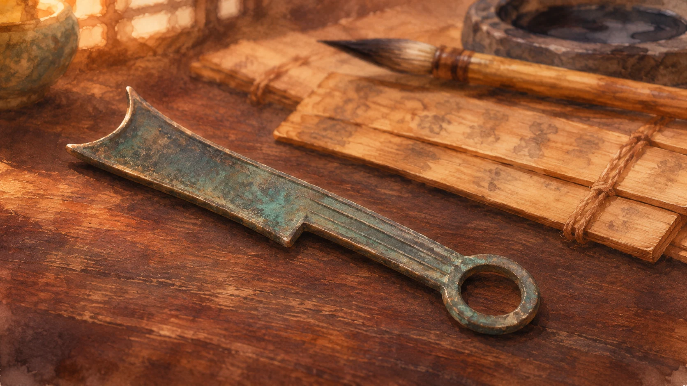
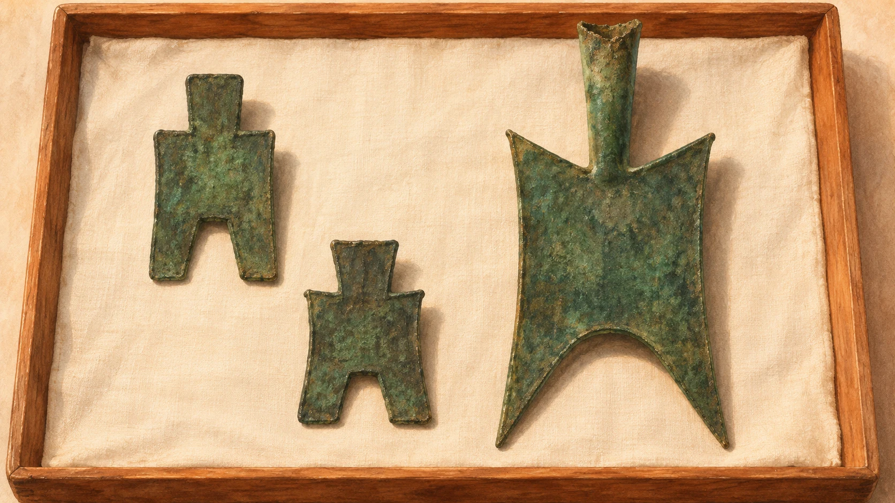

**刀銭（とうせん）は小刀の形、布銭（ふせん）は農具の鋤に似た形をした青銅製のお金です。** 「刀で支払う」と聞くと武器を差し出す場面を想像しますが、話の中心は、道具の姿を受け継いだ貨幣です。

丸い硬貨を見慣れていると、どちらも一見お金には見えません。しかも刀銭につながる小刀は、戦うためというより、文字を書く仕事に関わる道具でした。

## 刀銭のルーツは、書き間違いを削る小刀

[日本銀行金融研究所貨幣博物館の解説](https://www.imes.boj.or.jp/cm/research/kinken/mod/gra_china3.pdf)では、刀幣は「削（さく）」と呼ばれる小刀から発展した貨幣とされています。木簡や竹簡に誤って書いた文字を削るのに使う道具で、筆とともに筆記に欠かせないものでした。

刀銭の姿と筆記道具とのつながりをイメージした参考イラストです。実物の出土品や当時の机上を再現したものではありません。

今なら消しゴムや取り消し操作で済むことに、小刀が関わっていた。その道具の形がお金に残っていると考えると、名前の物騒な印象が少し変わります。

刀銭は柄の端に環があり、先端の形には尖ったもの、四角いもの、丸みを帯びたものなどがあります。春秋・戦国時代には黄河流域の東側から中国北部へ広く流通しました。ただし、買い物のたびに実用の刀を渡した、という意味ではありません。

## 「布銭」なのに、布ではなく金属？

布銭も、布地の切れ端ではありません。[同館の布幣解説](https://www.imes.boj.or.jp/cm/research/kinken/mod/gra_china2.pdf)では、鋤形の農具から発展した青銅製貨幣と説明されています。「布」という字も、農具を表す「鎛」の字が、同音で簡単な「布」に置き換わったという解釈が一般的とされています。語源には諸説があるため、唯一の確定説ではありません。

形の違いを伝える参考イラスト。銘文は再現しておらず、寸法や大きさの比率を測るための図ではありません。

初期の布銭には、農具の柄を差し込むような空洞が残る「空首布」があります。その後は薄く平たく、小型・軽量の「平首布」へと変わりました。道具らしさを残しながら、お金としての姿へ移っていくところに面白さがあります。

## 古代中国で、どこでも同じお金だったわけではない

布銭は戦国時代に中原諸国を中心に流通し、刀銭と布銭を併用した地域もありました。種類や時代で形も流通域も違うため、「中国全土で、この二種類だけを使っていた」とまとめるのは不正確です。

小刀と鋤。形の違いを知るだけでも、昔のお金がぐっと身近になります。単に変わった硬貨というより、当時の暮らしにあった道具の名残を眺めるつもりで見ると、博物館の展示も楽しめそうです。実際の形や銘文は、参考資料の写真で確かめられます。
