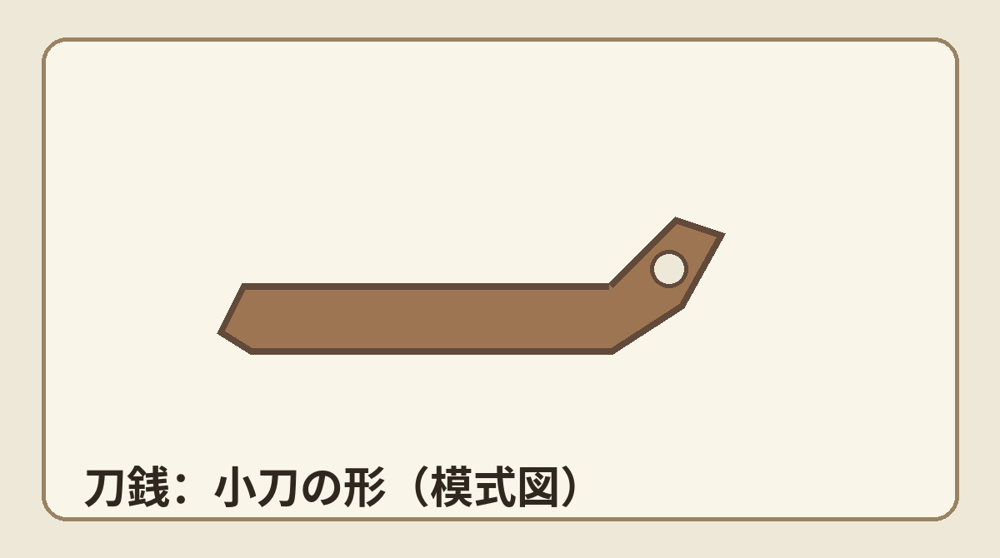
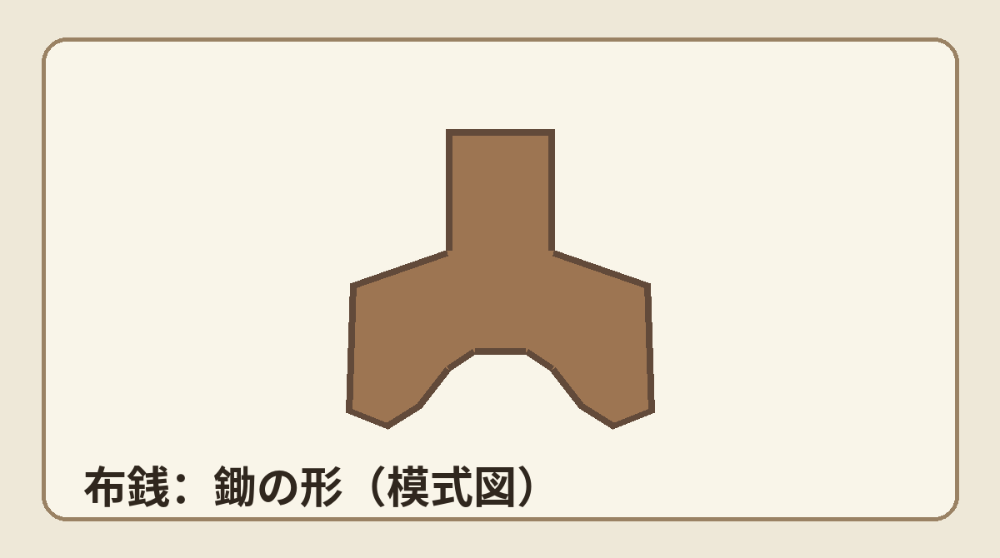

**刀銭（とうせん）は小刀の形、布銭（ふせん）は農具の鋤に似た形をした銅製のお金です。** 「カタナで支払う」と聞くと武器を差し出す場面を想像しますが、話の中心は*道具の形をした貨幣*です。

## 刀銭は「小刀型の銅貨」

[日本銀行金融研究所貨幣博物館の刀幣解説](https://www.imes.boj.or.jp/cm/research/kinken/mod/gra_china3.pdf)によれば、刀幣は文字を削る小刀「削」から発展した青銅製の貨幣です。春秋・戦国時代には黄河流域の東側から中国北部にかけて広く流通し、燕や趙では布幣も併用されました。刀銭（刀幣）とは、買い物のたびに実用の刀を渡した、という意味ではありません。

上は形だけを示した模式図です。実物は銘文や柄・刃にあたる部分の形もさまざま。これだけを見て、どこの国で作られた何年ごろの一枚かは判定できません。

## 「布銭」の布は、布地のこと？

布銭（布幣）も銅製です。名前から布の切れ端を想像しがちですが、[貨幣博物館の「金属貨幣の発生1―布幣―」](https://www.imes.boj.or.jp/cm/research/kinken/mod/gra_china2.pdf)は、鋤形の古代農具を表す「鎛」の字が、同音の「布」に置き換わったという説を一般的な解釈として紹介しています。ただし、字の由来には諸説あり、これが唯一確定した語源というわけではありません。

同資料によれば、布幣は戦国時代には中原諸国を中心に流通しました。つまり「古代中国の人が、どこでも同時に同じ形のお金を使った」という話ではありません。形と使われ方には地域や時期の違いがあります。

刀や鋤のような姿が、お金の形として残った。そこが面白いところです。いつもの丸い硬貨とは違う形を見ると、当時の人にとって身近な道具が何だったかも、少し想像したくなります。
