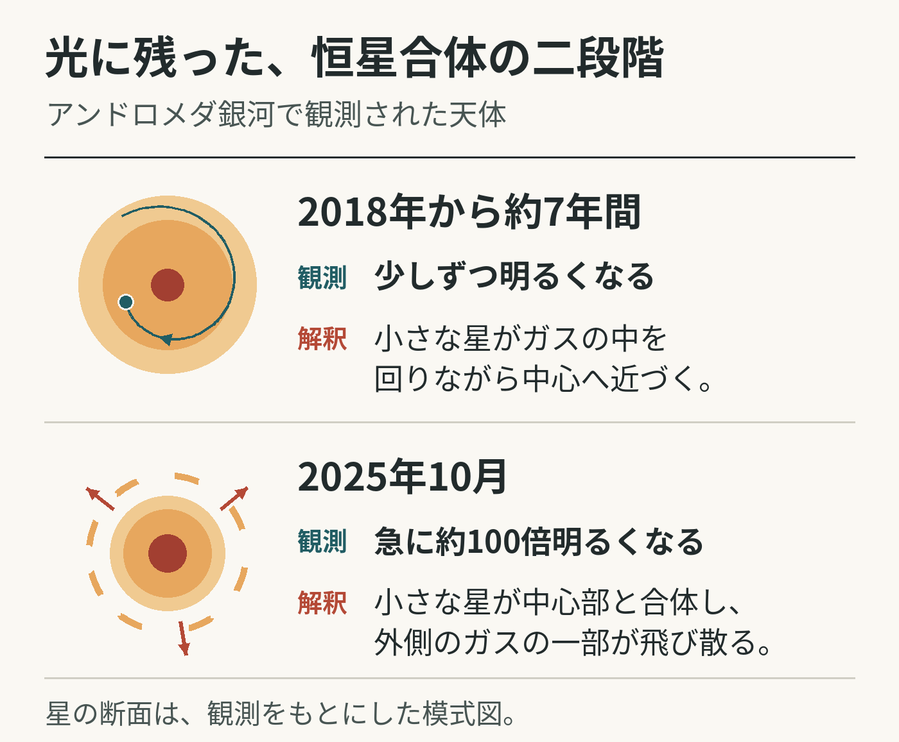

2025年10月、アンドロメダ銀河のある天体が、急に約100倍も明るくなりました。二つの星が一つになる瞬間を捉えたとしたら、光はいつ変わり始めたのか。過去の記録をたどると、**同じ場所は2018年から約7年、少しずつ明るくなっていました。**

## 飲み込まれた星は、どこへ行く？

この天体にはもともと、互いの周りを回る二つの星がありました。大きい方は質量が太陽の約7倍で、年老いて外側のガスが大きく膨らんだ星。小さい方は太陽の約0.7倍でした。

研究チームが光の変化から描いたのは、一つのガスの層に二つの星が包まれる姿です。膨らんだガスが小さな星をすっぽり包んでも、その内側で星は回り続けます。ガスの抵抗で軌道が縮むにつれてエネルギーが周りに伝わる。その過程なら、7年間かけて届く光が強くなったことを説明できます。

## 岡山の望遠鏡に届いた、最後のひときわ強い光

岡山の「せいめい望遠鏡」などが2025年10月に捉えた急増光は、その長い過程の終盤に当たります。研究チームは、小さな星がついに大きな星の中心部と合体し、その衝撃で外層のガスの一部が吹き飛んだと考えています。

望遠鏡に届くのはガスの外から見える光です。内側で起きたことを探るために、岡山で捉えた急増光と、爆発前の観測記録、ジェームズ・ウェッブ宇宙望遠鏡が捉えた爆発後の光を突き合わせました。一晩の閃光に見えた現象の前には、もう一つの星が内側を回っていた年月がありました。成果は2026年11月18日に『Nature』で発表されました。
