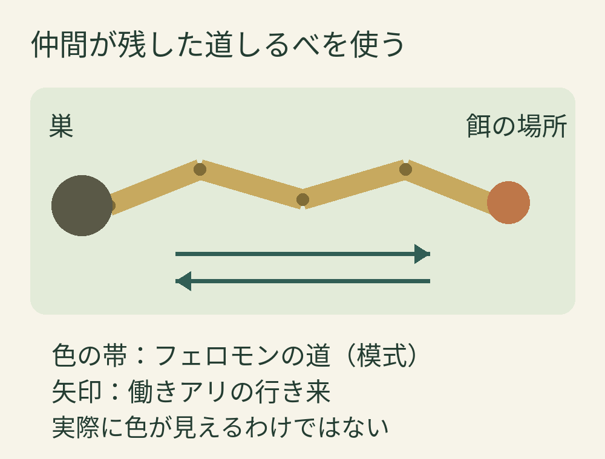
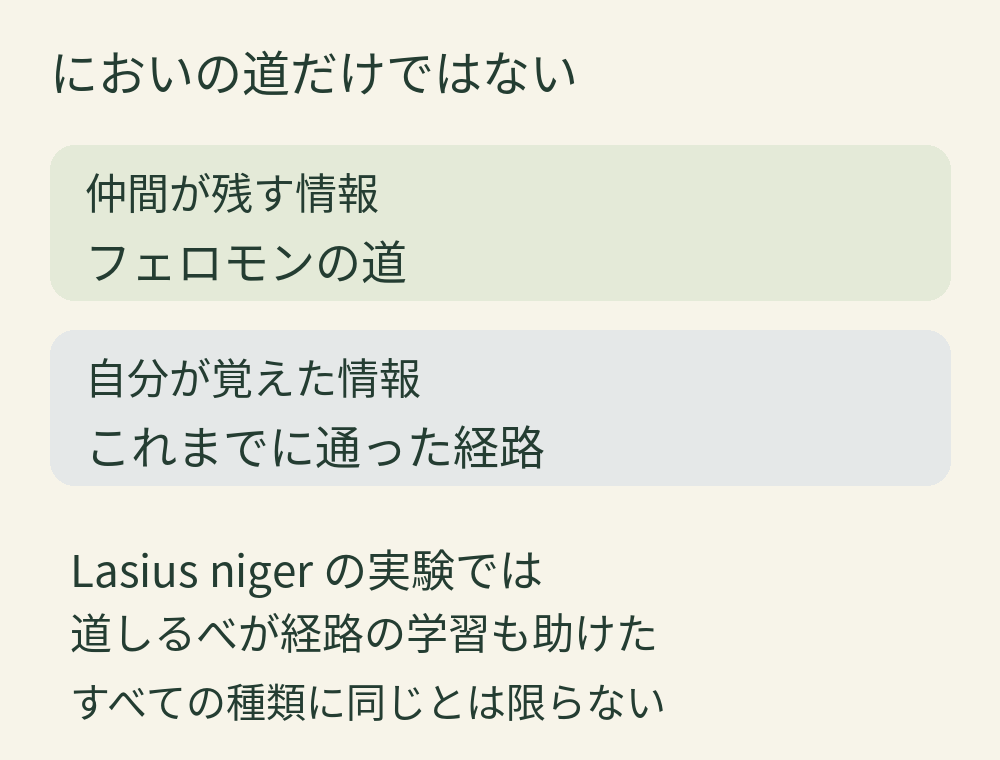

**アリが行列をつくる理由のひとつは、仲間が地面などに残したフェロモンを道しるべにするからです。** 餌を見つけた働きアリの通り道が、ほかの働きアリにも使われるようになります。ただし、すべての種類が同じ方法で移動するわけではありません。[サセックス大学の解説](https://www.sussex.ac.uk/lasi/research/organisation)

色の帯は、目には見えない道しるべを表しています。矢印はアリの行き来であり、フェロモン自体に一方通行の矢印がついているという意味ではありません。実際の道の形や濃さを測った図ではありません。

## 先頭の一匹についていくだけではない

一列に歩いていると、前のアリを見失わないようについていく集団に見えます。でも、フェロモンの道を使う種類では、地面に残る化学物質が仲間を案内します。先に通った個体がその場にいなくても、手がかりが残るのが面白いところです。[ミネソタ大学の解説](https://extension.umn.edu/garden-and-home/home-maintenance/household-insects/ants)

多くの種類では、餌を見つけた働きアリが巣へ戻る道にフェロモンを残し、誘われた仲間も道しるべを加えます。一方、餌がなくなって新しく残されなくなれば、残った物質は次第に失われます。つまり、行列は一度決まった場所を永久に通り続けるものではなく、餌の状況に応じて変わるしくみなのです。[サセックス大学の解説](https://www.sussex.ac.uk/lasi/research/organisation)

## 道しるべと、自分の記憶を使い分ける

においの道が便利でも、それだけが頼りとは限りません。Lasius nigerという種類の働きアリでは、**自分が通った経路の記憶と、仲間が残したフェロモンの両方**が使われます。

研究では、分かれ道が二つある実験用の道を歩かせました。「左、左」のように同じ方向へ曲がる経路より、「左、右」と曲がる経路のほうが覚えにくく、間違いが増えました。しかし、フェロモンがあると、その難しい経路での間違いが減りました。さらに、6回目まで道しるべを使えた群は、7回目にそれを取り除いても、最初から使えなかった群の7回目より間違いが少なくなりました。道しるべは、その場の案内だけでなく、経路を覚える助けにもなったと報告されています。[Czaczkesらの研究](https://www.socialinsect-research.com/resources/Publications/Czaczkesetal.2013.pdf)

Lasius nigerの研究をもとにした整理図。情報の割合や優先順位を示すものではありません。

この結果は、限られた種類と実験条件で確かめられたものです。「どのアリも、においがあれば迷わない」とは言えません。それでも、行列の一匹一匹が、ただ機械的に同じ信号へ反応しているだけではないと分かります。[研究の実験条件と考察](https://www.socialinsect-research.com/resources/Publications/Czaczkesetal.2013.pdf)

## 行列の行き先は、甘いものとは限らない

砂糖に集まる姿から、アリは甘いもの専門という印象を持ちがちです。実際には、食べるものは種類によって異なり、でんぷん質、肉、脂肪、甘いものなどさまざま。アブラムシなどが出す甘露を利用する種類もいます。

また、一部の種類では巣が必要とするものに応じて、季節の中で食物の好みが変わります。脂っぽい食べ物に集まることがあっても不思議ではありませんが、どのアリも同じ食べ物に集まるわけではないのです。[ミネソタ大学「Food preferences」](https://extension.umn.edu/garden-and-home/home-maintenance/household-insects/ants)

## 女王の号令で並んでいるわけではない

女王という名前から、巣全体へ指示を出す司令官を想像するかもしれません。けれども、アリなどの社会性昆虫では、一匹が全体を指揮するのではなく、働き手が身近な状況に反応することで、集団の動きがまとまります。道しるべを残す、たどる、加えるというやり取りもその一例です。[サセックス大学の解説](https://www.sussex.ac.uk/lasi/research/organisation)

道端の短い行列にも、仲間から受け取った情報と、それぞれが覚えた道が重なっているのかもしれません。そう思うと、足元のいつもの風景が少し面白く見えてきます。
