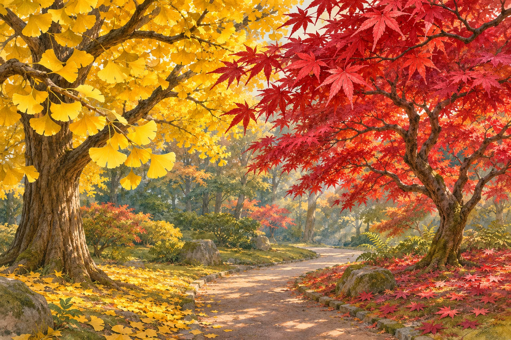
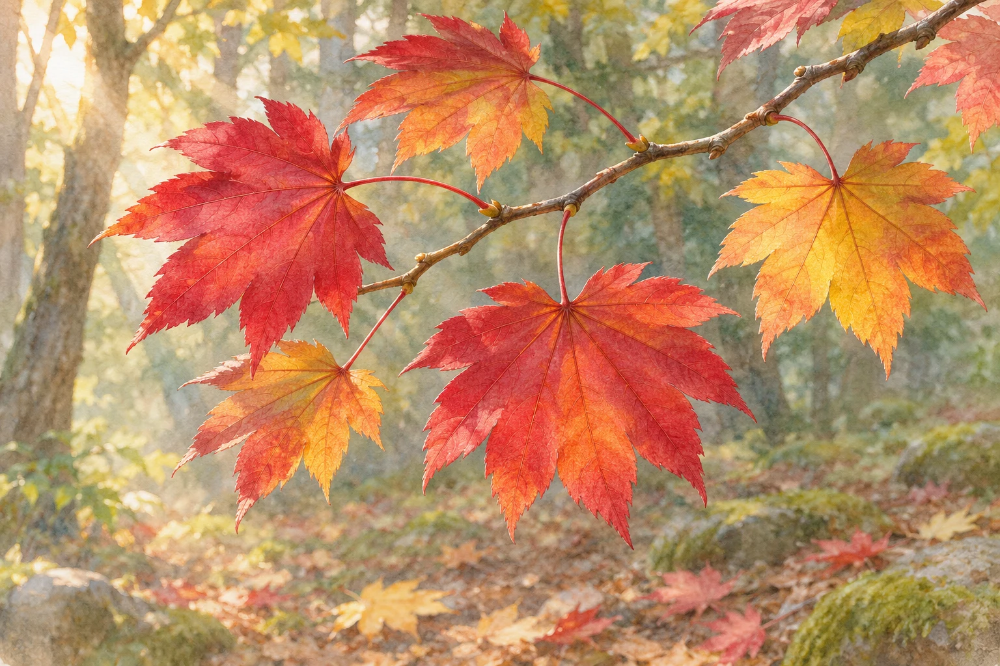

**秋のモミジが赤くなるのは、緑色のクロロフィルが減るのに加えて、赤い色素のアントシアニンが新しく作られるためです。** 黄色い葉では、もともとあった別の色素が目立ってきます。同じ秋の色づきでも、赤と黄では事情が少し違います。[森林総合研究所の色素の解説](https://www.ffpri.go.jp/qa/living/qa-living3.html)

## 緑の葉にも、黄色の色素はある

夏の葉を緑色に見せているのは、光合成に関わるクロロフィルです。葉緑体には、黄色系のカロテノイドも含まれていますが、ふだんは緑が強く目立ちます。

秋に葉の老化が進み、クロロフィルが分解されて減ると、残ったカロテノイドの色が見えてきます。これが、イチョウなどで見られる黄葉の基本です。黄色い絵の具が外から加わるのではなく、緑に隠れていた色が表に出る、と考えると分かりやすくなります。[森林総合研究所「森林の生き物 Q3」](https://www.ffpri.go.jp/qa/living/qa-living3.html)

黄色いイチョウと赤いモミジ。同じ葉の変化の順番ではなく、別々の木が見せる秋の色です。

## 赤は、秋の葉の中で作られる

モミジ類の紅葉では、アントシアニンの合成・蓄積が加わります。緑色の色素がそのまま赤色の色素へ変身する、ということではありません。

葉がどんな色に見えるかは、緑が減る速さと赤い色素が作られる時期や量の組み合わせで変わります。緑がまだ残るうちに赤が増えれば暗い赤に見えることもあり、**すべての葉が「緑→黄→赤」と同じ順番をたどるわけではありません。** イチョウの黄色も、赤くなるのを待っている途中の色ではありません。[日本植物生理学会「黄葉と紅葉について」回答1・2](https://jspp.org/hiroba/q_and_a/detail.html?id=1107)

## 落ちる前の葉は、まだ働いている

もうすぐ落ちる葉で、わざわざ赤い色素を作るのはなぜでしょうか。アントシアニンには葉を強い光から守るという説などがありますが、その働きを一つに決めつけることはできません。

ハウチワカエデを調べた2024年の研究では、色素の合成に糖を使うことで、葉の糖濃度が上がりすぎるのを抑える働きが報告されました。この樹種では、葉の老化に伴ってデンプンを作らなくなる時期に、アントシアニンの合成が糖の調節を助けると考えられています。これは特定の樹種で得られた知見で、紅葉するすべての木の役割が解明された、という意味ではありません。[森林総合研究所による2024年の研究紹介](https://www.ffpri.go.jp/research/saizensen/2024/20240729.html)

葉と枝を切り離す「離層」との関係にも、新しい知見があります。2026年に公表された札幌のハウチワカエデの調査では、離層の細胞が壊れ始める前から赤い色素の合成が始まり、落葉の直前まで窒素という養分の回収が続いていました。この例は、葉の出口がふさがって糖がたまるから赤くなる、という単純な説明には合いません。[森林総合研究所による2026年の研究紹介](https://www.ffpri.go.jp/research/saizensen/2026/20260413.html)

赤くなっても、葉はすぐに役目を終えるわけではありません。枝に残る秋の葉を描いた参考イラストで、研究の観察写真ではありません。

黄色い葉と赤い葉が並ぶと、秋らしくてきれいです。その色が見えるまでに、葉の中では違う変化が起きていると思うと、見慣れた紅葉も少し面白くなります。

