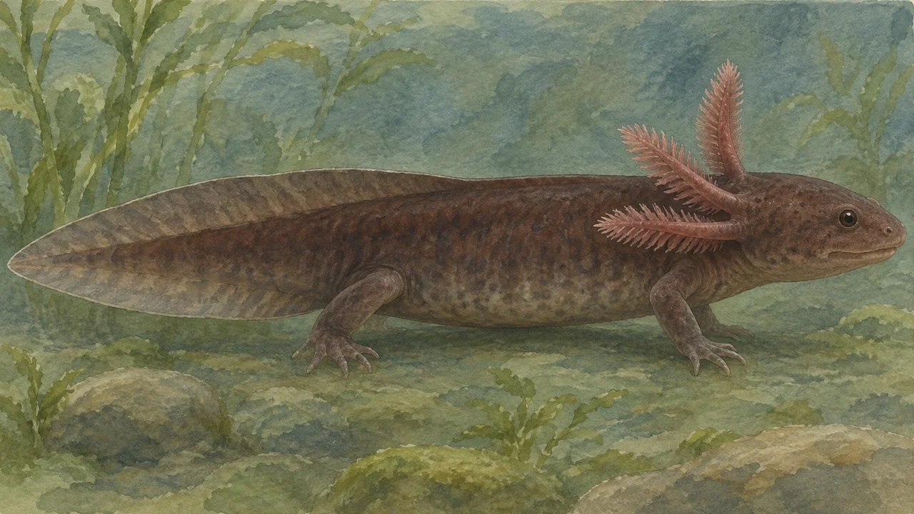
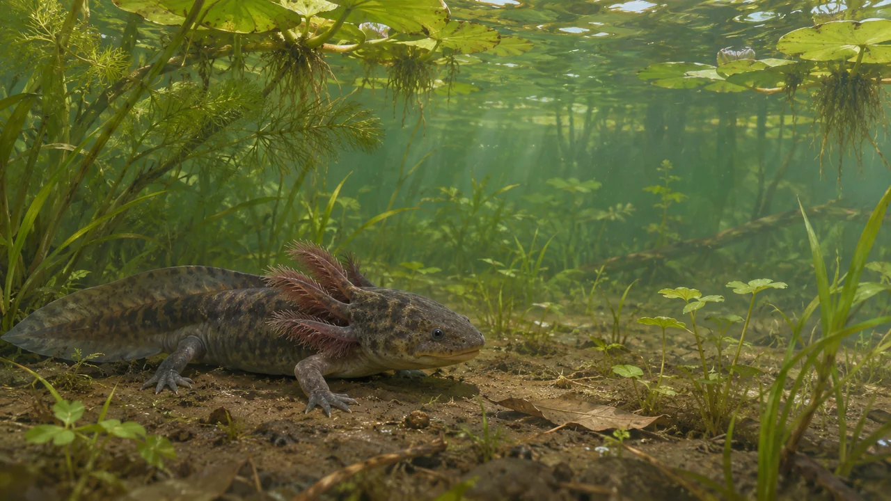

**ウーパールーパーの顔の横にあるふさふさは、耳ではなく「外えら」です。** 体の外に出たえらで、水中で呼吸するのに使います。羽毛のように広がったえらが、あの独特な顔立ちをつくっています。

## 外えらを使うけれど、肺もある

*外えらの位置と見え方を描いた挿絵です。*

ウーパールーパーはサンショウウオの仲間です。サンディエゴ動物園の解説によると、あの目立つ外えらで水中の酸素を取り込みます。それだけ聞くと魚に近いように思えますが、肺も持っています。

## ふさふさがあっても、子どもとは限らない

*水中で暮らす姿を描いた想像図です。*

この動物の面白いところは、幼いときの外えらを残したまま成体になることです。ロンドン自然史博物館の解説でも、幼い姿のままに見えても、繁殖できる大人になると説明しています。

幼いころの特徴を成体にも残すことは「幼形成熟」と呼ばれます。成長が止まっているのではなく、姿が大きく変わらなくても大人になれる、ということです。顔の横のふさふさを見ると、水中で暮らす体の特徴が、なんだか耳飾りのように見えていたわけです。
