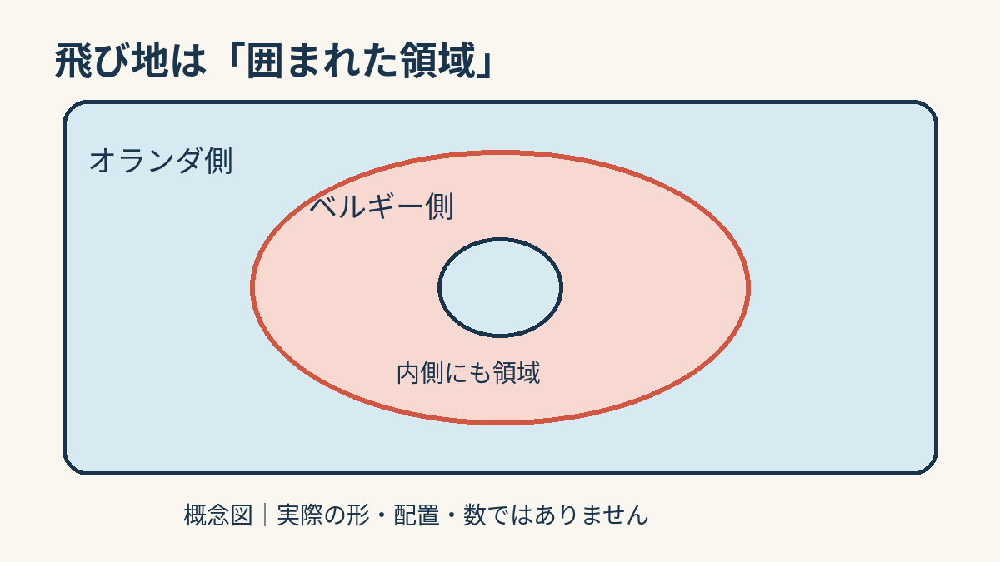
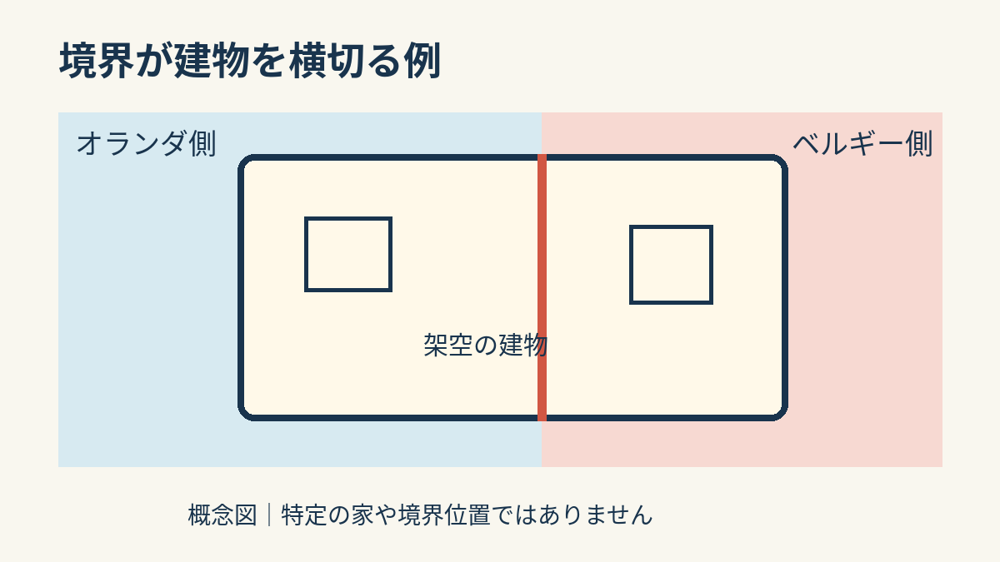

**はい。オランダとベルギーにまたがる町バールレには、国境が建物を横切る場所があります。** 町全体が一本の国境で二つに分かれているのではありません。小さな領域が互いの側に入り込む「飛び地」の境界が、道や庭だけでなく家にも重なっているのです。[バールレ観光案内](https://en.visitbaarle.com/informatie/overbaarle)

## まず「飛び地」とは？

ここで扱う飛び地は、ある国の領域が別の国の領域にすっぽり囲まれた場所です。ベルギー側の自治体バールレ＝ヘルトフは、バールレの形を、一つの線で二分された町ではなく、複数の飛び地がある町として説明しています。ベルギー側の領域がオランダ側に囲まれ、さらにその内側にオランダ側の領域が入る場所もあります。[バールレ＝ヘルトフ自治体](https://www.baarle-hertog.be/30-enclaves)

図は「囲まれ方」を伝えるための模式図です。描いた輪郭は実際の地図ではなく、飛び地の数も表していません。地図の形が複雑だからこそ、一本の国境線を思い浮かべるだけでは、この町の様子をつかみにくいのです。

## 境界が家に重なると

バールレの観光案内は、境界が道路、家、庭を横切ると説明しています。市街地では、特別な舗装石や道路面のアルミ板で境界を見えるようにしているそうです。[観光案内](https://en.visitbaarle.com/informatie/overbaarle)

上の建物は架空の形です。実際の家の間取りや、どの部屋を線が通るかを示すものではありません。けれど「建物は一つ、そこを境界が横切る」という地理的な関係は、現地の資料と一致します。ここで図が示しているのは、境界と建物が平面上で重なる関係だけです。

家の中の国境と聞くと、床に大きな線が引かれた姿を想像しがちです。現地の資料から分かる話の核心は、もっと素朴で、もっと不思議です。町を細かく入り組んで通る境界が、暮らしの場所である建物さえ横切る。地図の線を生活の大きさで考えると、飛び地という言葉が急に身近になります。
