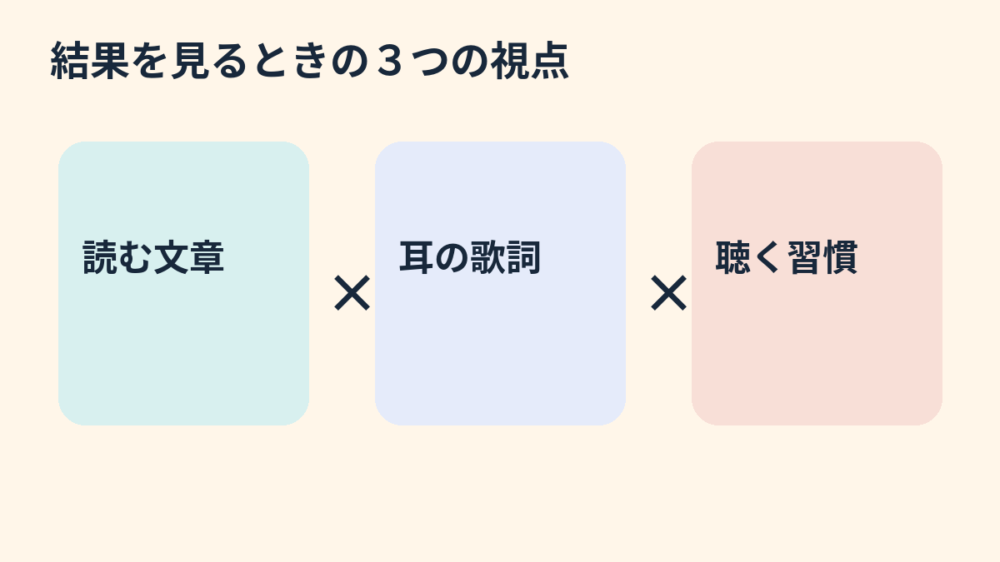

**作業用BGMを流せば、必ず集中できるわけではありません。** 曲を楽しめることと、文章の内容を正確に読み取れることは、分けて考える必要があります。

## 比べたのは「読解の正答率」

2024年の実験では、中国語を母語とする大学生90人が、中国語と英語の短文を読んで正誤問題に答えました。中国語の歌詞付き曲、英語の歌詞付き曲、無音の3条件を別々の参加者で比較。音楽は読解と回答の間に流れました。

結果は、歌詞付き音楽の条件では無音より正答率が全体として低く、文章と歌詞が同じ言語だと、異なる言語の場合より低いというものでした。ただし、測ったのは読解問題の正答率。「集中力」という言葉でまとめがちなものにも、気分、作業の速さ、正確さなど、異なる見方があります。

## 習慣だけで結論は出せない

普段の勉強で音楽を聴く習慣によっても結果は違いました。ただし習慣は自己申告による分類で、「慣れさせた」実験ではありません。**慣れれば影響が減る、という因果関係は示せません。** 英語力や作業記憶も測っていません。

この研究には歌詞なしの音楽条件がなく、歌詞の有無だけを直接比べた結果でもありません。特定の曲と読解課題を扱った研究なので、別の曲や、計算・創作などへそのまま広げることはできません。

「BGMは良いか悪いか」と二択にするより、どんな音で、何をして、何を測ったのかを見る。音楽の気持ちよさを否定せずに、実験で確かめた範囲も見失わずに済みます。
