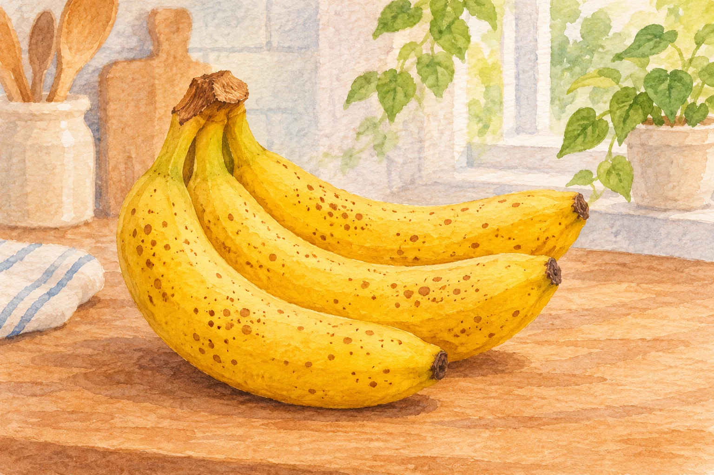
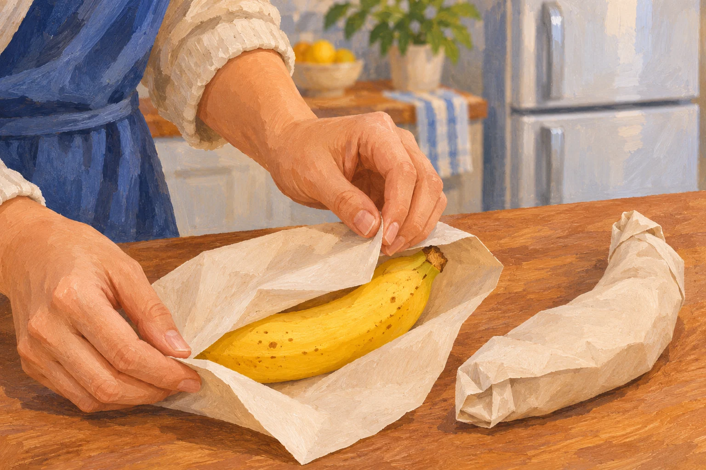

**バナナの皮にできる小さな茶色や黒っぽい斑点は「シュガースポット」と呼ばれ、熟して甘くなってきた目安になります。** ただし、皮が黒くなる原因は追熟だけではありません。冷やしすぎや傷による変色もあるので、黒さだけを見て甘さや食べられるかどうかを決めることはできません。

シュガースポットのあるバナナの参考イラスト（AI生成）。斑点の数や色から糖度や安全性を判定する図ではありません。

## 黒い点は、砂糖の粒が出てきたもの？

名前に「シュガー」とありますが、皮から砂糖の粒が浮き出ているわけではありません。Doleのバナナ担当者は、熟して皮の細胞が壊れやすくなると、中の成分が酸素と反応して茶褐色に変わると説明しています。シュガースポットにも、この酸化による褐変が関わっています。

点が出てきたら、黄色い皮が傷んだと慌てる前に、熟度が進んだ可能性を考えられます。日本バナナ輸入組合も、茶色い斑点を熟して甘くなったサインとして紹介しています。

とはいえ、斑点は糖度を測るメーターではありません。甘くやわらかい食感を好むか、少しかための食感を好むかによって、好きな食べ頃も変わります。斑点が出るまで必ず待たなければならない、という意味ではないのです。

## 冷蔵庫で黒くなった場合は？

バナナは低温で皮が変色することもあります。これは追熟による変化と区別したいところです。冷たい環境で皮の細胞が傷み、酸化が進んで黒くなる「低温障害」が起こるためです。

皮が黒くても、中の果肉まで同じように傷んでいるとは限りません。一方で、「黒いバナナは甘い」という話を、どんな状態でも食べてよいという判断には使えません。皮をむいて中の状態も確かめ、異臭やカビなどがあるものを無理に食べないようにしましょう。

## まず好みの熟度まで、そこから保存を考える

日本バナナ輸入組合は、基本の保存場所として15〜20℃ほどの風通しのよい場所を案内しています。房を下敷きにすると重みで傷みやすいため、吊るすか、山形に置くのも工夫の一つです。

日本バナナ輸入組合は、夏の暑い時期には新聞紙などで包んで冷蔵庫の野菜室に入れる方法を案内しています。まだ追熟させたい段階で冷やしすぎると熟成が止まることがあるので、「いつ冷蔵庫へ移すか」も大切です。室温は季節によって違うため、暑い台所に置きっぱなしにせず、商品の案内も参考にしてください。

好みの熟度になったバナナを紙で包む保存準備の参考イラスト（AI生成）。追熟させたい未熟なバナナをすぐ冷やす案内ではなく、皮の色だけで安全性を判断する図でもありません。

皮の斑点は、熟し方を知る一つの目印です。買った日の黄色い皮と、あとから増える茶色い点を比べ、自分の好きな食感の時期を覚えておくと、食べる順番や冷蔵へ移す時期を考えやすくなります。
