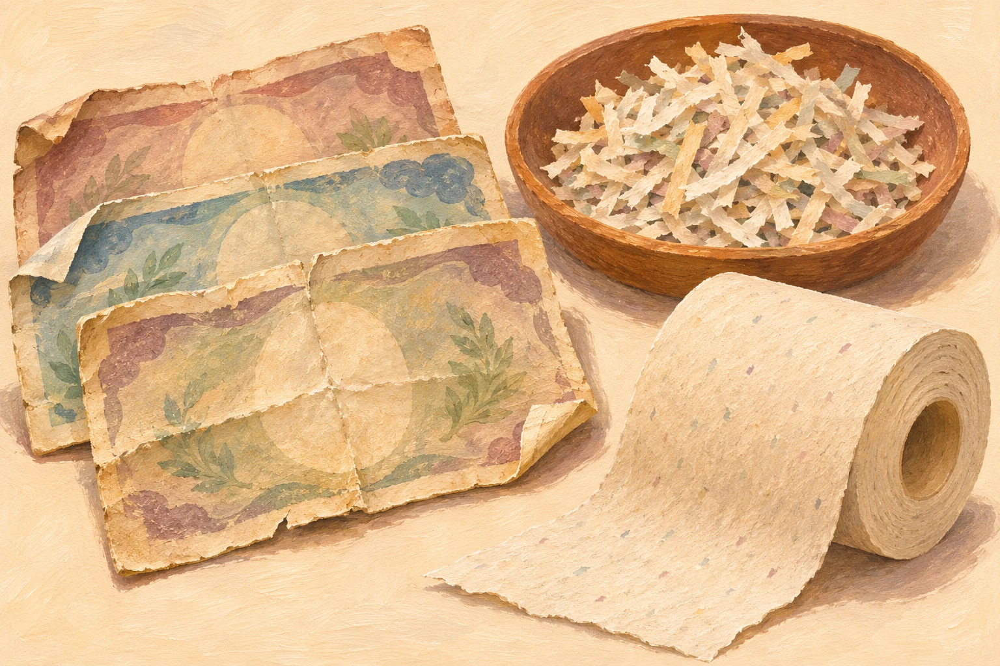
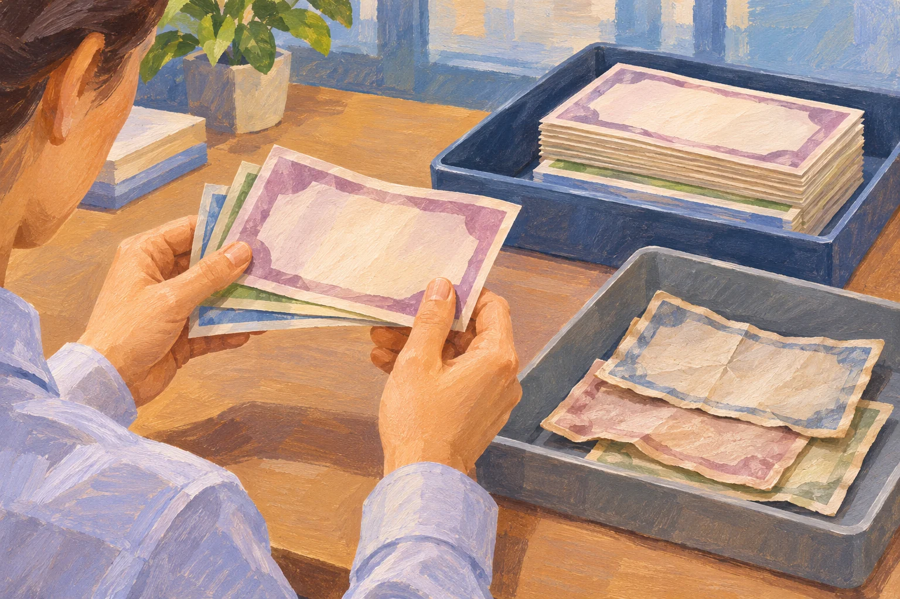

**使われて傷んだお札は、日本銀行に戻ったときに状態を確認され、再び流通させるのに適さなければ細かく裁断されます。その裁断くずの一部は、トイレットペーパーなどの紙製品にリサイクルされています。** 財布の中から姿を消したあとにも、意外な行き先があるのです。

お札と裁断くず、再利用先の紙製品をイメージした参考イラスト（AI生成）。実物の銀行券や処理工程の再現ではなく、裁断くずのすべてが再利用されるわけではありません。

## 財布から財布へ。その先で点検を受ける

お札は国立印刷局が製造し、日本銀行を通じて世の中へ送り出されます。その後は、お店での支払いに使われたり、金融機関に預けられたりしながら流通します。

お札の状態を点検する場面の参考イラスト（AI生成）。実際の日本銀行の作業や装置の再現ではありません。戻された本物のお札は、状態に応じて再び流通するものもあります。

金融機関が当面の支払いに必要としないお札は、日本銀行の本店や支店へ戻されます。そこで行われるのが「鑑査」という点検です。枚数を数え、本物かを確かめるとともに、汚れや傷みの程度から、もう一度流通させられるかを判別します。

まだ使えると判断された本物のお札は、再び金融機関へ渡ります。日本銀行に戻ったお札が、すべて一度きりで処分されるわけではないのですね。

## 千円札と一万円札では、平均寿命が違う

日本銀行によると、一万円券の平均寿命は4〜5年程度。五千円券と千円券は1〜2年程度です。五千円券や千円券は、つり銭などでやり取りされる機会が多く、傷みやすいことが関係しています。

同じお札でも、どのくらい人の手を渡るかによって、使われ方はずいぶん違います。ただし、この年数はあくまで平均です。「千円札は2年たったら無効」という意味ではなく、一枚ごとに期限が印刷されているわけでもありません。

## 裁断されたお札が、紙製品になる

流通に適さないと判断されたお札は、細かく裁断されます。裁断くずの一部はトイレットペーパーなどへ再利用され、それ以外は一般廃棄物として自治体の施設で焼却されます。

ここは「使い終わったお札は全部トイレットペーパーになる」と覚えないのがポイントです。再利用は行われていますが、すべてが同じ製品になるわけではありません。

買い物の支払いを支えていた紙が、役目を終えたあとには日用品の材料にもなる。金額の印象が強いお札にも、紙という素材としての一生があるのが面白いところです。

## 古いデザインのお札が出てきたら

平均寿命の話と、古い種類のお札が今も使えるかどうかは分けて考えましょう。発行が終了した種類にも、引き続き有効なものがあります。一方、過去の特別な措置で使えなくなった種類もあるため、昔のお札なら何でも使えるとは言えません。

引き出しから見慣れないお札が出てきたときは、見た目の古さだけで判断せず、[日本銀行の案内](https://www.boj.or.jp/about/education/oshiete/money/c07.htm)から有効な種類を確認できます。「古いから処分」と決める前に、そのお札の種類を確かめたいですね。
