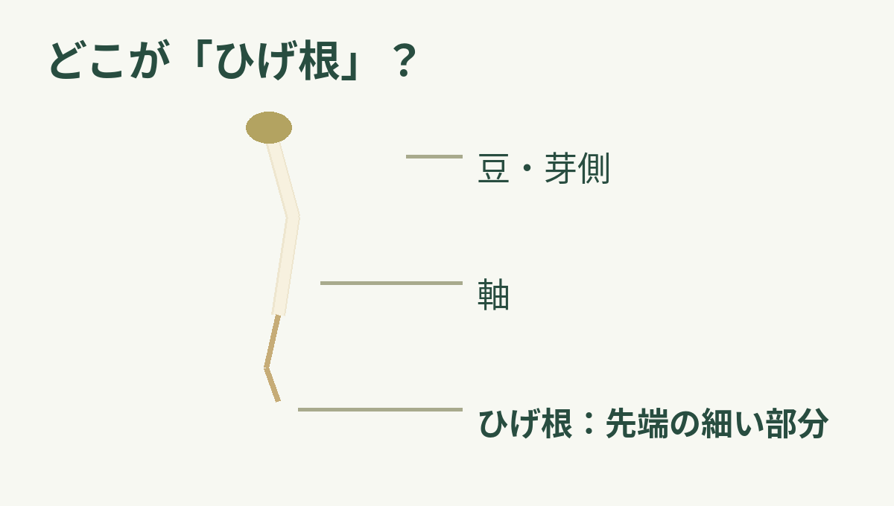
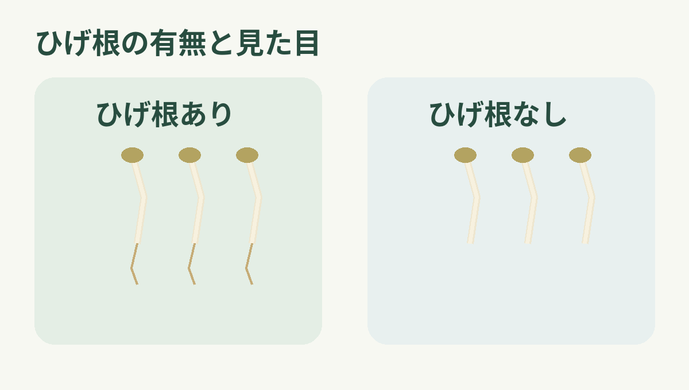

**もやしのひげ根を取る主な理由は、料理の見た目と口当たりを整えるためです。** ひと手間かけると仕上がりがすっきりします。一方、時間がないときは取らずに調理してもよく、「必ず取るべき部分」ではありません。

もやしの形を単純化した自作模式図。品種ごとの実際の形や長さを再現したものではありません。

## 「根」はどこ？

ここでいうひげ根は、もやしの**軸の先に伸びる細い部分**です。上側に見える芽や豆、豆の殻と同じ部分ではありません。[オレンジページの下ごしらえ案内](https://www.orangepage.net/food/basics-cooking/pre-yasai/111620)も、先端の細い部分をひげ根として示しています。取るなら、その部分を指先でつまみ、折るように外します。

## 取ると何が変わる？

[JAさいたまに掲載されたベターホームのお料理教室の記事](https://www.ja-saitama.or.jp/wp/?p=420)は、ひげ根を取ると料理の仕上がりがきれいになり、食べたときの口当たりもよくなると説明しています。細い根が見えなくなるため、もやしの軸が目立つ、すっきりした見た目になります。食感についても、根の細い部分が口に触れない仕上がりを好む人には意味のある下ごしらえです。

根の有無による見た目の違いを強調した自作概念図。味、栄養、安全性や、すべてのもやしの仕上がりを比較する図ではありません。

ただし、取れば誰にとっても「おいしくなる」と決められるものではありません。ひげ根が気にならない料理や、下ごしらえの手間を減らしたいときは、ひげ根を残して調理する選択もできます。オレンジページも、時間がないときは取らずに調理してよいとしています。

つまり「取る意味」はありますが、それは仕上がりの好みと手間のバランスの話。ひげ根を見て気になれば取る、気にならなければひげ根を残して調理する。料理に合わせて決めてよい下ごしらえです。
