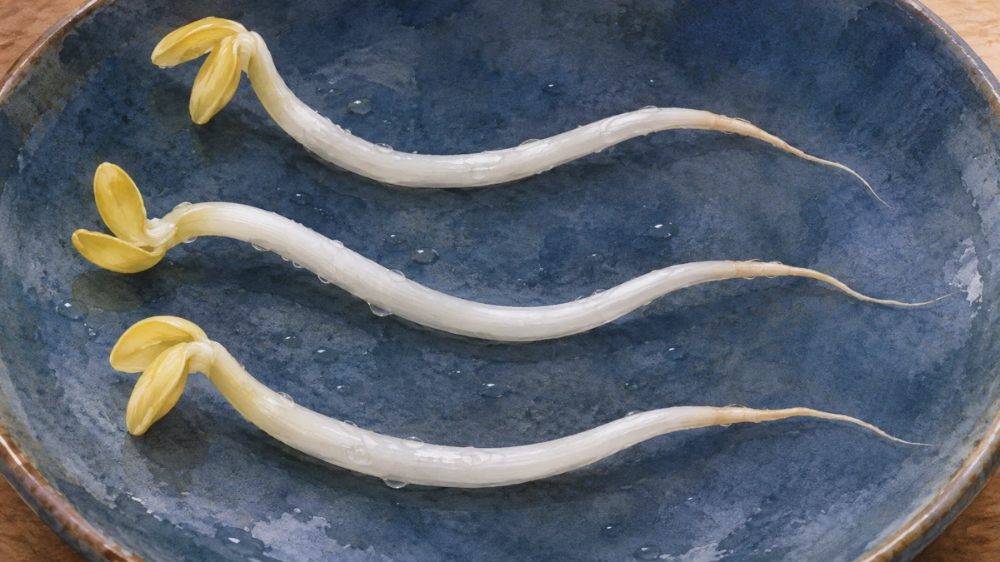
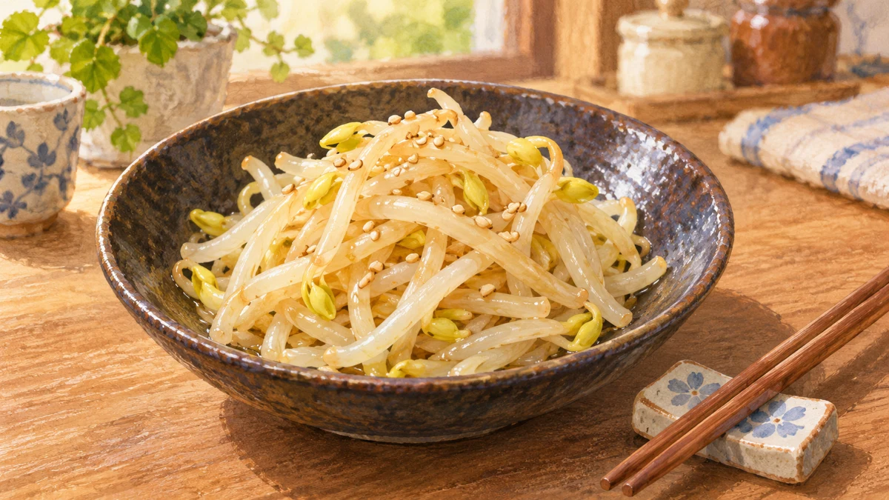

**もやしのひげ根を取る主な理由は、料理の見た目と口当たりを整えるためです。** ひと手間かけると仕上がりがすっきりします。一方、時間がないときは取らずに調理してもよく、「必ず取るべき部分」ではありません。

もやしの姿を描いたイメージ。細い根は芽とは反対側にあります。品種や育ち方で形は変わります。

## 「根」はどこ？

ここでいうひげ根は、もやしの**軸の先に伸びる細い部分**です。上側に見える芽や豆、豆の殻と同じ部分ではありません。[オレンジページの下ごしらえ案内](https://www.orangepage.net/food/basics-cooking/pre-yasai/111620)も、先端の細い部分をひげ根として示しています。取るなら、その部分を指先でつまみ、折るように外します。

## 取ると何が変わる？

[JAさいたまに掲載されたベターホームのお料理教室の記事](https://www.ja-saitama.or.jp/wp/?p=420)は、ひげ根を取ると料理の仕上がりがきれいになり、食べたときの口当たりもよくなると説明しています。細い根が見えなくなるため、もやしの軸が目立つ、すっきりした見た目になります。食感についても、根の細い部分が口に触れない仕上がりを好む人には意味のある下ごしらえです。

もやし料理の盛りつけイメージ。口当たりの違いは画像では比較できません。

ただし、取れば誰にとっても「おいしくなる」と決められるものではありません。ひげ根が気にならない料理や、下ごしらえの手間を減らしたいときは、ひげ根を残して調理する選択もできます。オレンジページも、時間がないときは取らずに調理してよいとしています。

ここが、下ごしらえの面白いところだと思います。ひと手間の価値は、いつでも同じではありません。きれいに盛りたい日には丁寧に、忙しい日には省いてよい。

つまり「取る意味」はありますが、それは仕上がりの好みと手間のバランスの話。ひげ根を見て気になれば取る、気にならなければひげ根を残して調理する。料理に合わせて決めてよい下ごしらえです。
