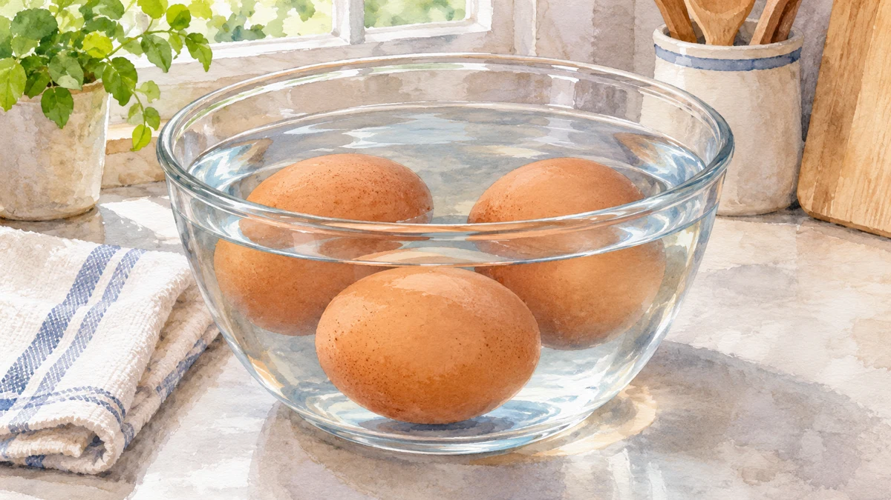
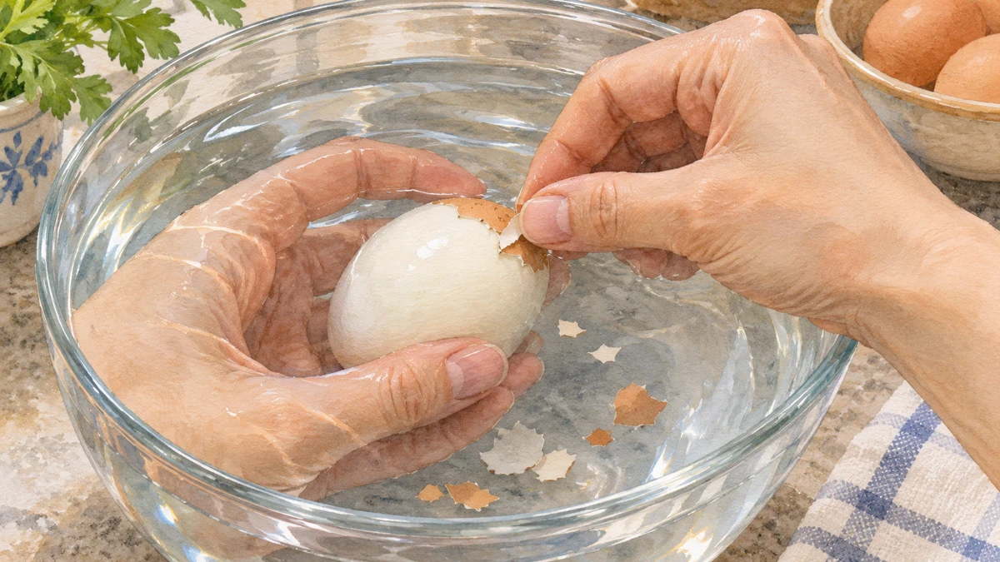

**ゆで卵がきれいにむけないのは、卵の鮮度と作り方の両方が関係するからです。** 産みたてに近い卵ほどむきにくいことがありますが、「古い卵なら必ずきれいにむける」という話でもありません。

冷やす場面のイメージです。画像から卵の中心温度や冷却時間を判断することはできません。

## 産みたてに近い卵は、なぜむきにくい？

卵は保存中に、殻の小さな穴を通じて二酸化炭素を失います。[カリフォルニア大学の普及資料](https://ucfoodsafety.ucdavis.edu/files/26416.pdf)は、それに伴って白身のpHが上がり、よりアルカリ性に傾くことと、固ゆで後の殻のむきやすさを結びつけて説明しています。単に「ガスが減った」というだけでなく、白身の性質も変わるのです。

[Reinkeらの研究](https://doi.org/10.3382/ps.0520692)でも、白身のpHを変えた実験で、pHが低いとむきにくく、高いとむきやすい結果が報告されています。保存中の変化と殻のむきやすさを考える手がかりになりますが、pHだけで仕上がりが必ず決まるという意味ではありません。

冷蔵保存した卵は、産みたてに近いものよりむきやすくなることがあります。ただし、買った日が産卵日とは限りません。むきやすさのために室温へ放置したり、表示の期限を過ぎるまで待ったりせず、商品の保存方法と期限を優先してください。

## むくときは「冷やす、ヒビ、水」

ここからは保存中の変化とは分けて、[キユーピーが紹介するむき方](https://www.kewpie.com/academy/cook-eat/boiledegg-challenge/)を見てみましょう。ゆで終わった卵をすぐ冷水へ移し、完全に冷めてから殻の丸い側に細かなヒビを入れます。その後、水の中で薄皮と白身の間に水を入れるようにして、少しずつむきます。むき始める場所と水の入り方まで意識すると、「ただ力を入れて殻を割る」より手順がはっきりします。

完全に冷めてから水の中でむく場面のイメージです。どの卵でも同じようにむけるという保証ではありません。

殻のむけ方は、食べられるかどうかの判定には使えません。

むきにくさを手先の器用さだけのせいにしなくてもよさそうです。卵の状態と、むき始める前のひと手間にも目を向けたいですね。
