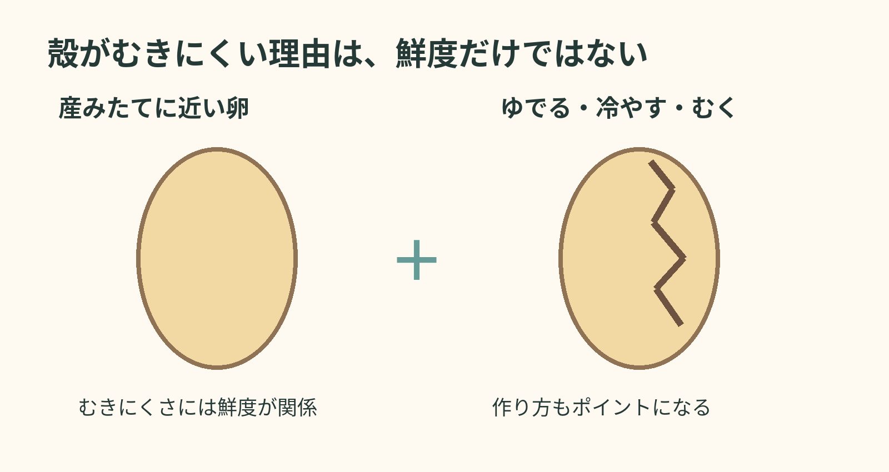
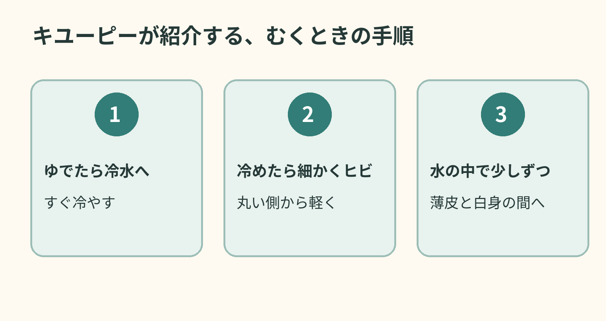

**ゆで卵がきれいにむけないのは、卵の鮮度と作り方の両方が関係するからです。** 産みたてに近い卵ほどむきにくいことがありますが、「古い卵なら必ずきれいにむける」という話でもありません。

鮮度だけでなく、ゆでた後の手順にも目を向けます。図は説明を単純化した模式図です。

## 産みたてに近い卵は、なぜむきにくい？

[キユーピーの解説](https://www.kewpie.com/academy/cook-eat/boiledegg-challenge/)によると、産みたてに近い卵の白身には炭酸ガスが含まれています。ゆでると白身が殻にはりつきやすくなり、殻だけをはがしにくくなります。時間がたつにつれてガスは殻の小さな穴から抜けるため、冷蔵保存した卵では、産卵日から数日たったものの方がむきやすくなると説明しています。

ただし、買った日が産卵日とは限りません。むきやすくするために卵を室温に放置する、という意味ではありません。

## むくときは「冷やす、ヒビ、水」

同社の作り方では、ゆで終わった卵をすぐ冷水へ移し、完全に冷めてから殻の丸い側に細かなヒビを入れます。その後、水の中で薄皮と白身の間に水を入れるようにして、少しずつむきます。むき始める場所と水の入り方まで意識すると、「ただ力を入れて殻を割る」より手順がはっきりします。

キユーピーの手順を要約した模式図。卵の内部構造や個々のゆで上がりを正確に示す図ではありません。

殻のむけ方は、食べられるかどうかの判定には使えません。

むきにくさを手先の器用さだけのせいにしなくてもよさそうです。卵の状態と、むき始める前のひと手間にも目を向けたいですね。
