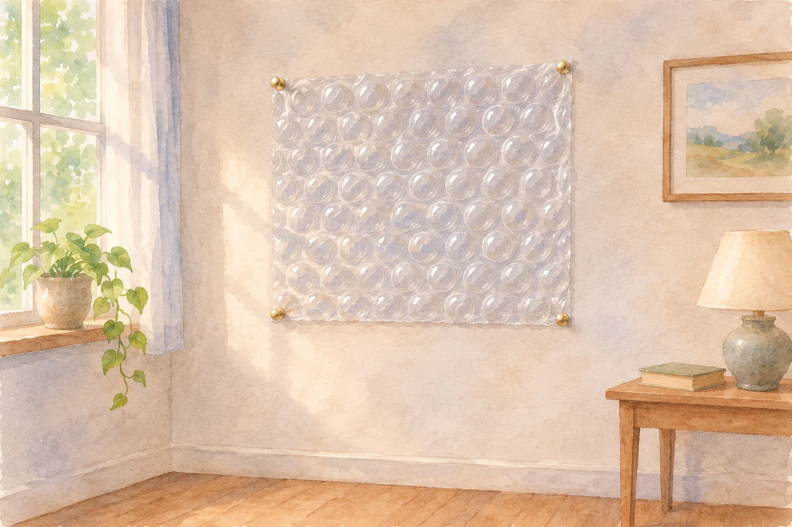
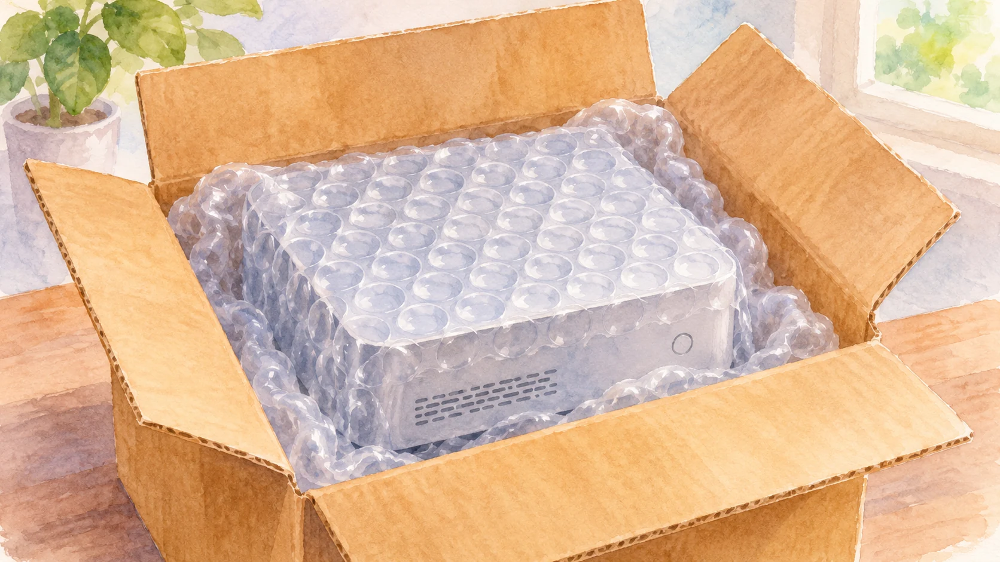

**米国の「BUBBLE WRAP」は、もともと壁紙として考案されたものが、荷物を守る梱包材へと用途を変えた製品です。** 最初から宅配便の中に入れるために作られた、というわけではありません。

AI生成の参考イラスト。壁紙構想の概念画。発明当時の人物・製品・現場の再現ではありません。

## 壁を飾るはずが、コンピューターを守る材料に

開発元の[Sealed Airの公式記事](https://www.sealedair.com/ap/resources/blog/bubble-wrap-appreciation-day)によると、出発点は1957年ごろの米国ニュージャージー州でした。創業者たちは壁紙のアイデアを形にしたものの、その用途では成功しませんでした。

AI生成の参考イラスト。包装用途の参考イラスト。実在の機器や輸送事例の再現ではありません。

その後、空気の粒を持つ材料は保護用の包装に使われるようになります。同社は、1960年からIBMのコンピューターの輸送を守るために使われたと紹介しています。

壁に貼る素材としては広がらなくても、別の場所では役に立つ。用途が変わることで、身近な製品へ育った例です。

## 日本の「プチプチ」とは、名前を分けて考える

日本でおなじみの「プチプチ」は、すべての同種製品の一般名称ではなく、登録商標です。[製造元の公式Q&A](https://www.putiputi.co.jp/faq)では、一般名称を「気泡緩衝材」と説明しています。

そのため、壁紙から始まった歴史を紹介するときは、米国のBUBBLE WRAPの話であることを区別しておくと正確です。見た目が似た製品でも、ブランド名と開発の歴史まで一緒とは限りません。

## 小さな粒の中には何がある？

プチプチの公式Q&Aによると、凹凸のあるシートに平らなフィルムを貼り合わせ、粒の中に空気を閉じ込めています。身近なあの丸い形は、空気を小分けに包んだ構造なのです。

荷物を開けると見慣れた緩衝材が出てきますが、壁紙という出発点を知ると、同じ形でも少し違って見えます。壁を飾る案は広まらなくても、空気を閉じ込めた構造はコンピューターを守る梱包材として生きました。
