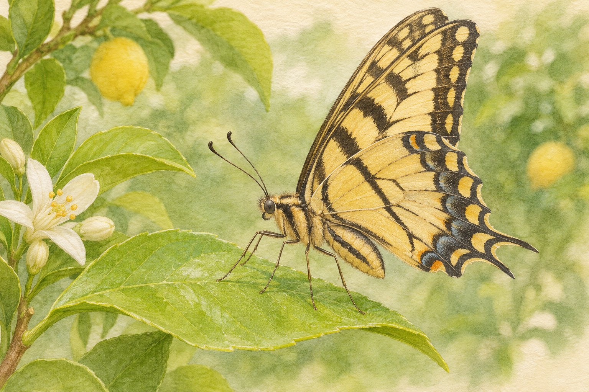
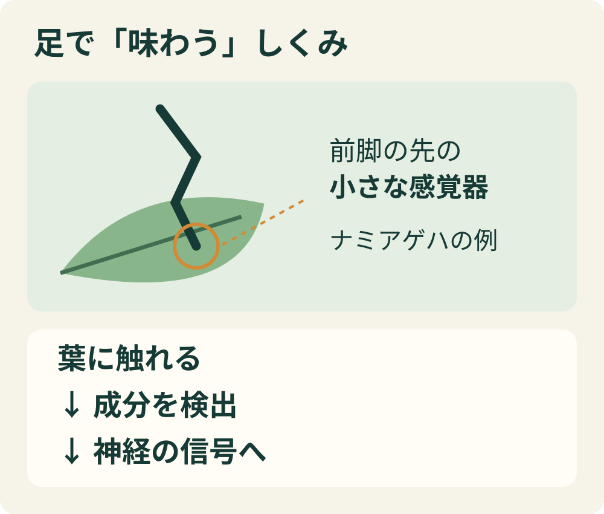
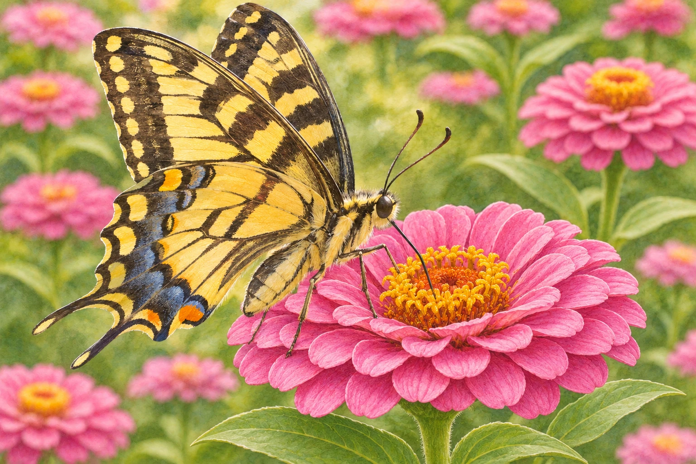

**蝶は、足でも味を感じます。足にある感覚器で、触れたものの化学成分を確かめているのです。** 食べ物を見つけるだけでなく、雌が卵を産む植物を選ぶ場面にも役立ちます。ただし、「足でしか味を感じない」という意味ではありません。[カールトン大学の解説](https://carleton.ca/biology/description/do-butterflies-really-taste-through-their-feet/)

葉の上に止まる姿をイメージしたAI生成の参考イラスト。特定種の形や感覚器を正確に再現した標本図ではなく、実際の産卵行動を撮影した写真でもありません。

## 足に小さな舌があるわけではない

「足で味わう」と聞くと、足の裏に舌がついているようで不思議です。実際は、触れた物質を検出する「接触化学感覚」。人間のように口へ運ばなくても、立っている場所の成分を受け取れるしくみです。蝶が感じるおいしさまで人間と同じだとは、言い切れません。[カールトン大学の解説](https://carleton.ca/biology/description/do-butterflies-really-taste-through-their-feet/)

足の味覚を説明する模式図。感覚器の形・数・大きさを再現したものではありません。

ナミアゲハの研究では、前脚の先の「ふ節」にある、毛のような小さな感覚器が調べられています。研究者は、産卵を促す成分に感覚器の神経細胞が示す電気的な反応を調べました。「味見していそう」という見た目だけでなく、成分への反応を実際に確かめているのです。[原著論文の抄録（九州大学）](https://kyushu-u.elsevierpure.com/en/publications/gustatory-sensing-mechanism-coding-for-multiple-oviposition-stimu/)

## 自分のごはんと、子どものごはん

蝶の足の味覚は、食べ物探しにも関わります。カールトン大学の解説では、果物を好む熱帯の蝶が、発酵した果物に溶けた糖を足の感覚器で検出する例を紹介しています。一方、雌が葉を足でたたくように調べるときは、自分がその葉を食べるのではなく、幼虫の食べ物になる植物を探している場合があります。[大学の解説](https://carleton.ca/biology/description/do-butterflies-really-taste-through-their-feet/)

AI生成の参考イラスト。成虫が花で食事する場面を描いています。特定種の標本図や研究の再現ではなく、食べるものは蝶の種類によって異なります。

たとえばナミアゲハは、ミカン科の限られた植物を利用します。雌は前脚で葉に触れ、複数の成分の組み合わせを手がかりにします。単に「甘い葉ならよい」という判定ではありません。2013年の研究では、葉の成分に応答する神経細胞と、成分を組み合わせたときの産卵行動との関係が調べられました。[原著論文の抄録（九州大学）](https://kyushu-u.elsevierpure.com/en/publications/gustatory-sensing-mechanism-coding-for-multiple-oviposition-stimu/)

## オスとメスで、まったく同じ？

同じナミアゲハでも差があります。この研究では、産卵を促す成分によく反応する型の感覚器が、前脚では雌に多く見られました。一方、糖などに反応する別の型は雄にも雌にもあります。**「雌だけが足で味を感じる」わけではない**のです。この結果を、すべての蝶の感覚器の数や配置にそのまま当てはめることはできません。[原著論文の抄録（九州大学）](https://kyushu-u.elsevierpure.com/en/publications/gustatory-sensing-mechanism-coding-for-multiple-oviposition-stimu/)

## 蜜を吸う口にも、味覚はある

花の蜜などを吸う細長い器官は「口吻（こうふん）」といいます。アメリカ自然史博物館は、蝶には足だけでなく口吻にも味を感じる細胞があると説明しています。「足で確かめ、口は吸うだけ」と完全に分業しているわけではありません。[博物館のAmazing Senses](https://www.amnh.org/exhibitions/butterflies/anatomy)

フロリダ自然史博物館も、足の味覚を産卵する植物選びと結びつけながら、口吻など別の器官の味覚にも触れています。「足で味わう」という短い雑学は本当でも、体のどこで、何のために感じるかまで見ると、もっと面白くなります。[博物館の解説](https://www.floridamuseum.ufl.edu/exhibits/blog/butterfly-moment-how-do-they-taste/)

蝶が葉の上に止まっているだけに見えても、そこには子どもの食事につながる情報がある。足もとでそんな確認ができるのは、なかなか便利そうです。きれいな羽だけでなく、小さな足の動きも気になってきます。
