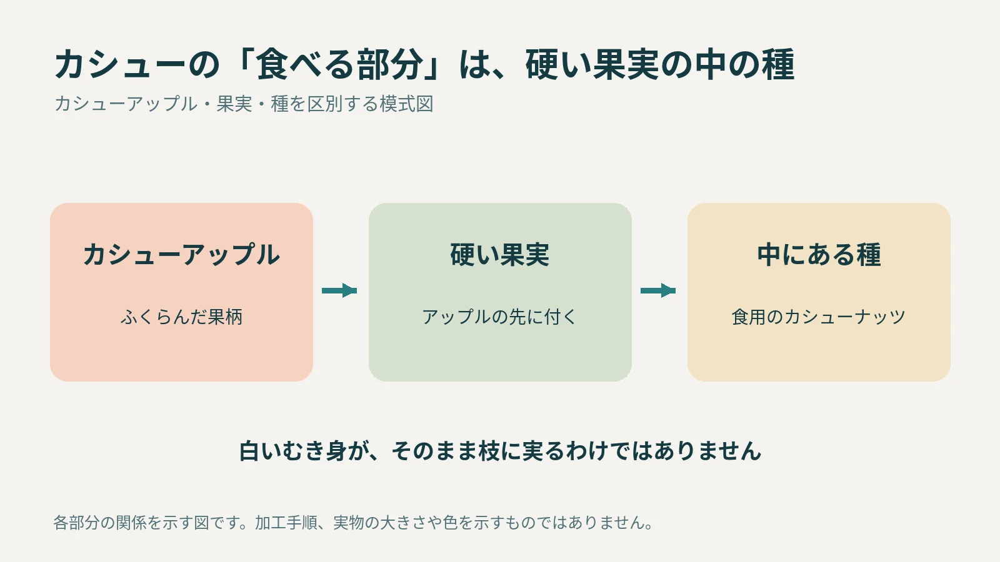
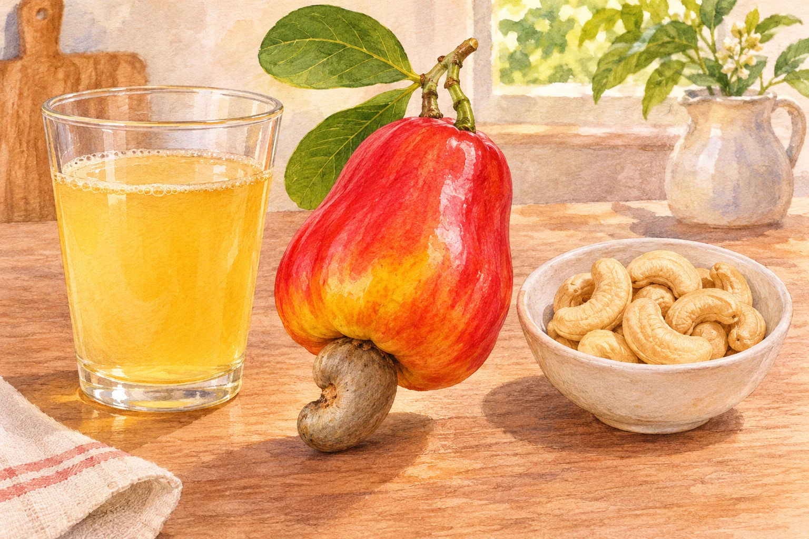

**いつも食べているカシューナッツは、カシューという木の「種」です。赤や黄色のカシューアップルの先に硬い果実が付き、その中に食用の種が入っています。** 白いむき身が、そのまま枝に実るわけではありません。

## 赤い部分と、ナッツの入る部分は別

木に実る姿を見ると、赤や黄色の大きな部分が目立ちます。これは「カシューアップル」と呼ばれますが、[PROSEAの植物資料](https://prosea.prota4u.org/view.aspx?id=1468)では、果柄がふくらんだ部分として説明されています。

その先に付く、勾玉のように曲がった硬い部分が植物学上の果実です。さらに、その内側の種を取り出したものが、食品として売られるカシューナッツになります。

各部分の関係を整理した模式図。大きさの比率や色は模式的なもので、加工方法を示すものではありません。

## 先に果実ができ、あとから軸がふくらむ

[オックスフォード大学の解説](https://herbaria.plants.ox.ac.uk/bol/plants400/Profiles/ab/Anacardium)では、受精後に種を1個含む果実が育ち、その後、花の軸がふくらんでカシューアップルになると説明されています。

見た目では大きいカシューアップルが主役に見えますが、食べ慣れたナッツはその中ではなく、先端にある硬い果実の中です。「果実の外に種がむき出しになっている」と受け取らないのがポイントです。

## カシューアップルも利用される

[シンガポール国立公園庁の植物情報](https://www.nparks.gov.sg/florafaunaweb/flora/2/7/2709)は、カシューアップルも生食やジュースなどに利用されると紹介しています。ナッツとは別の部分にも使い道があるのです。

カシューアップルのジュース利用と、市販のむき身のカシューナッツを並べたAI生成の参考画。実物写真や加工方法の説明ではありません。

ただし、硬い果実の殻には刺激性のある油が含まれます。普段売られている食用のむき身と、木から取った殻付きのものは同じ状態ではありません。写真で姿を知ることと、自分で殻を処理することは分けて考えましょう。

木に実る写真を見るなら、大きな赤い部分より、その先の曲がった硬い果実に注目すると食用の種の位置が分かります。カシューアップル、果実、種。この三つを分けると、売り場のむき身と木の上の姿がつながります。
