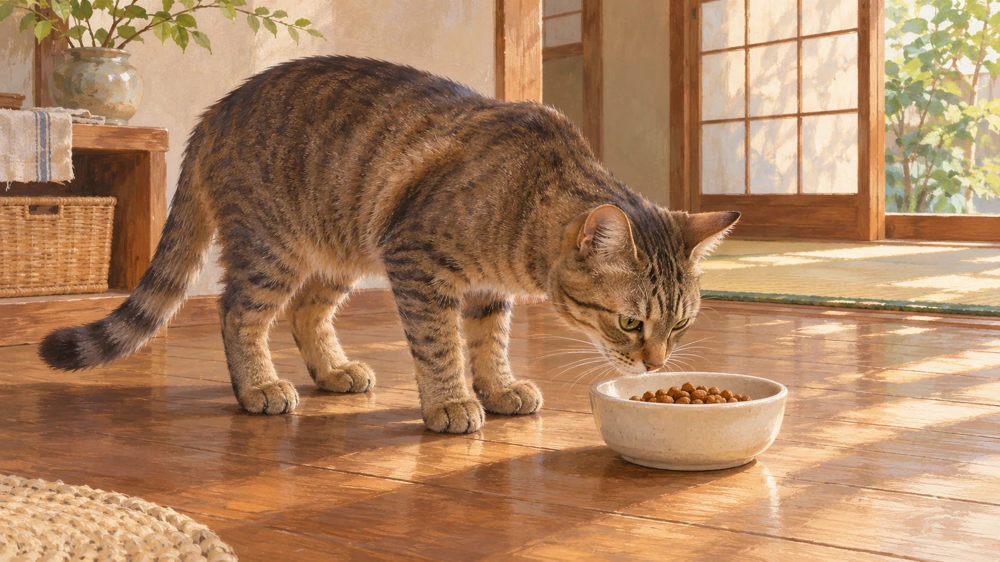
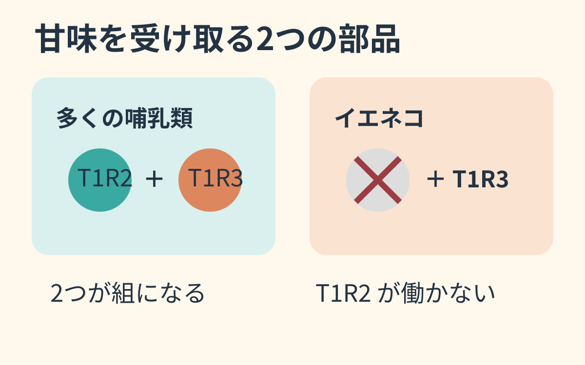

**猫では、通常の甘味受容体が作れないことが、砂糖への反応が乏しい理由と考えられています。** 人間が感じる「甘くておいしい」は、そのまま猫には当てはまらないようです。

食べ物を確かめる猫の暮らしを描いた参考イラストです。甘味への反応を測る実験ではありません。

## 甘味の「受け皿」は二つで一組

多くの哺乳類では、T1R2とT1R3という二つのタンパク質が組になって、甘味を受け取ります。[2005年のイエネコの遺伝子研究](https://journals.plos.org/plosgenetics/article?id=10.1371/journal.pgen.0010003)では、T1R2を作る**Tas1r2**に欠失などの変化が見つかりました。研究者は、正常な受容体を作る働きを失った「偽遺伝子」と結論づけています。

図はしくみの整理で、実際のタンパク質の形や大きさではありません。

最初のイエネコ1匹だけでなく、追加の成猫6匹、トラとチーターでも関連する変化が確認されました。ただし、全種・全個体の味覚や行動を測った研究ではありません。**甘味の話であって、「猫には味覚がない」という意味でもありません。**

同じ研究ではチーターの遺伝子も調べられました。絵は種の姿を伝える参考で、調査個体の写真ではありません。

## 遺伝子だけで、目の前の行動までは決められない

甘い食べ物に近づいたとしても、それだけで甘さを感じた証拠とは限りません。逆に無視した理由も、甘味だけに決めつけられないのです。

肉食への進化との関係も気になりますが、論文は**遺伝子の変化と食べ方の変化のどちらが先かは決められない**と記しています。「肉食になったから甘味を失った」と一本道に語るのは、研究の結論を超えます。

同じ食べ物でも、味を受け取る入口が違う。単なる好き嫌いだと思っていた反応の奥に、こうした違いがあるのが面白いところです。自分のおいしいを、そのまま別の動物のおいしいに置き換えることはできないのですね。
