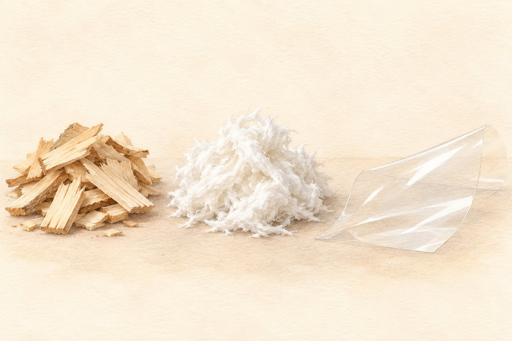
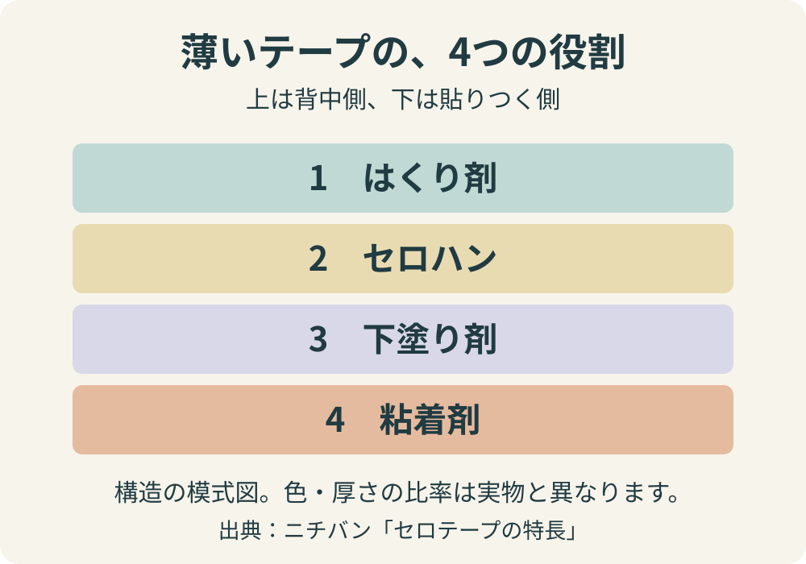

**ニチバンの「セロテープ」の透明なフィルムは、木材パルプを原料に作られています。** 木をそのまま薄く削ったものではなく、植物繊維を加工してできる「セロハン」です。のりにも、天然ゴムや天然樹脂が主原料として使われています。

ただし、透明なテープがすべて木からできているわけではありません。「セロテープ」はニチバンの登録商標です。[ニチバンの製品説明](https://www.nichiban-cellotape.com/merit/)

ここでは、この製品の素材と仕組みを見ていきます。[メーカーの素材説明](https://www.nichiban-cellotape.com/environment/)

木材チップからパルプを経て透明なフィルムになる流れのイメージ。AI生成の説明用イラストで、実際の原料や製造現場の写真ではありません。

## 木から、どうやって透明な膜になる？

木と透明テープは、見た目も手触りもずいぶん違います。その間をつなぐのが、木材から取り出した植物繊維のかたまりである「パルプ」です。

メーカーの[製造工程の解説](https://www.nichiban-cellotape.com/process/)では、木材チップからパルプを作り、それを溶かして化学反応を起こすことでセロハンフィルムにすると説明しています。原料の姿をそのまま残すのではなく、工程を経て薄い膜に作り直すわけです。

つまり「木からできている」は原料の話。木目のある板を極限まで薄くしたもの、という意味ではありません。あの透けた膜にも、たどっていくと植物につながる出発点があるのです。

## 透明な部分と、くっつく部分は別の材料

テープを支える透明な膜を「基材」といいます。セロテープの基材がセロハンで、その裏側に、ものへ貼りつくための粘着剤が付いています。

粘着剤の主原料は、ゴムの木から取れる天然ゴム。これを加工し、天然樹脂などと混ぜて作ります。「木からできたテープ」といっても、膜ものりも同じ木材パルプでできているわけではありません。[ニチバンの粘着剤の製造説明](https://www.nichiban-cellotape.com/process/)

## 1枚に見えるテープは、実は4層

さらに意外なのは、透明な膜にのりを塗っただけの2層ではないことです。ニチバンの解説によると、セロテープは**はくり剤・セロハン・下塗り剤・粘着剤の4層構造**になっています。

メーカーの構造説明をもとにした模式図。各層を見分けるために色分けし、厚さを強調しています。実物の色や厚さの比率は示していません。

- **はくり剤**：テープを巻いたとき、粘着剤が背中側に強くくっつかず、引き出せるようにします。
- **セロハン**：テープの本体になる透明なフィルムです。
- **下塗り剤**：フィルムと粘着剤をしっかり貼り合わせます。
- **粘着剤**：紙などに貼りつく「のり」の部分です。

貼った先ではくっついてほしいのに、ロールからは軽くはがれてほしい。その両方をかなえるために、表と裏で違う役割を持たせています。薄い1枚に見えるものが、なかなか器用なつくりです。[ニチバン「4層構造の秘密」](https://www.nichiban-cellotape.com/merit/)

## 見た目が同じ透明テープでも、中身は違う

透明な粘着テープには、ポリプロピレンフィルムを基材にした「OPPテープ」もあります。ニチバンの比較解説では、こちらは主に石油由来の成分で作られ、粘着剤には主にアクリル系が使われるとされています。[セロテープとOPPテープの比較](https://www.nichiban-cellotape.com/difference/)

見た目の透明さだけでは、原料まで同じとは判断できません。素材が気になったときは、パッケージの「基材」「粘着剤」の欄や製品の説明を確認すると、違いをたどりやすくなります。

## 身近な道具にも、表と裏の工夫がある

透明なテープと木がつながるのは意外ですが、仕組みを知ると、さらに気になるのは表と裏の役割分担です。ただ貼れるだけでなく、使う直前までは軽く引き出せることも必要だった。普段は気に留めない使い心地にも、ちゃんと理由があるのが面白く感じます。

次にテープの端を探すときは、透明な膜と、その両面の小さな工夫も少し違って見えそうです。
