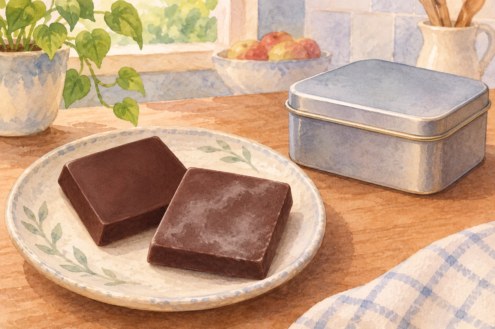
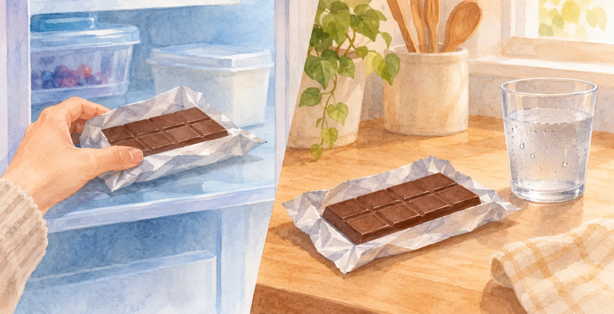

**チョコレートが白っぽくなる原因の一つは、脂肪や砂糖の結晶が表面に現れる「ブルーム現象」です。** 主に脂肪が関わるものと、砂糖が関わるものの2種類があります。ただし、白い見た目だけでブルームと決めつけることはできません。

AI生成の参考イラスト。記事の出典資料から転載した画像ではありません。

## 温度変化で起こる「ファットブルーム」

チョコレートには、カカオ由来の脂肪であるココアバターが含まれています。温度が上がってその脂肪が溶け、再び冷えて固まると、表面に白い模様が現れることがあります。

[明治のQ&A](https://qa.meiji.co.jp/faq/show/130?site_domain=default)は、この変化をファットブルームと説明しています。脂肪の結晶の状態が変わり、なめらかな口どけや風味も損なわれることがあります。

「溶けたチョコを冷やせば、見た目も口どけも必ず元どおり」とはいかないのは、結晶の状態も関係するためです。

## 結露がきっかけになる「シュガーブルーム」

もう一つは、砂糖が関わるシュガーブルームです。[明治の解説](https://www.meiji.co.jp/hello-chocolate/column/106/)によると、冷たいチョコレートを暖かい場所へ移すと、表面に結露することがあります。

AI生成の参考イラスト。結露に関する概念画。画像から変色の原因や食用可否は判断できません。

その水分に砂糖が溶け出し、あとで水が蒸発すると、表面で砂糖が再び結晶になります。こちらは脂肪が溶ける話とは別の仕組みですが、やはり白っぽい見た目につながります。

## 白ければ、食べても大丈夫？

メーカーは、ブルーム現象そのものはカビではないと説明しています。ただし、これは手元の白いものがすべてブルームだという意味ではありません。生チョコなど水分の多い製品では、保存状態によってカビが生えることもあります。

原因が分からない変色や異常がある場合は、味見で確かめず、製品表示やメーカーの案内を確認してください。保存方法も、板チョコと生チョコなどで同じとは限りません。

見慣れたチョコレートの表面にも、温度や水分の変化が跡を残します。白さの正体を知ることと、安全に食べられるかを判断することは、分けて考えたいところです。
