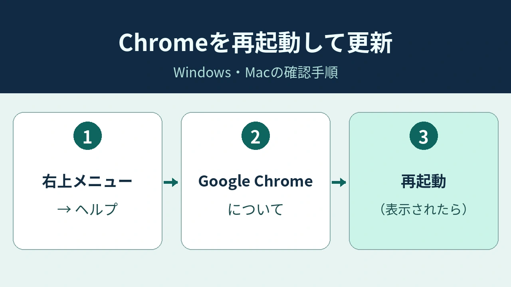

米Googleは11月23日（米国日付）、パソコン向けChromeの通常安定版に、同社が「Critical」と評価した脆弱性を修正する更新を発表しました。まずはChrome右上のメニューから［ヘルプ］→［Google Chrome について］を開き、［再起動］が出たら押してください。ダウンロードが終わっていても、再起動するまで更新は適用されません。

## Windows・Macで更新を確認する

1. Chrome右上の［︙］から［ヘルプ］→［Google Chrome について］を開きます。この画面で現在のバージョンが表示され、更新の有無が確認されます。
2. ［再起動］が表示されたら、作業中の内容を保存してから押します。通常のタブは復元されますが、シークレットウィンドウは戻りません。
3. 再起動後、同じ画面でもう一度バージョンを見ます。会社や学校が管理している端末で更新できない場合は、管理担当に確認してください。

*Windows・Macの更新の流れ。実際の画面ではありません。出典：Google Chrome ヘルプ。*

## 11月23日の告知に出たバージョンは？

通常安定版で発表されたのは、**Windows・Macが 158.0.8127.88 または 158.0.8127.89、Linuxが 158.0.8127.88** です。この告知は数日から数週間かけての段階配信で、すでに新しい版を使っている場合は、告知の番号に合わせて古い版へ戻す必要はありません。LinuxではGoogleの案内に従い、パッケージ管理ツールで更新します。

企業などで使われる拡張安定版は通常安定版とは番号が異なり、同日付の告知はWindows・Mac向けの **156.0.8078.114** です。Androidも別告知で **158.0.8127.92** が案内され、対応するパソコン版と同じセキュリティ修正を含むとGoogleは説明しています。Google PlayでChromeの更新を確認してください。iPhone・iPadの同日告知は安定性と性能の改善を案内しており、同じ修正が含まれるとは記載していません。
