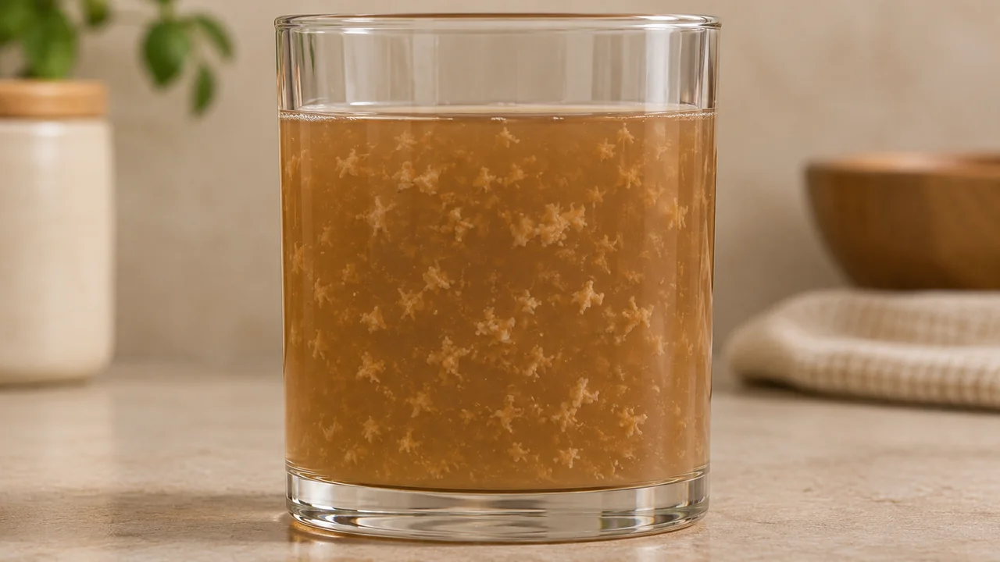

**コーラに牛乳を加えると上の液体の色が薄くなることがあるのは、牛乳のタンパク質がかたまり、コーラの色の成分の一部を巻き込んで沈むからです。** 白い牛乳が混ざって茶色が薄まるだけではなく、上の液体と、下にたまるかたまりに分かれていきます。

## 牛乳のタンパク質が、コーラの酸でかたまる

*タンパク質のかたまりが液体に散らばった様子を描いたAI生成の参考イラストです。*

牛乳に含まれる主なタンパク質の一つが、カゼインです。牛乳の中では、水に完全に溶けているのではなく、小さな粒子として散らばっています。

化学研究機関のICIQによると、コーラの酸で粒子の電荷が変わると、粒子どうしの反発が弱まり、集まってかたまりを作ります。こうして小さな粒子が集まることを「凝集」といいます。かたまりが大きくなると、液体の中に散らばったままではいられず、底へ沈みます。

## 上が薄くなる理由は、底を見るとわかる

*上の液体と底の沈殿の違いを描いたAI生成の参考イラスト。色合いは一例です。*

ICIQは、かたまりが沈むときに、コーラの色をつけている成分なども一緒に沈むと説明しています。上だけ見ると色が消えたようでも、底にできた沈殿まで見ると、色の成分の一部が下に移ったと考えられます。

なお、脱脂乳を酸性にした別の研究では、温度によってタンパク質のかたまりの構造が違いました。これはコーラの色を調べた研究ではありませんが、牛乳の固まり方は条件次第だとわかります。上の液体に色が残ることもあり、いつも同じ見た目になるわけではありません。

混ぜたのに、あとから上と下に分かれていく。そこがこの現象の面白いところです。上だけでなく底まで見ると、色が薄くなる理由が見えてきます。
