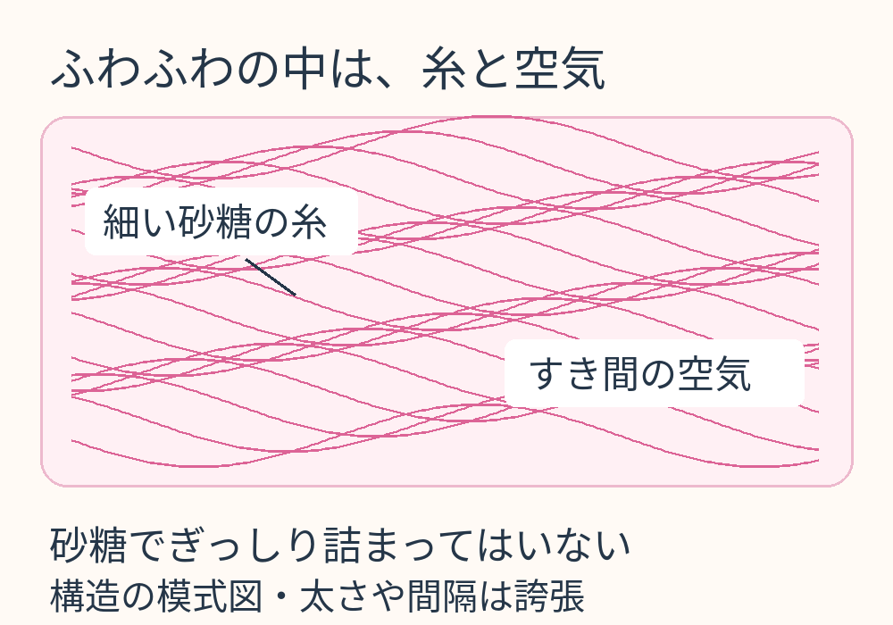
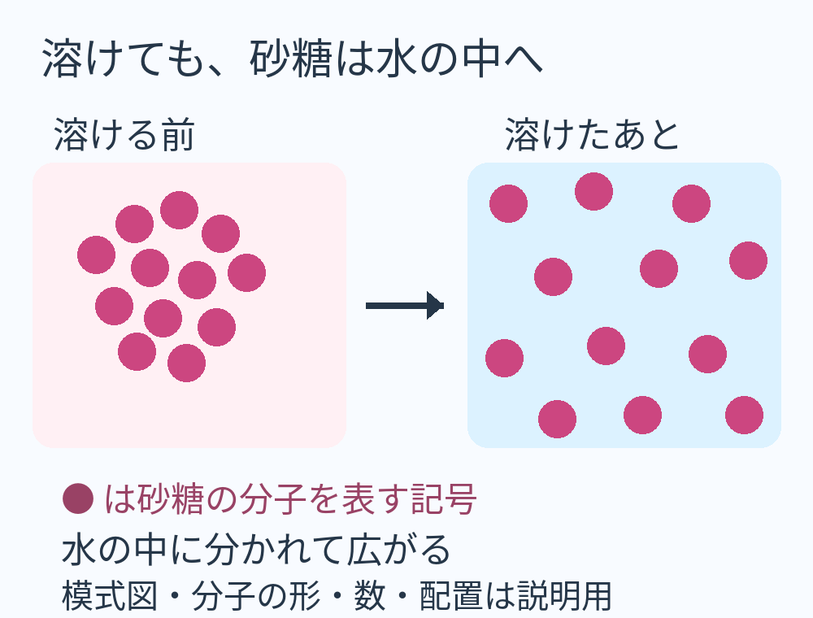

**綿あめが口の中で消えるように見えるのは、細い砂糖の糸が唾液の水分に溶け、空気をたくさん含んだふわふわの形を保てなくなるからです。** 大きく見えていたかたまりがしぼんでも、砂糖そのものがなくなったわけではありません。

## 大きさの秘密は、糸の間のすき間

綿あめは、砂糖を細い糸にして集めたお菓子です。製造時には砂糖を熱して液体にし、細く引き出して冷やすことで、固体の糸になります。[コロラド州立大学の教材](https://www.bmb.colostate.edu/wp-content/uploads/sites/6/2021/06/cottoncandy.pdf)も、材料の砂糖とできあがった綿あめは、姿が違ってもどちらも固体だと説明しています。

ふんわり広がる糸の間には、空気の入ったすき間があります。つまり、綿あめの外側をぐるりと囲んだ大きさのすべてが、砂糖で埋まっているわけではありません。綿のように見えるのも、大きいのに軽く感じるのも、このまばらな構造を考えると納得できます。

糸とすき間の関係を示す独自の模式図。糸の太さや間隔は見やすく誇張しており、実物の拡大写真ではありません。

## 口の中では、熱より「水に溶ける」が主役

作るときと食べるときでは、同じ「溶ける」でも起きていることが違います。製造時は熱で砂糖が液体になる変化。口の中では、砂糖が唾液の水分に溶け込む変化です。綿あめの糸ができる過程については、[ACSの「Cotton Candy」節](https://www.acs.org/education/chemmatters/articles/everything-is-chemistry-even-dessert.html)にも説明があります。

水に砂糖が溶けると、砂糖の分子どうしが離れ、水の中へ分かれていきます。分子そのものが、ばらばらの原子になって消えるのではありません。[ACSの授業資料「Why Does Water Dissolve Sugar?」](https://www.acs.org/middleschoolchemistry/lessonplans/chapter5/lesson4.html)は、この違いをはっきり区別しています。ふわふわの形が見えなくなっても、砂糖は水分の中に残っているのです。

丸は砂糖の分子を表す記号です。分子の形や数、水との大きさの比率を再現した図ではありません。記号の並び方は説明のためのもので、綿あめ内部の実際の分子配置や結晶構造を表していません。溶ける前後で砂糖の記号の数を同じにし、「見えなくなる」と「なくなる」の違いを示しています。

## 細い糸だと、どうしてすぐ溶ける？

砂糖の量が同じでも、ひとかたまりの状態と、細かく分かれた状態では、水に触れられる表面の広さが違います。細い糸として広がった綿あめには、水分が触れやすい表面がたくさんあります。

[ACSシカゴ支部の「Sugary Nanoscience」（p.3）](https://chicagoacs.org/images/downloads/Chemical_Bulletin/11may.pdf)では、同じ重さの砂糖でも形を変えて溶け方を比べ、水温などの条件が同じなら、液体が触れられる表面が広いほど溶解が速くなることを説明しています。綿あめがさっとしぼむ背景には、砂糖が水に溶ける性質だけでなく、この細さもあるのです。

ただし、どんな綿あめも必ず同じ秒数で消えるわけではありません。糸のまとまり方、水分の量などで変わります。「一瞬」は食べたときの印象としてはぴったりでも、決まった実験値ではありません。

## 小さくなっても、砂糖の量は別の話

ここで分けて考えたいのが、**見た目の体積と、含まれる砂糖の量**です。ふわふわに広がっているときの大きさには、糸の間の空気も含まれます。砂糖の糸が溶けてその構造が崩れれば、かさは大きく減ります。

けれど、砂糖が水に溶けること自体で、砂糖の量が消えるわけではありません。逆に、大きな綿あめを見ただけで砂糖の量を決めることもできません。どれくらいの砂糖を使ったかと、どれくらいふんわり巻かれているかは、別の情報だからです。

大きな雲のようなお菓子が、口に入れるとすっと小さくなる。砂糖という身近な材料でも、形が変わるだけでこれほど食べ心地が違うのは面白いですね。
