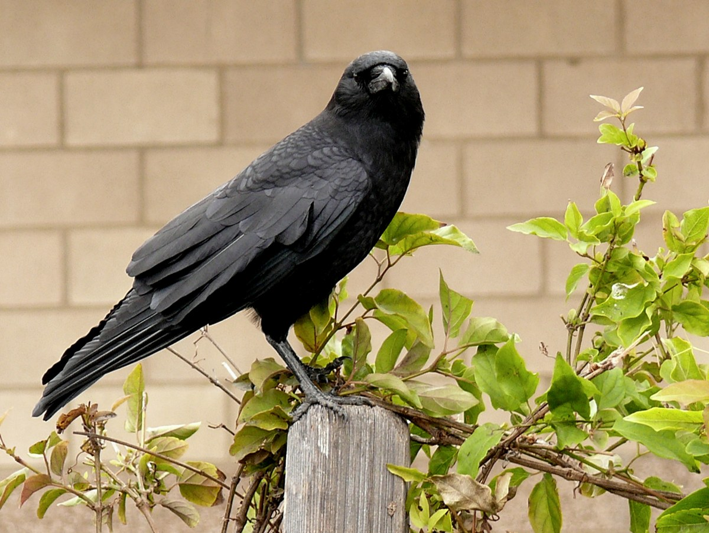
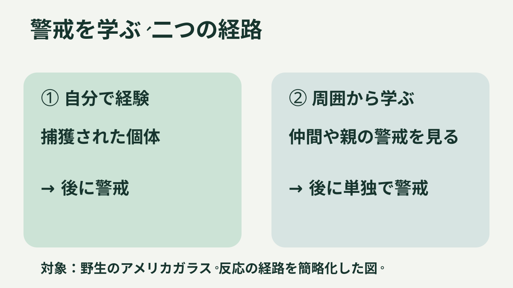

**アメリカガラスには、危険な経験と結びついた顔を見分ける力が、野外研究で示されています。** ただし、使ったのは人の素顔ではなく、顔全体を覆うマスク。「昨日追い払った日本のカラスが、今日も見ている」という場面をそのまま証明した実験ではありません。

写真：Linda Tanner／[Wikimedia Commons原画像](https://commons.wikimedia.org/wiki/File:American_Crow.jpg)、[CC BY 2.0](https://creativecommons.org/licenses/by/2.0/)。縮小・再圧縮のみ。実験を撮影したものではなく、種の参考画像です。

## 自分で覚えることと、仲間から学ぶこと

[ワシントン大学の研究チームの論文](https://pmc.ncbi.nlm.nih.gov/articles/PMC3234554/)では、捕獲を経験した個体が、その経験と結びついたマスクと中立のマスクを区別して警戒しました。

さらに、捕獲されていない個体や若鳥にも、周囲や親の警戒を見た後、単独で同じマスクに警戒の声を上げる例がありました。直接の経験だけでなく、**ほかの個体からの社会学習**が関わることを示す結果です。ただし、野外では個体の同定や経験の追跡に限界があり、学習経路をすべて完全に切り分けられたわけではありません。

図は観察された学習経路の整理です。実験写真や、カラス同士の会話を示す図ではありません。

## 「5年間」と「同じ一羽が5年覚えた」は違う

1地点では5年間の調査で、危険なマスクへの集団の警戒反応が広がりました。これは、マスクに繰り返し出会う調査中の結果です。**同じ一羽が、その顔に再び会わないまま5年間覚え続けたと測った数字ではありません。**

「恨みを仲間に言いふらす」というより、誰に警戒すべきかを経験や周囲の反応から学ぶ。そう考えると、あの視線は少し違って見えます。
