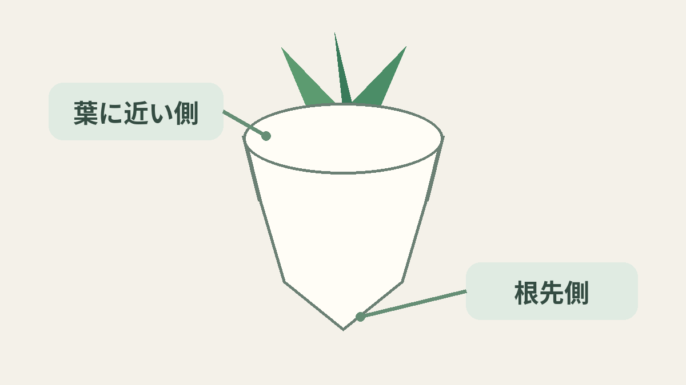
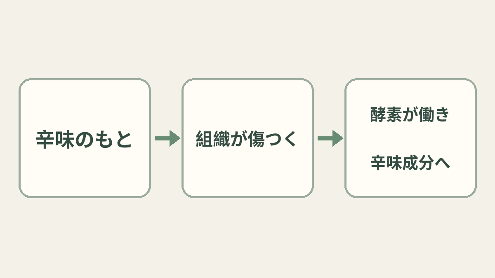

**大根は、葉に近い側より根の先端側が辛くなりやすい傾向があります。** [農林水産省の説明](https://www.maff.go.jp/j/heya/sodan/2106/01.html)も、先端に近いほど辛味成分が多いとしています。ただし「どの大根も必ず先端が何倍辛い」という決まりではありません。辛味のもとの量は、部位だけでなく品種や育ち方でも変わります。

位置関係だけの自作図です。上が葉側、下が根先で、品種や辛さを見分ける図ではありません。

## 根先に多い、辛味のもと

[農業研究機関の研究](https://www.jircas.go.jp/sites/default/files/publication/jarq/24-4-273-279_0.pdf)では、大根の根を長さ方向に分けて辛味のもととなる成分を調べました。その論文に示された分布測定では、葉に近い側より根先側で多くなる結果が報告されています。

ここで測ったのは、辛味を生む材料の**グルコシノレート**です。これが酵素の**ミロシナーゼ**によって分解されると、大根の主な辛味成分である**イソチオシアネートの一種**ができます。材料と、食べるときに感じる辛味成分は別物なのです。

## 切ったり、すりおろしたりすると？

大根の組織を傷つけると、それまで離れていた材料と酵素が反応しやすくなります。[大根をすりおろして分析した研究](https://www.jstage.jst.go.jp/article/jjshs1925/59/3/59_3_545/_pdf/-char/ja)でも、大根自身のミロシナーゼが働いて辛味成分が生成すると記されています。切る・おろす操作そのものが、辛味成分を作る反応のきっかけになります。ただし切り方やすりおろし方が違えば、できる量も同じとは限りません。

独自の概念図。分子の実際の形や反応速度、量の比較を表したものではありません。

なお、先端側に材料が多いという測定結果を、そのまま一本一本の「食べたときの辛さ」の厳密な順位に置き換えることはできません。農林水産省の説明でも、辛味成分の量は品種や栽培条件によって変わるとされています。大根の「先端は辛い」は目安の一つ。食べ慣れた大根でも、部位と反応の両方に目を向けると、味の違いの見方が少し変わります。
