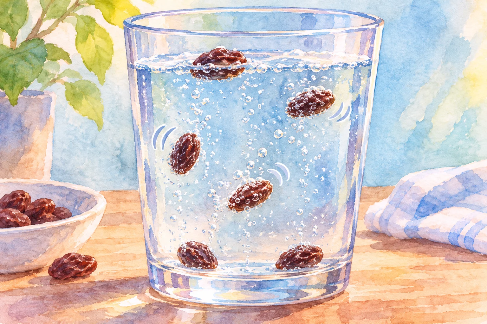
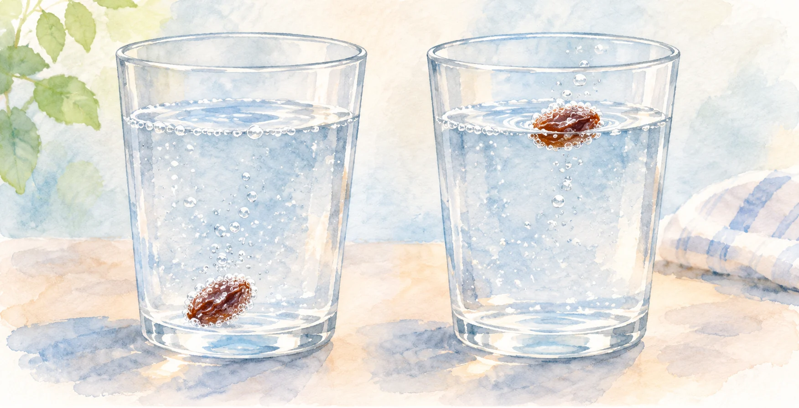

**炭酸水の中でレーズンが上下するのは、表面についた二酸化炭素の泡が浮く力を増やし、泡が離れると再び沈むためです。** レーズン自体が泳いだり、急に軽くなったりしているわけではありません。

AI生成の参考イラスト。記事の出典資料から転載した画像ではありません。

## 泡がつくと、押しのける水が増える

レーズンを炭酸水に入れると、表面の細かな凹凸などに泡ができます。[CERNの教材](https://educational-resources.web.cern.ch/states-of-matter/)は、このような表面が泡の生まれる足場になることを説明しています。

泡がつくと、レーズンと泡を合わせた全体の体積が増え、その分だけ周囲の水を押しのけます。水から受ける上向きの力である「浮力」が大きくなり、重さを上回る条件になると浮かび始めます。[Science-Uの解説](https://science-u.org/experiments/dancing-raisins.html)も、押しのける液体の量が増えることを浮上の理由に挙げています。

ポイントは、レーズンだけの体積がふくらむのではなく、くっついた泡まで含めて考えることです。

## 水面で泡が外れると、また沈む

レーズンが水面まで来ると、泡が空気に触れて壊れたり、表面から離れたりします。泡の助けを失うと、レーズンは再び沈みます。

AI生成の参考イラスト。浮沈を説明する概念画。実験記録ではなく、すべての粒が同じように動く意味ではありません。

沈んだところでまた十分な泡がつけば、もう一度浮かびます。この繰り返しが、レーズンが踊っているように見える動きです。

## いつまでも踊り続けるわけではない

[Iowa PBSの実験解説](https://www.iowapbs.org/education/resources/page/8183/learn-about-density-dancing-raisins)によると、炭酸が抜けると、この繰り返しも止まります。粒の状態や泡のつき方によって動きは違い、すべてのレーズンが同じタイミングで浮くわけでもありません。

透明な容器なら、浮いたレーズンから泡が離れ、再び沈む瞬間を追えます。
