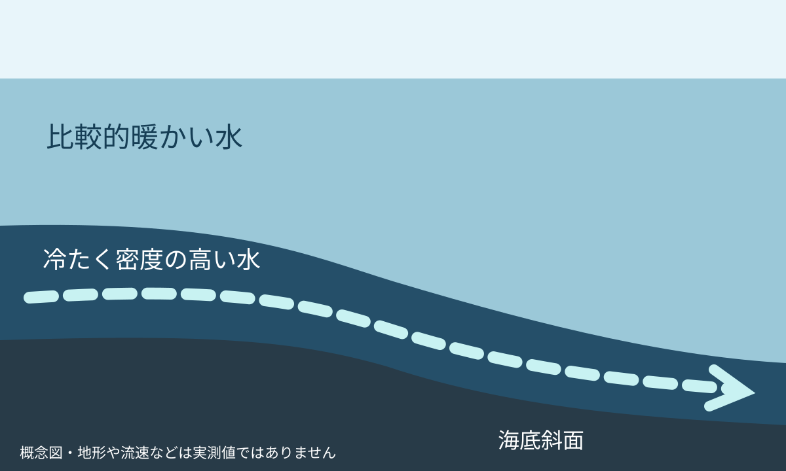

**「世界最大の滝」が海にある、という話の正体は、デンマーク海峡の海底を下る巨大な海流です。** 冷たく密度の高い海水が、比較的暖かい水の下に潜り、海底の起伏に沿って流れます。岩壁から水が空気中へ落ちる陸上の滝とは、見た目も仕組みも違います。[NOAAの解説](https://oceanservice.noaa.gov/facts/largest-waterfall.html)

独自概念図。実際の地形・流速・縮尺を示すものではありません。

## 「最大」は何を比べる？

NOAAは、グリーンランドとアイスランドの間にあるデンマーク海峡の海中の流れを「世界最大の滝」と紹介し、下向きの流量を**毎秒350万立方メートルを超える**と推定しています。これは測るたびに同じ値になるという意味ではありません。「最大」は流量・落差・幅のどれを比べるかで意味が変わります。海中の流れを、目に見える陸上の滝と単純な高さの順位で比べたり、世界中の滝を一つの基準で順位付けした結果と受け取ったりしないことが大切です。[NOAAの本文・図の説明](https://oceanservice.noaa.gov/facts/largest-waterfall.html)

比較基準の整理図であり、滝の統一ランキングではありません。

## なぜ海の中で「下る」の？

北方の海から南へ向かう冷たい海水は、比較的暖かい水と出会うと、その下へ入り込みます。海水の密度は**温度だけでなく塩分にも左右される**ので、「冷たい水なら必ず沈む」「ここの水は必ずより塩辛い」と単純には言えません。周囲より密度が高いことが大事な条件です。深い層に入った水は、海底の斜面に沿って流れ続けます。[NOAAのデンマーク海峡解説](https://oceanservice.noaa.gov/facts/largest-waterfall.html)・[海水の密度の解説](https://www.noaa.gov/jetstream/ocean/sea-water)

海面から大きな滝が見えるわけではないのに、下ではこんな流れが続いている。海を平らな一枚の水面として想像すると、ちょっと意外ですね。図は仕組みを示す模式図で、実際の地形・水の境界・流速を再現したものではありません。
