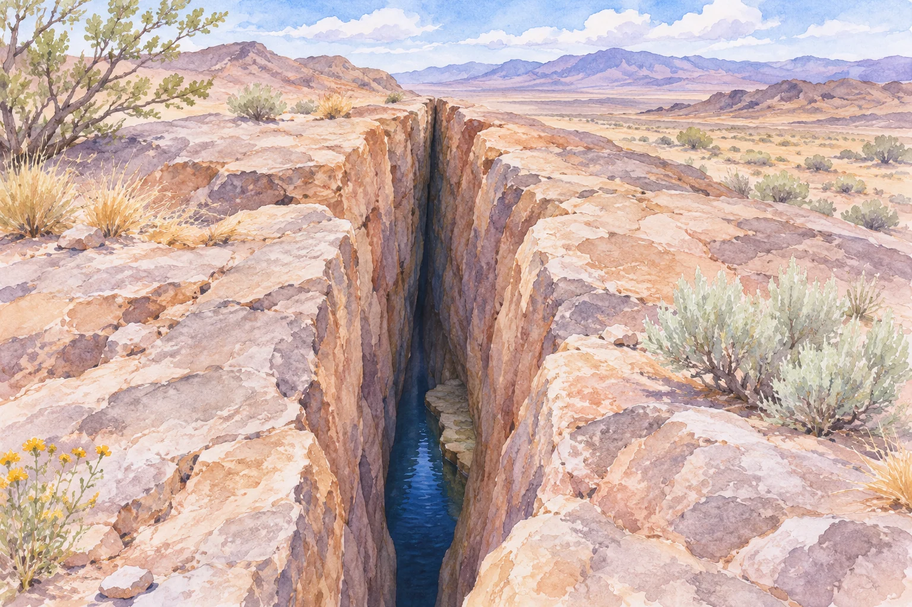
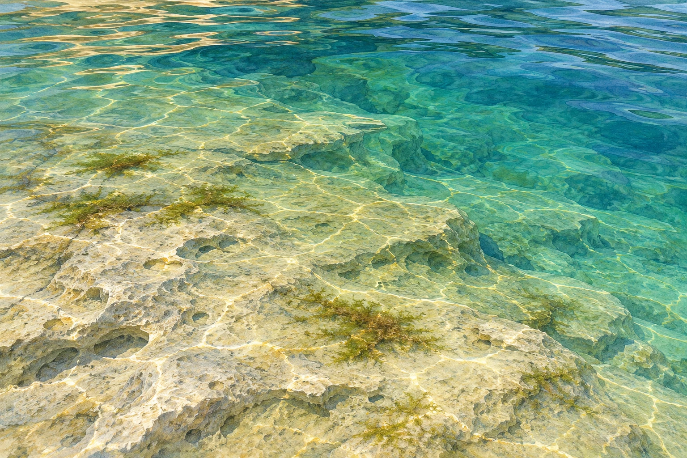

**米国ネバダ州のデビルズホールには、そこだけを自然の生息地とする「デビルズホール・パプフィッシュ」がいます。** 砂漠の砂の中を泳ぐのではなく、水で満たされた洞窟で暮らす小さな魚です。

写真：Sam Stukel／USFWS。表紙は[米国魚類野生生物局の本種の写真](https://www.fws.gov/media/devils-hole-pupfish)（Public Domain）を縮小・再圧縮したものです。

AI生成の参考イラスト。実際のデビルズホールの地形を正確に再現したものではありません。

## 砂漠の地下水に支えられた生息地

デビルズホールは、デスバレー国立公園の飛び地にあたる場所です。[米国国立公園局の解説](https://www.nps.gov/places/devils-hole.htm)によると、水温は深い場所で約33.5〜34℃。酸素が少なく、魚にとって厳しい条件の水場です。

## 深い洞窟の中でも、浅い岩棚が大切

水場は深く続いていますが、食事や繁殖を支えるのは、水面近くの浅い岩棚です。[米国魚類野生生物局](https://www.fws.gov/species/devils-hole-pupfish-cyprinodon-diabolis)は、面積約20平方メートルの棚で、藻類や小さな無脊椎動物などを食べると説明しています。

AI生成の参考イラスト。水面近くの岩棚をイメージするための絵で、デビルズホールの実地形や水深、藻類の量を再現したものではありません。

深い水がたくさんあれば、それだけで暮らせるわけではありません。浅い場所の餌や産卵環境が失われることも、魚にとって大きな問題になります。

## 「自然界ではここだけ」と「全個体がここだけ」は違う

この魚を絶滅から守るため、保全施設でも飼育・繁殖が行われています。[米国魚類野生生物局の報告](https://www.fws.gov/story/inside-devils-hole-mysterious-depths-endangered-fish-and-unwavering-partnership)では、自然の個体群が大きく減った際に、施設で育てた魚を戻す取り組みも紹介されています。

[国立公園局の2026年11月の発表](https://www.nps.gov/deva/learn/news/rare-devils-hole-pupfish-count-more-than-doubles-since-fall-2025.htm)は、その年10月10日の調査で137匹を数えたと報告しました。これはその調査時点の数で、固定された生息数ではありません。

小さな魚の話をたどると、地下水、岩棚、藻類、そして保全の仕事までつながります。珍しい生き物を守ることは、その暮らしが成り立つ場所ごと守ることなのですね。
