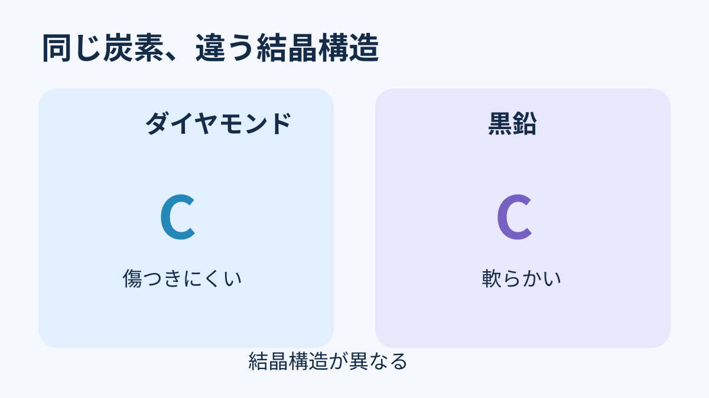
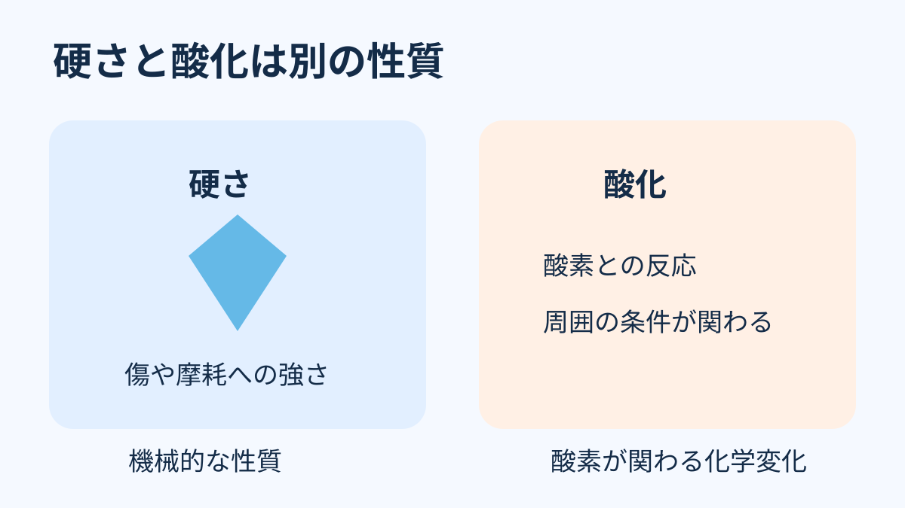

**ダイヤモンドも、条件がそろえば酸化し、燃えます。** 傷のつきにくさで知られていますが、それは酸素との化学変化まで起こらないという意味ではありません。

## 同じ炭素でも、並び方で性質が変わる

ダイヤモンドの主成分は炭素です。[鉛筆の芯に使われる黒鉛も炭素](https://periodic-table.rsc.org/element/6/)ですが、原子の結びつき方や結晶構造が違います。その違いが、見た目や硬さの違いにつながります。

図は結晶構造と硬さの違いを伝える概念図です。原子配置を示す模型ではありません。

## 「硬い」は「燃えない」ではない

宝石の硬さは、主に傷や摩耗への強さです。一方、ここでいう酸化は、ダイヤモンドの炭素が酸素と反応する化学変化。比べている性質が違うのです。[GIAも、硬さと、熱や化学物質に対する安定性を別々に説明](https://www.gia.edu/diamond-care-cleaning)しています。

図は性質の区別を示す模式図で、酸化の進み方や実験方法を示すものではありません。

ダイヤモンドが酸化して燃えるには、十分な熱が加わるなどの条件が必要です。ダイヤモンドを燃やすと二酸化炭素が生じることは、[英国王立化学会が紹介する歴史的な実験](https://periodic-table.rsc.org/element/6/)でも確かめられています。ふだんの姿から「絶対に燃えない」と思いがちですが、硬さだけでは化学変化は決められない。そこがこの話の意外なところです。
