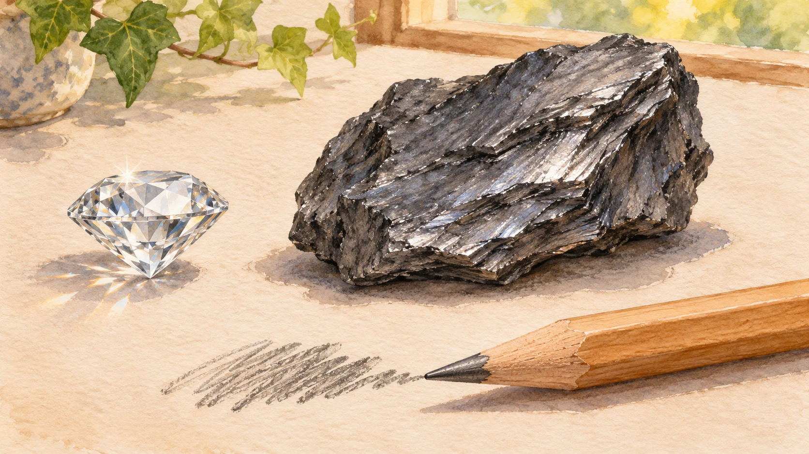
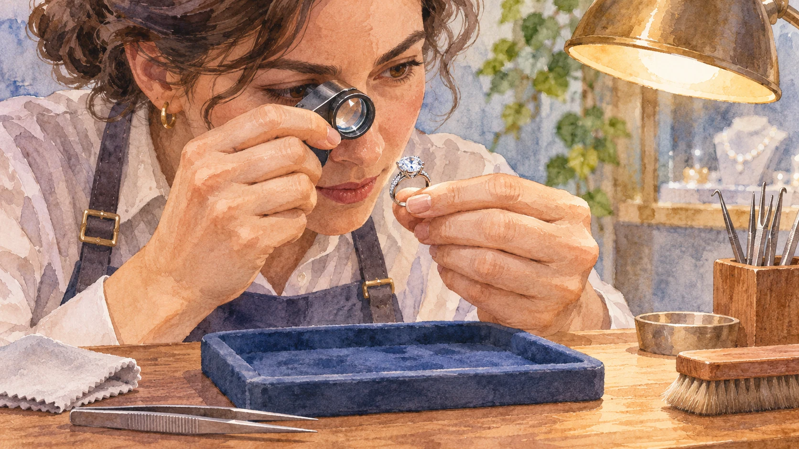

**ダイヤモンドも、十分な熱と酸素などの条件がそろえば酸化し、燃えます。** 傷がつきにくいからといって、化学変化まで起こらないわけではありません。

「硬い」と聞くと、何に対しても強いように感じます。でも、ひっかき傷に強いことと、熱や酸素にどう反応するかは別の性質。この区別が、話の入り口です。

## ダイヤモンドと鉛筆の黒鉛は、どちらも炭素

[米国宝石学会GIA](https://www.gia.edu/diamond)は、ダイヤモンドと黒鉛はいずれも炭素からなる一方、結晶構造が大きく違うと説明しています。原子の結びつき方が違うため、見た目も硬さも異なります。

炭素の身近な姿を並べたイメージです。[鉛筆の芯には粘土も含まれ](https://www.tombow.com/mamechishiki/p10/)、芯そのものが純粋な黒鉛という意味ではありません。

宝石の透明な輝きと、紙に残る黒い線。その違いの大きさを思うと、材料の名前だけで性質は決められないのだと感じます。

## 傷に強いことと、熱に耐えることは別

[GIAのお手入れガイド](https://www.gia.edu/diamond-care-cleaning)は、宝石の耐久性を、傷・摩耗への強さ、割れや欠けへの強さ、熱や化学物質に対する安定性に分けて説明しています。

ダイヤモンドは傷にとても強い一方、十分に強い衝撃が適切な方向から加われば割れることがあります。急激で極端な温度変化も、ひびの原因になります。つまり、**「硬い」は「何をしても壊れない」という保証ではありません。**

丁寧な扱いを描いたイメージ。硬い宝石でも、衝撃や熱への注意が要らなくなるわけではありません。

## 燃えると、何になる？

ダイヤモンドの炭素が酸素と反応すると、二酸化炭素になります。[英国王立化学会の炭素の解説](https://periodic-table.rsc.org/element/6/)では、1796年にスミソン・テナントが、燃やしたダイヤモンドから二酸化炭素だけができることを示し、炭素の一形態であると証明した経緯が紹介されています。

きらきらした固体が気体になる、というのが意外なところです。単に溶けて液体になるという説明とは違い、ここでは物質そのものが反応して変わっています。

もちろん、日常の室温で簡単に燃え出すという話ではありません。GIAは燃焼の目安として約850℃を挙げています。実際の変化には周囲の条件も関わるので、温度の数字だけで一律に決まるものではなく、宝石を加熱して試すべきではありません。

「燃えるなら弱い」「硬いなら不変」と二択にせず、何に対して強いのかを分けて考える。ダイヤモンドの話から持ち帰れるのは、そんな物の見方です。
