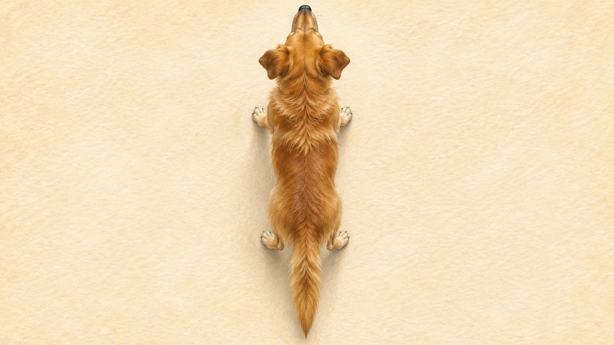
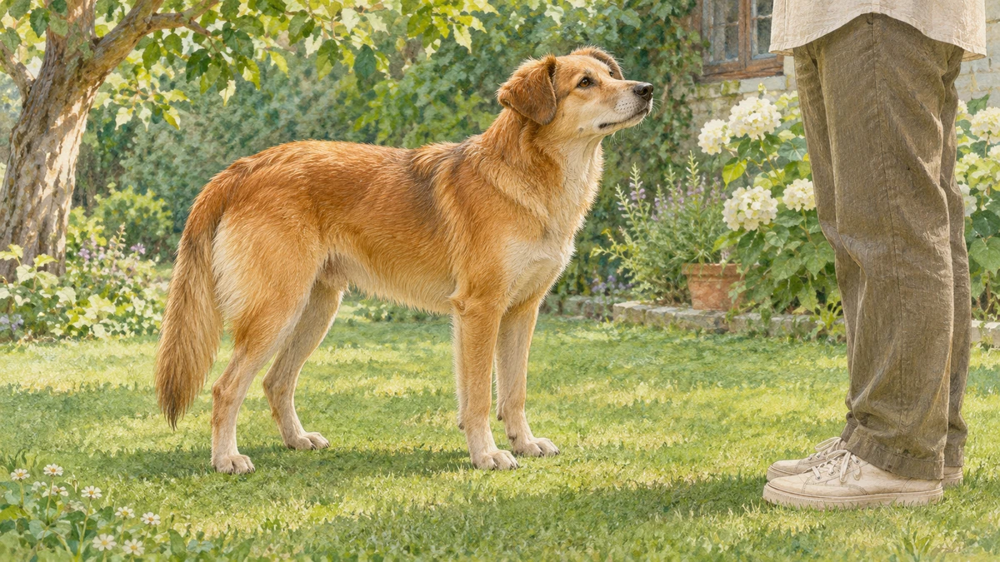

**飼い主を見たとき、犬自身の右側への振れ幅が大きかった。** 2007年の30頭の実験で報告された傾向です。「右なら好き」という一匹ごとの気持ちの翻訳表ではありません。

上から見た犬のAI生成イラスト。頭が上、尾が下の向きなので、画面の右が犬自身の右、左が犬自身の左に当たります。

## 左右それぞれの振れ幅を見る

実験では箱の窓越しに飼い主、知らない人、猫、研究で優位と評価された見知らぬ雄犬を見せ、何も見せない場合と比べました。飼い主と知らない人は犬に働きかけず、録画から尾の左右の最大角度を記録しました。

飼い主・知らない人・猫では右偏り、無刺激・指定された雄犬では左偏りでした。猫を見たときは振り自体が小さく、「右」が大きな振りや好意そのものを意味するわけではありません。

AI生成の参考イラスト。実験場面や、犬の感情を判定する見本ではありません。

著者は接近・回避傾向との関係を考察しますが、感情を直接測ったわけではなく、頭の向きなど他の姿勢との関係も残ります。特定条件の集団傾向を、一頭の気持ちや接近してよいかの判定には使えません。

## 見る犬の反応は、別の問い

2010年にオンライン公開された別の研究は、左右に尾を振るロボット犬へ、屋外の犬が近づく反応を調べました。採用された452回の遭遇では、左に振る模型の方が止まらず近づく割合が高く、著者の予測とは逆でした。ただし模型は、本物の犬のように視覚や音声で応答しません。これは2007年の「犬自身の尾振り」を再現した実験ではないので、その結果を直接否定したものとも言えません。

しっぽをどちらへ動かすかと、それを見た別の犬がどう動くか。似ているけれど異なる問いを分けると、しっぽ一本から分かることと、まだ分からないことが見えてきます。
