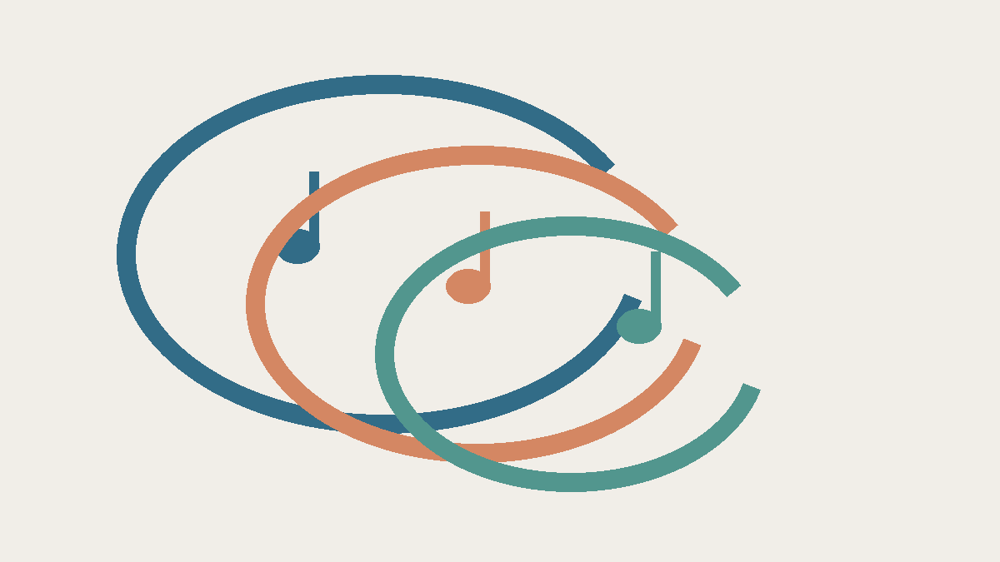
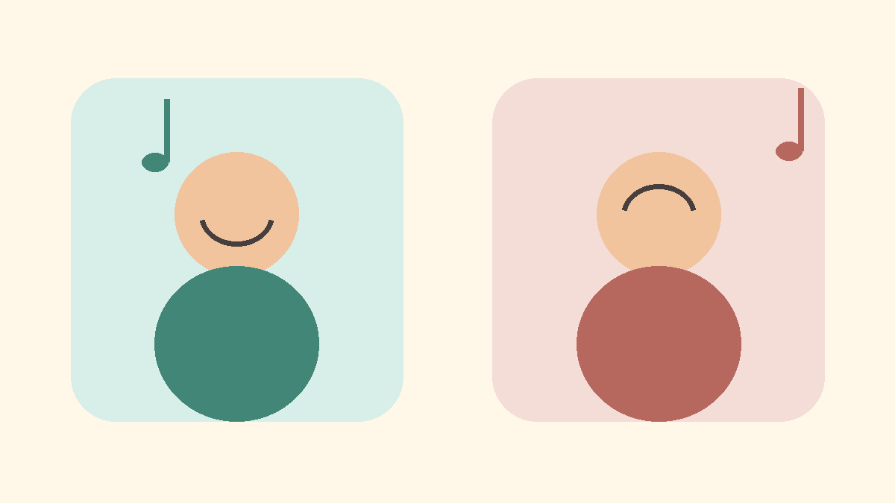

**頭の中で曲が勝手に繰り返す「イヤーワーム」は、必ずしも不快な体験ではありません。** 曲が流れていないのに音楽の一部が意図せず浮かび、反復する現象で、心理学では「不随意音楽イメージ」と呼ばれます。[Williamsonらの研究](https://pmc.ncbi.nlm.nih.gov/articles/PMC3908735/)

音のループを表したイメージ図。脳内の回路や実際の音を記録した図ではありません。

## 気になるときも、気にならないときも

2014年の研究では、フィンランド語の自由記述215件と、英語の自由記述・メール831件、計1,046件の報告を分類しました。フィンランド語の調査には、嫌だという報告だけでなく、楽しんだり、気にせずやり過ごしたりする報告もありました。一方、英語の調査は、望まないイヤーワームへの対処を尋ねています。質問が違うので、二つを単純に合わせて「何割が不快」とは言えません。[同研究のResults・Discussion](https://pmc.ncbi.nlm.nih.gov/articles/PMC3908735/)

受け止め方の例を描いた概念図。感じ方の種類すべてや、人数の割合を示していません。

## 調査から言えること

嫌なときには、別のことを考えたり、その曲を聴き直したりする人もいます。研究には、そうした行動で変化があったという本人の報告も含まれます。ただ、これは主に回答を分類した調査で、参加者を対策ごとに割り振って効果を比べた実験ではありません。**「この方法なら誰でも止まる」とは言えません。** [同研究のResults・Materials and Methods](https://pmc.ncbi.nlm.nih.gov/articles/PMC3908735/)

曲の一部分だけが浮かぶことを「続きが気になるから」と説明したくなります。実際、研究者はその可能性を仮説として論じていますが、原因として証明したわけではありません。小さな音の断片が、意識しないうちに戻ってくる。身近なのに、まだ問いが残る音楽記憶の一面です。[同研究のDiscussion](https://pmc.ncbi.nlm.nih.gov/articles/PMC3908735/)
