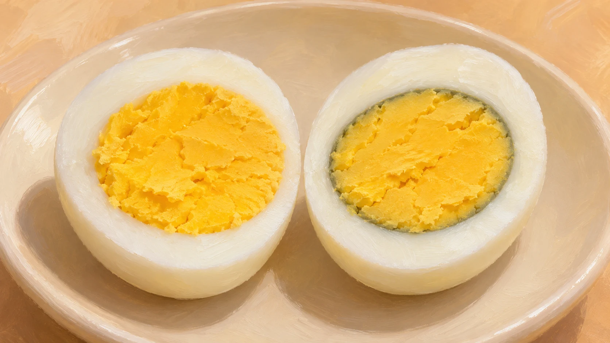
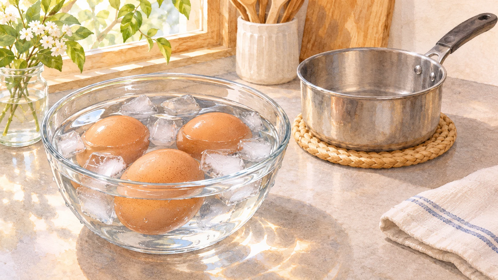

**ゆで卵の黄身のまわりにできる緑灰色の輪は、白身の硫黄を含む成分と、黄身の鉄分が反応してできる「硫化鉄」による変色です。** 黄身の中まで緑になるのではなく、主に白身と接する表面に現れます。

あの縁取りを見ると、何か失敗したようで気になります。けれど、白身と黄身の境目で起こる反応だと知ると、輪の形にもちゃんと理由があると分かります。

色の違いを表した参考イラストです。実際の色や輪の幅は卵ごとに異なります。

## なぜ黄身の「外側」だけ変わる？

[広島県食品工業技術センター](https://www.pref.hiroshima.lg.jp/soshiki/26/foodfaq3-4.html)によると、卵白のたんぱく質には硫黄を含むアミノ酸があります。加熱によって生じる硫化水素が、卵黄に多い鉄分と反応すると硫化鉄ができます。白身側と黄身側に、反応の材料が分かれているのです。

[ネブラスカ大学の解説](https://food.unl.edu/how-avoid-green-ring-hard-boiled-egg-yolks/)でも、硫化鉄は黄身の表面でできると説明されています。丸い黄身の表面が変色しているので、切った断面では「輪」に見えます。黄色い中心が残っているのも、このためです。

## 色の輪を減らすなら、ゆでた後も大切

変色は強く長く加熱するほど起こりやすくなります。避けたいときは、ゆですぎないことに加えて、**加熱が終わったら冷水などで速やかに冷ますこと**がポイントです。両資料とも、加熱後の冷却を変色対策として挙げています。

冷却の場面を描いた参考イラスト。卵を入れたまま熱い湯で待つのではなく、加熱後の扱いも色に関係します。

つい「何分ゆでるか」だけに目が向きますが、火を止めた後まで見た目に影響するところが面白いと思います。ただし、輪の出方は加熱時間だけでは決まりません。ネブラスカ大学は、調理水に鉄が多い場合も原因になり得るとしています。色だけで「何分ゆでたか」は逆算できません。

## この輪そのものは、腐敗の印ではない

資料では、この反応で生じる変色自体は有害ではないと説明されています。ただし、それは**加熱した卵の黄身表面にできる輪**についての話です。卵全体の安全性を色だけで判断したり、保存状態の悪い卵や別の変色まで大丈夫と考えたりすることはできません。

見慣れたゆで卵にも、材料の違いが目に見える場所があります。「白身と黄身が出会うところに輪ができる」と覚えておくと、次に見かけたときの印象が少し変わりそうです。
