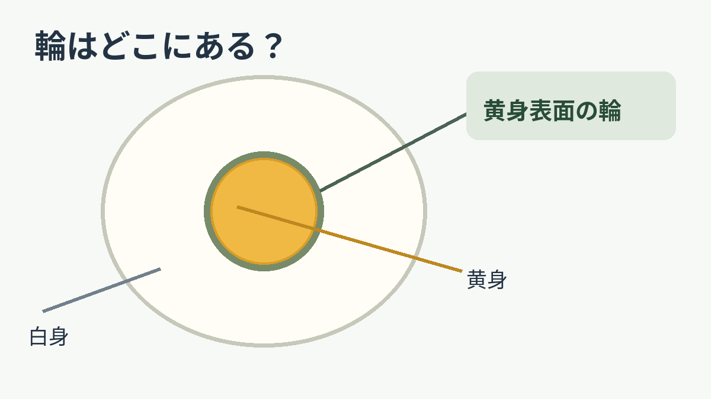
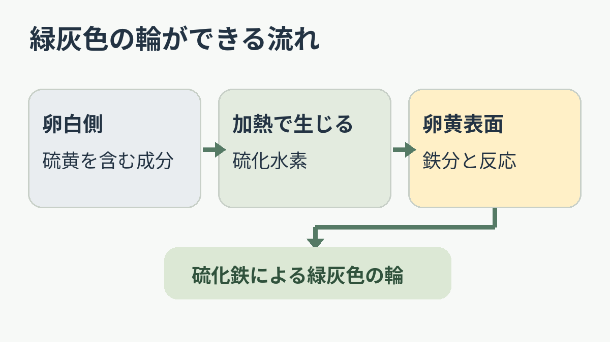

**ゆで卵の黄身のまわりに見える緑灰色の輪は、卵白の硫黄を含む成分と、卵黄の鉄分が反応してできる硫化鉄による変色です。** 黄身の黄色がまるごと緑に置き換わるのではなく、主に白身と接する表面に現れます。

図は輪ができる位置を強調した概念図です。実際の色や輪の幅は卵ごとに異なります。

## 白身の硫黄と、黄身の鉄

[広島県食品工業技術センターの解説](https://www.pref.hiroshima.lg.jp/soshiki/26/foodfaq3-4.html)によると、卵白のたんぱく質には硫黄を含むアミノ酸があります。加熱によって生じた硫化水素が、卵黄に多い鉄分と反応すると、硫化鉄ができます。難しそうな名前ですが、ここで大切なのは「材料が白身側と黄身側に分かれている」という点です。

矢印は成分と反応の流れを単純化したものです。原子や分子の実際の配置、移動距離を表す図ではありません。

## なぜ「輪」に見える？

二つの成分が出会うのは、白身と黄身の境目です。[ネブラスカ大学の解説](https://food.unl.edu/how-avoid-green-ring-hard-boiled-egg-yolks/)も、硫化鉄は黄身の表面でできるとしています。丸い黄身を切ると、その表面の変色が断面では縁取りになり、「緑の輪」に見えるわけです。硫化鉄自体は黒っぽい物質で、ゆで卵では暗緑色から緑灰色のように見えることがあります。

この変色は加熱しすぎたときに現れやすいものの、ネブラスカ大学は調理水に鉄が多い場合も原因になり得ると説明しています。だから、輪だけを見て「必ず何分ゆでた」と逆算することはできません。

黄身の輪は、身近な材料どうしが境目で出会って起こる化学変化です。ただし、ここで説明しているのは**加熱した卵の黄身表面にできる輪**だけ。ほかの緑色の変化まで、同じ理由とは言えません。
