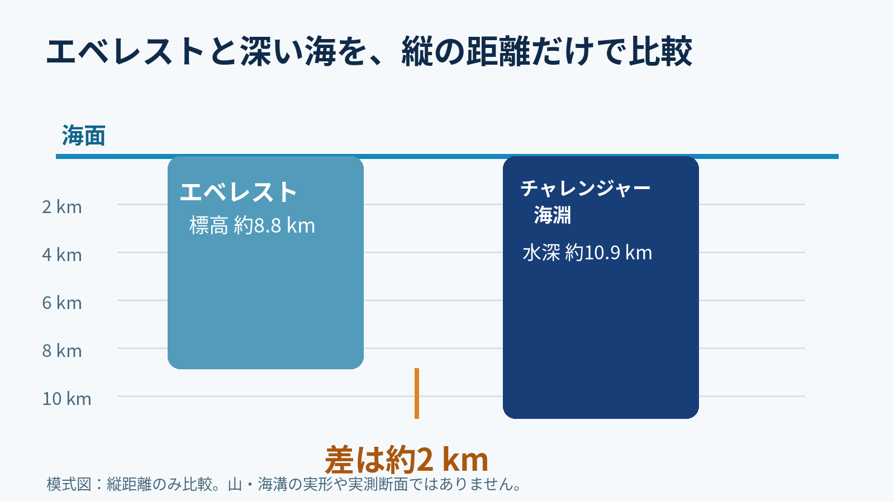
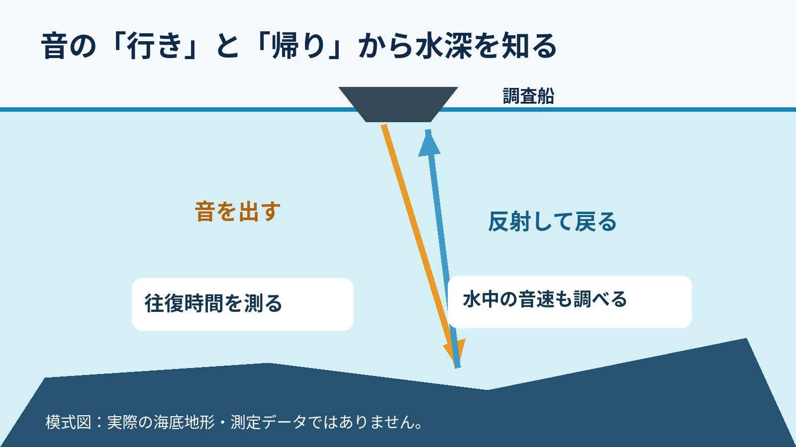

**高さと深さを数字だけで比べると、エベレストの頂上は海面まで届かず、約2km下に残ります。** エベレストの標高は約8.8km、マリアナ海溝のチャレンジャー海淵の水深は約10.9km。ただし、山を実際に海溝へ移せるという話ではありません。[中国・ネパールの共同発表](https://www.fmprc.gov.cn/eng/gjhdq_665435/2675_665437/2752_663508/2754_663512/202406/t20240607_11411566.html)・[NOAAの水深解説](https://oceanexplorer.noaa.gov/ocean-fact/ocean-depth/)

図は**縦の距離だけ**をそろえた模式図。実際のエベレストの形やチャレンジャー海淵の断面ではありません。

## 山の「麓」からの高さではない

2020年に中国とネパールが共同発表した、エベレスト山頂の雪面の標高は8,848.86mです。ここで使うのは、**麓から頂上までの距離ではありません。** 標高を考えるときの基準となるジオイドは、平均海面のモデルです。[共同発表の説明](https://www.fmprc.gov.cn/eng/gjhdq_665435/2675_665437/2752_663508/2754_663512/202406/t20240607_11411566.html)・[NOAAのジオイド解説](https://oceanservice.noaa.gov/facts/geoid.html)

NOAAが紹介するチャレンジャー海淵の水深は10,935m。両方を約8.8kmと約10.9kmに丸めて比較すると、差は**約2km**です。水深には資料や測定方法による違いもあるので、細かな桁まで引いた値を結論にはしません。[NOAAの水深解説](https://oceanexplorer.noaa.gov/ocean-fact/ocean-depth/)

ただし、わかるのは縦の距離の大小だけ。山体の幅や斜面、海溝の形は比べていないので、「実際に山がすっぽり入る」とまでは言えません。

## 深い海はどう測る？

海底まで長い物差しを下ろす代わりに、海底地形の調査では音波が使われます。船から音を出し、海底に当たって戻る**往復時間**を測る方法です。水中での音の速さも調べ、深さへ換算します。広い範囲を調べるマルチビームソナーは、多数の音波を扇状に送って海底を地図にしていきます。[NOAAのマルチビーム解説](https://oceanexplorer.noaa.gov/technology/sonar-multibeam/)

これも計測原理の模式図で、チャレンジャー海淵での実際の観測装置やデータではありません。海底は平らではなく、深いところほど細部を描きにくいのも調査の難しさです。数字だけでは想像しにくい深海も、山を物差しにすると少し身近になりますね。[NOAAの海底地形・水深解説](https://oceanexplorer.noaa.gov/ocean-fact/ocean-depth/)・[マルチビーム解説](https://oceanexplorer.noaa.gov/technology/sonar-multibeam/)
