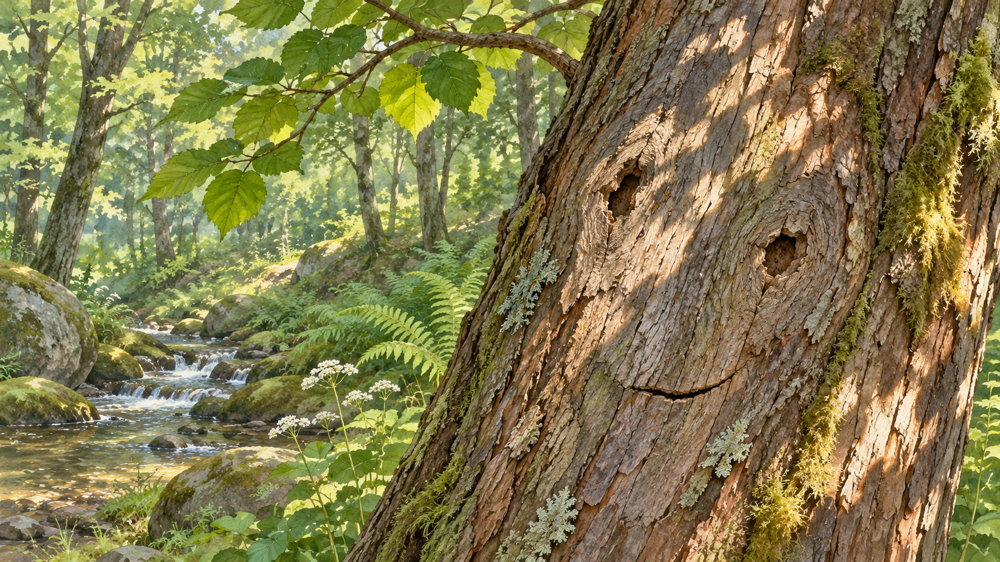
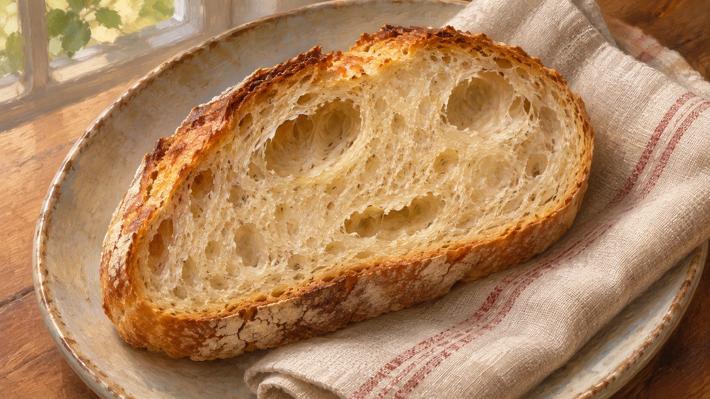

**物の模様でも、顔を見るときの視覚のしくみの一部が働くと考えられています。** 壁のシミに二つの目と口があるように見える。そんな、物の模様から顔を感じる現象を「顔のパレイドリア」と呼びます。本物の顔ではないと分かっていても、表情まであるように感じることがあります。

## 点と線が「顔」になる

顔のパレイドリアは壁だけでなく、木や食べ物など、身近な物でも起こります。目のような部分と口のような部分が並ぶと、ただの模様を顔として見ることがあります。下のイラストでは、木の穴や割れ目を顔らしい配置にしています。説明のために作った例で、自然にできた木の写真や研究で使った画像ではありません。

## 「顔に見える」けれど、物でもある

[2025年の研究](https://amandakrobinson.github.io/pdfs/Stuart_etal_2025_oneobjecttwoidentities_JEPHPP.pdf)では、顔に見える食べ物などの画像を使い、顔を探す課題と食べ物を探す別の課題を行いました。顔としても食べ物としても検出できる条件がありましたが、見つけやすさは提示時間と課題によって変わりました。「常に同時に認識する」と確かめたわけではありません。実験で選んだ画像と課題での結果です。

パンにも顔にも見えるように作った参考画です。顔に見えたかどうかで、その人の心理状態や病気が分かるわけではありません。

## 思い込みだけで片付く？

[2020年の研究](https://journals.sagepub.com/doi/full/10.1177/0956797620924814)では、各実験で30人分を分析し、顔に見える物を繰り返し見たあと、人の顔の視線方向の判断に影響が見られました。顔らしい部分を除いた物では、その効果は小さくなりました。研究者は、単に「顔に似ている」と考えるだけでなく、顔を見るときに働く視覚処理の一部が関わる証拠と解釈しています。ただし、これだけで脳の働きの全体像が確定したわけではありません。

ただの模様だと分かっていても、顔らしく見えることがある。「何か分からないから顔と間違える」だけでは片付かないところが面白いと思います。物だと知っていることと、顔らしさを感じることは、必ずしも矛盾しないのですね。
