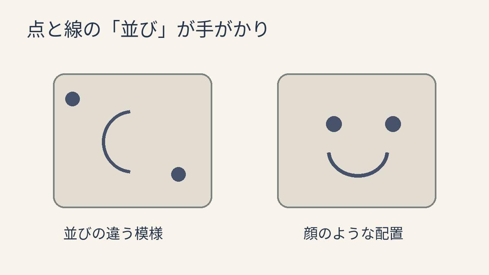
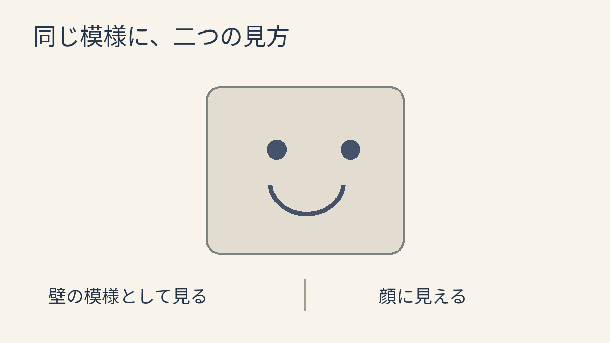

**物の模様でも、顔を見るときの視覚のしくみの一部が働くと考えられています。** 壁のシミに二つの目と口があるように見える。そんな、物の模様から顔を感じる現象を「顔のパレイドリア」と呼びます。動画の「壁にゾンビ！？」も、この見え方が出発点です。

## 点と線が「顔」になる

顔のパレイドリアは壁だけでなく、木や食べ物など、身近な物でも起こります。目のような部分と口のような部分が並ぶと、ただの模様を顔として見ることがあります。下の図は考え方を示す自作例です。研究で使われた写真や実験結果を再現したものではありません。

## 「顔に見える」けれど、物でもある

[2025年の研究](https://amandakrobinson.github.io/pdfs/Stuart_etal_2025_oneobjecttwoidentities_JEPHPP.pdf)では、顔に見える食べ物などの画像を使い、顔を探す課題と食べ物を探す別の課題を行いました。顔としても食べ物としても検出できる条件がありましたが、見つけやすさは提示時間と課題によって変わりました。「常に同時に認識する」と確かめたわけではありません。実験で選んだ画像と課題での結果です。

## 思い込みだけで片付く？

[2020年の研究](https://journals.sagepub.com/doi/full/10.1177/0956797620924814)では、各実験30人を対象に、顔に見える物を繰り返し見たあと、人の顔の視線方向の判断に影響が見られました。顔らしい部分を除いた物では、その効果は小さくなりました。研究者は、単に「顔に似ている」と考えるだけでなく、顔を見るときに働く視覚処理の一部が関わる証拠と解釈しています。ただし、これだけで脳の働きの全体像が確定したわけではありません。

ただの模様だと分かっていても、顔らしく見えることがある。そこが、この現象の面白いところですね。
