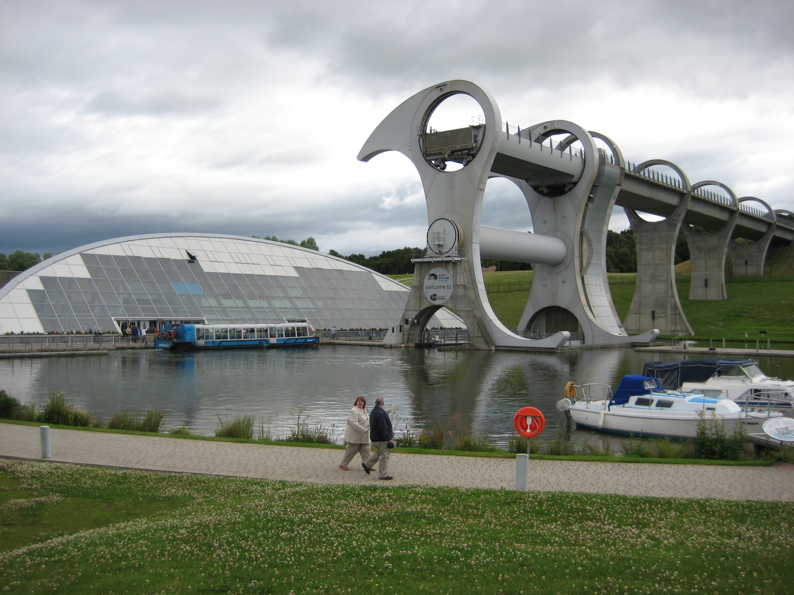
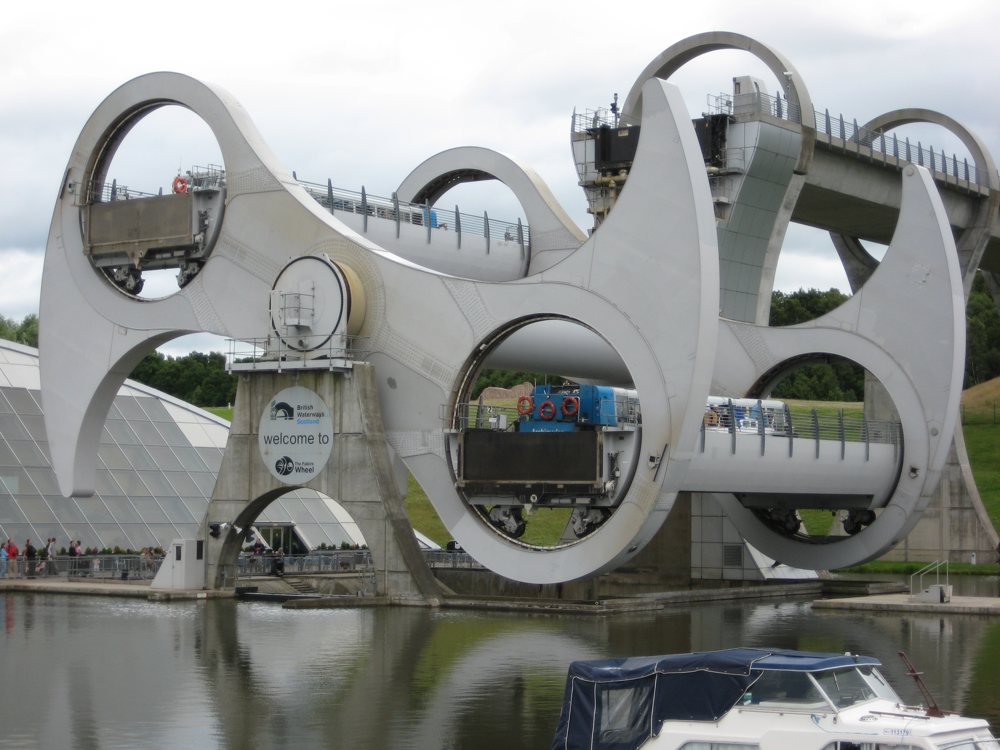

**船を水槽ごと回して、低い運河と高い運河の間を運ぶ装置です。スコットランドの「ファルカーク・ホイール」は、観覧車のような姿をした船舶昇降機。船をひっくり返すのではなく、水槽を水平に保ったまま持ち上げます。**

全景。下の水面から高架水路まで、船の通り道ごとつなぐ装置です。

写真：[J. Miers / (WT-shared) Jtesla16](https://commons.wikimedia.org/wiki/File:Falkirk_Wheel.JPG)、[CC BY-SA 1.0](https://creativecommons.org/licenses/by-sa/1.0/)。原画像無改変、表示サイズのみ調整。

## 水から引き上げず 水ごと運ぶ

普通のエレベーターなら、乗るのは人や荷物。でも、ここで運ぶのは船と、その船が浮かんでいる水です。向かい合う二つの水槽の一方が上がり、もう一方が下がって、運河の高低差をつなぎます。

私が好きなのは、船を水から取り出そうとしない発想です。「船をどう持ち上げるか」を「浮かんだままの場所をどう動かすか」に変える。姿の派手さだけでなく、その考え方に面白さがあります。

## 重い船が入っても なぜ釣り合うのか

船が入れば、その重さがそのまま水槽に足されるように思えます。けれど、浮いている船は、自分の重さと同じ重さの水を押しのけます。

水位をそろえると、そのぶんの水が水槽から出るため、「船＋水」の合計の重さは、もともとの水の重さと釣り合います。設計に携わったTony Geeも、この仕組みが二つの水槽のつり合いに使われていると説明しています。

ここは条件つきです。船が水に浮き、水位が管理されているから成り立つ話。「容器に重い物を何でも入れても、重さが変わらない」という意味ではありません。

## 回転するのに 船が傾かない理由

腕が回るのと、水槽まで同じ角度に傾くのは別です。水槽には、回転中も水平を維持する歯車の仕組みがあります。

回転中の様子。腕は斜めでも、船が入る水槽は水平です。

写真：[J. Miers / (WT-shared) Jtesla16](https://commons.wikimedia.org/wiki/File:Falkirk_Wheel_Operation.JPG)、[CC BY-SA 1.0](https://creativecommons.org/licenses/by-sa/1.0/)。原画像無改変、表示サイズのみ調整。

腕の角度と水槽の底を見比べると、写真でも違いがわかります。大きな腕の動きに目を奪われますが、船を傾けないための仕事は、水槽側の仕組みが受け持っているのですね。

## 数字を見るなら 何の高さかに注意

設計者の解説では、ホイールの直径は35メートル、船を上下させる段差は24メートルです。装置そのものの大きさと、船が上がる高さを混ぜると、仕組みを見誤ります。

運河間の移動にはホイール以外の区間もあります。「二つの運河の高さの差」と「ホイールだけの昇降量」を同じ数字として扱わないのがポイントです。大きな数字を覚えるより、何を測った数字かを確かめるほうが、この装置を正しく楽しめます。
