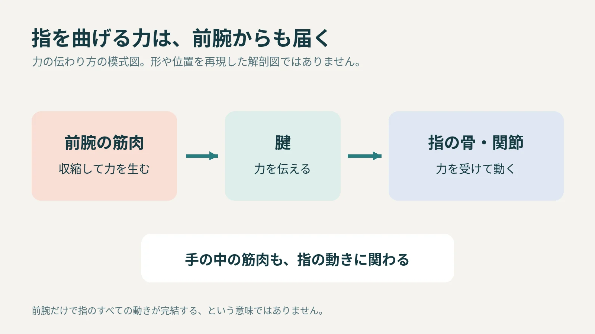

**指を曲げる筋肉の一部は、指の中ではなく、肘と手首の間にある「前腕」にあります。筋肉が生み出した力を「腱」が指の骨へ伝えることで、指が曲がります。**

小さな指先だけを使っているつもりでも、その動きは腕のほうから支えられています。

## 筋肉の力を、腱が指まで届ける

腱は筋肉と骨をつなぐ丈夫な組織です。[日本整形外科学会の解説](https://www.joa.or.jp/public/sick/condition/flexor.html)によると、前腕にある指を曲げる筋肉から伸びた腱は、手首、手のひらを通って指の骨に付きます。

イメージとしては、離れた場所で生まれた力を、長いひもで伝えるような仕組みです。腱そのものが筋肉の代わりに縮む、という意味ではありません。

力の伝わり方を整理した模式図。実際の筋肉・腱の形や位置、数を再現した解剖図ではありません。

## 手の中にも、指を動かす筋肉がある

ここで「指を動かす筋肉は、全部前腕にある」と覚えると、話が少し変わってしまいます。手の中にも筋肉があり、指を細かく動かす働きを支えています。

解剖学の教材[OpenStax](https://openstax.org/books/anatomy-and-physiology/pages/11-5-muscles-of-the-pectoral-girdle-and-upper-limbs)は、前腕から手へつながる筋肉と、手の中にある筋肉を分けて説明しています。文字を書く、キーボードを打つといった動作は、こうした筋肉の組み合わせによって成り立ちます。

文字を書く身近な動作を描いたAI生成の参考画。指先の細かな動きは、前腕と手の中にある筋肉の働きにも支えられています。

## 「小さな動き」は、指先だけの仕事ではない

指を曲げるときは、筋肉、腱、骨、関節などが連動します。目に見える動きが指先にあっても、力を生む場所まで同じとは限らないのです。

図をたどるときは、「力を生む筋肉」「力を伝える腱」「動く指の骨」を分けてみると整理できます。指先の動きだけでは見えない役割分担が、前腕から手へ続いています。
