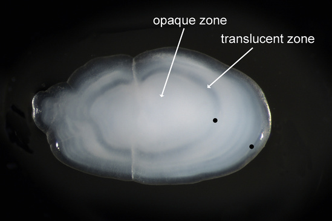

**魚の年齢は、頭の中にある「耳石」の成長層を調べて推定できます。** 木の年輪に似ていますが、見える線を無条件に「1本で1年」と数えるわけではありません。

魚は外から眺めただけでは、何年生きてきたのか分かりません。イラスト中の大小は年齢比較を表していません。

## 耳石に残る層を読む

耳石は魚の内耳にある炭酸カルシウムの構造です。[NOAA Fisheriesの説明](https://www.fisheries.noaa.gov/national/science-data/age-and-growth)によると、耳石は魚が生きている間に外側へ材料を積み重ねます。成長の速さが季節で変わる魚では、不透明な層と半透明な層が交互にできます。年ごとの形成が確かめられた魚では、その一組を1年分の成長として年齢推定に使えます。

研究者は必要に応じて耳石を切り、中心から縁まで拡大して観察して、年ごとの成長を示す層を読み取ります。魚の大きさだけから年齢を決めるより、成長の記録を直接確かめられる方法です。

## 魚種に合わせた確認が必要

層の形成は水温などの環境にも影響されます。また、耳石のないサメやエイにはこの方法をそのまま使えません。NOAAは魚種ごとに適切な構造と読み方を選び、既知の年齢の魚や標識して再捕獲した魚などで推定法を[検証する方法](https://www.fisheries.noaa.gov/alaska/science-data/otolith-growth-validation-and-corroboration)も紹介しています。

こちらは参考イラストではなく、[NOAA Fisheriesが公開している実物の耳石写真](https://www.fisheries.noaa.gov/national/science-data/age-and-growth)です。2歳のPacific Sand Lanceの例で、opaque zoneは不透明層、translucent zoneは半透明層。黒点は年輪の位置を示します。写真：NOAA Fisheries。

耳石の断面では、不透明な層と半透明な層の重なりを中心から縁へたどります。年齢を読み取るには、こうした成長層と年数の関係を魚種ごとに確かめる必要があります。

魚の年齢を調べる鍵が、体の大きさではなく、頭の中の小さな構造に残っているのは意外です。ただ線を数えるだけでなく、「その線が何年分なのか」まで確かめる。そこまで含めて読むからこそ、成長の記録として使えるのだと思います。
