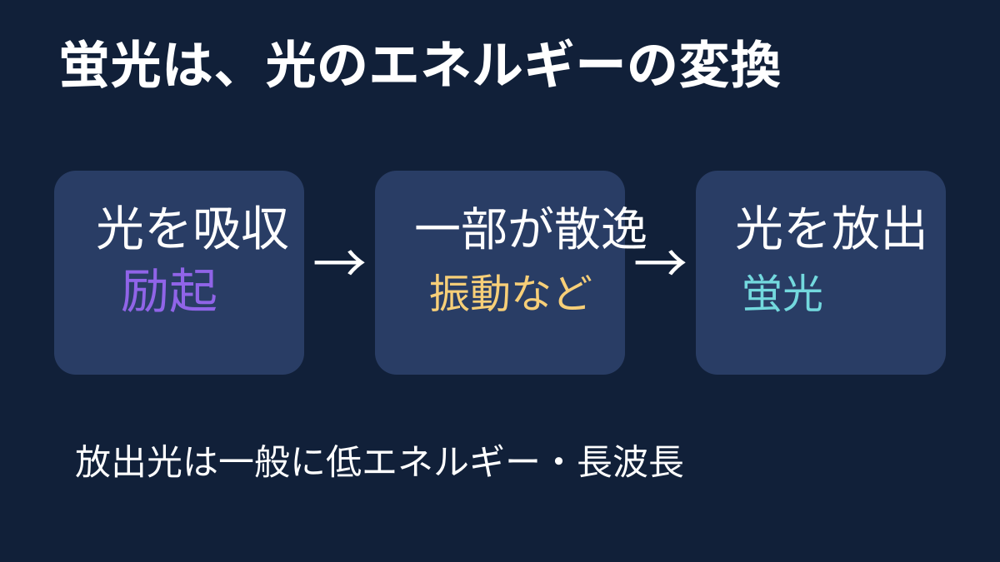

**文字が浮かぶ鍵は、インクに含まれる成分が光を吸収し、別の光を出す「蛍光」です。** 紫外線が文字を描き足すわけではありません。

## 光を吸って、別の光を出す

蛍光を出す物質の分子は、合う波長の光を吸収するとエネルギーの高い状態になります。そこから戻る途中、一部のエネルギーは分子の振動などとして散逸します。すばやく光を出して戻る経路が、蛍光です。一般的には、出てくる光は吸収した光よりエネルギーが低く、波長が長くなります。

図は蛍光を出す経路の一例です。吸収した光がすべて蛍光になるという意味ではありません。

紫外線を吸収し、目に見える光を放つ成分なら、文字が明るく見えます。ただし蛍光物質によって吸収・放出する波長は違います。「紫外線なら何でも同じ色に光る」わけではありません。普通の照明の下でそのインクがどれほど見えにくいかも、インクや紙の組み合わせによります。

## 反射や蓄光とは何が違う？

普通の照明の下で白い紙が明るく見えるのは、主に当たった可視光を反射するためです。一方、蛍光は吸収したエネルギーを別の光として出す現象で、単なる反射ではありません。

また、暗くなってからも光り続ける「蓄光」と、蛍光は同じ言葉ではありません。蛍光は通常、光による励起が止まるとすばやく消えます。長く残る光には、蛍光とは別の、より遅い発光過程が関わります。

「見えなかった文字が現れた」という驚きの裏側には、光を吸って別の波長の光を出す、分子の性質があるのです。
