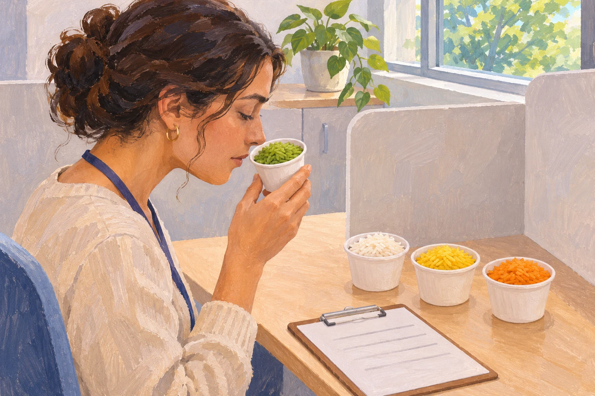
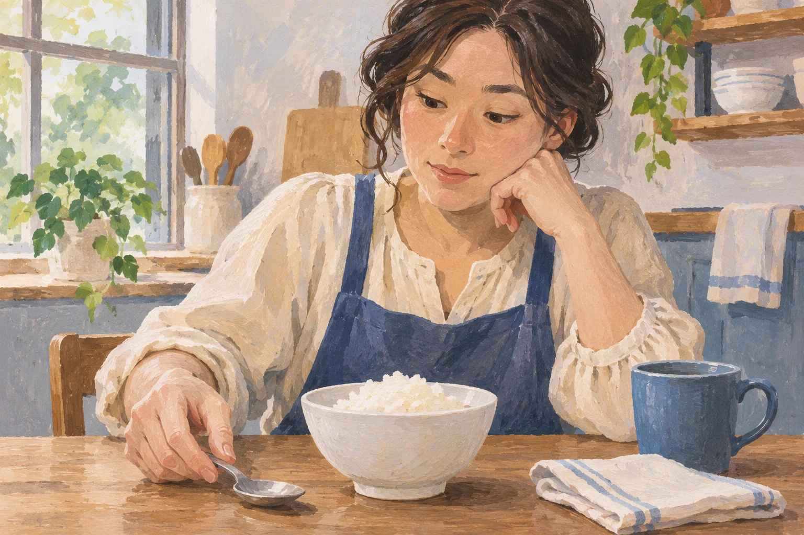

**食べ物の色は、どんな風味かという予想や、実際に感じた風味の評価に関わることがあります。ただし「青い料理は必ずまずい」といった、色だけで決まる法則ではありません。** 目で見た印象と、一口食べた感想を分けると、この話を整理しやすくなります。

たとえば、青い照明の下のローストビーフ。食べ慣れた料理でも、見た目がいつもと違うと「どんな味だろう」と立ち止まるかもしれません。

## 色を変えたご飯では、香りの答えも変わった

[2020年の原著論文](https://www.mdpi.com/2304-8158/9/12/1845)では、日常的にご飯を食べる成人98人に、白・黄・オレンジ・緑の炊いた米を評価してもらいました。色付きの試料には食品用の着色料を使い、対応する野菜や香辛料は加えていません。

参加者は、まず香りを嗅ぎ、当てはまる香りの言葉を選びました。緑ではグリーンピース、オレンジではトマトの香りを選ぶ人が、他の色より多くなりました。これは、色が変わって実際に豆やトマトが入ったという意味ではなく、参加者が報告した香りの違いです。

色と香りの評価を考えるためのAI生成の概念画。研究で撮影された写真や、実験設備の正確な再現ではありません。

## 「食べる前の予想」と「食べた後の評価」は別

見るだけで「こういう風味だろう」と想像することと、嗅いだり食べたりして答えることは、同じ測定ではありません。この研究では、香りを嗅ぐ評価に加え、食べたときの風味なども評価しています。

また、色を変えればあらゆる味が変わるわけでもありません。米の試験では、苦味や塩味の強さに色による有意な差は認められませんでした。ある評価に差が出た結果を、別の味の性質やすべての料理へ広げないことが大切です。

## 見慣れた色は、人によって違う

論文は、食文化や食べ慣れ、実験の条件も考慮すべきだとしています。色付きのご飯を日常的に食べる人と、そうでない人とで、同じ色から思い浮かべる料理が同じとは限りません。

食べる前の印象と食べた感想を分けて考える場面を描いたAI生成イラスト。特定の味や実験結果を表す画像ではありません。

日常なら、見たときに予想した風味を一つ思い浮かべ、食べたあとでその予想と比べてみると、感想を具体的にできます。「色の印象」「感じた香り」「甘さや塩気」を別々の言葉にするのがコツです。これは家庭で因果関係を証明する実験ではなく、自分の一口を観察する方法です。
