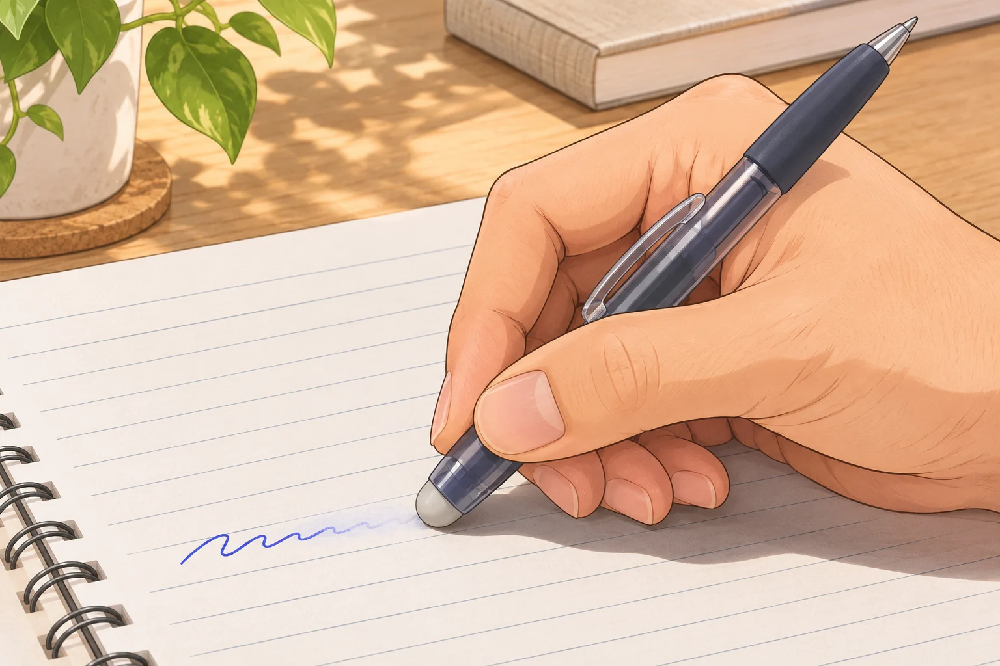
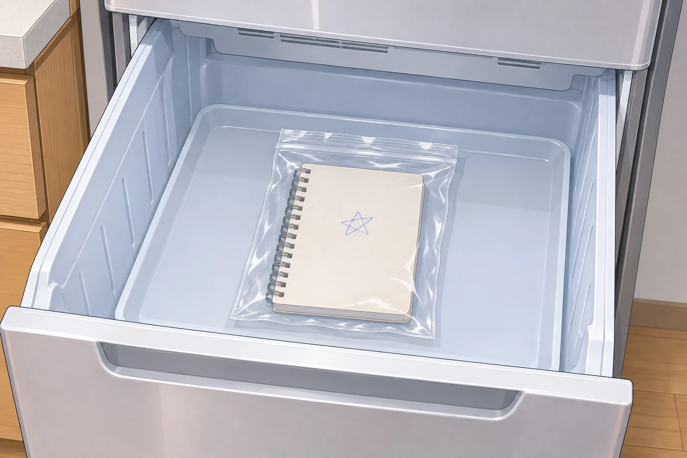

**フリクションで見えなくなった文字は、十分に冷やすと色が戻ることがあります。ただし、消す前の文字を必ず元通りにできるわけではありません。**

ポイントは、インキの「色」が温度で変わること。書き間違いを直せる便利さと、意図しないときに文字が消えたり戻ったりする困りごとは、同じ仕組みから生まれています。

## こすると消えるのは、摩擦で熱が生まれるから

フリクションのインキには、色を出すための成分などを収めた小さなカプセルが入っています。専用ラバーでこすると摩擦熱が生まれ、カプセル内の成分の組み合わせが変化して、インキが無色になります。メーカーは、60℃以上で無色になると説明しています。

専用ラバーでこすると摩擦熱が生まれます。AI生成の参考イラストで、実験の記録写真ではありません。

## 冷蔵庫に入れれば、何でも元通り？

色が戻り始める目安はマイナス10℃以下で、マイナス20℃前後になると色が戻る特性があります。ふつうの冷蔵室で少し冷やす話ではありません。無色になったあとも常温ではその状態が保たれ、色を戻すには大きく温度を下げる必要があります。

ただし、ここはインキの性質と、紙に残った文字の復元を分けて考えたいところ。メーカーの復元案内には、次の注意があります。

- ラバーでこすって消した筆跡は、完全には元に戻せません。

- 消した上から書き直した部分は、以前の文字も戻って重なることがあります。

- 極端な高温や強い紫外線でインキ自体が傷んだ場合は、復元できません。

## 熱で消えたノートに困ったら

高温で文字が消えた紙について、パイロットは、水滴で濡れないよう袋に包み、食品との接触を避けて冷凍室に一晩以上入れる方法を案内しています。ただし、十分に冷えなかった場合などは戻らず、復元の保証もありません。

大切な紙を扱う前には、[メーカーの復元方法と注意事項](https://www.pilot.co.jp/support/frixion/1334578774507.html)を確認してください。

メーカーの案内は、袋に包んだ紙を冷凍室に入れる方法です。復元を保証するものではありません。AI生成の参考イラスト。

## 残したい文字には、最初から別のペンを

書き直す予定のある下書きや予定表では、消せる機能が役立ちます。一方、メーカーは証書類、履歴書、宛名などへの使用を禁止しています。マークシートにも使えません。

使う前に決めておきたいのは、その文字をあとで消してもよいかどうか。何度も直す下書きと、相手へ渡す書類や残したい記録では、ペンを使い分けましょう。
