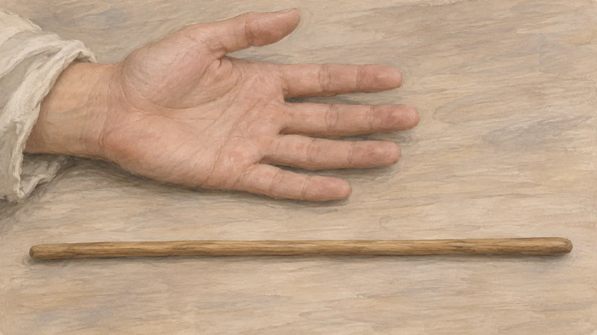

**歯をきれいにするのに、細長い木の棒を使っていたという記録があります。** ポルトガルの宣教師ルイス・フロイスが、戦国時代の1585年に書き残したものです。なかには、手を広げた幅より長いものもあったといいます。

## 楊枝といっても、手より長いものがあった

*長さをイメージするためのAI生成の挿絵。実物を復元したものではありません。*

フロイスは食事や飲み物を扱う章で、自分たちが使う歯の道具は短いのに、日本で使われる棒には「パルモ」と呼ばれる、手を広げた幅を表す尺度を超えるものもあると書きました。

楊枝と聞くと、指先でつまめるものを思い浮かべます。手の幅より長いと聞くと、同じ歯の道具でも、だいぶ印象が変わりますね。ただ、記録からは木の種類や先端をどんな形に加工していたかまでは分かりません。

## 朝、顔を洗う前に

*朝の身支度を描いたAI生成の想像図。特定の家や手順の再現ではありません。*

同じ章には、歯をきれいにするタイミングの違いも出てきます。フロイスは、自分たちは食事のあと、日本では朝、顔を洗う前に歯をきれいにすると書いています。

これは一人の宣教師が残した比較で、当時の日本中の人が同じ道具を使い、同じ順番で身支度をしていた証拠ではありません。それでも、道具の長さから朝の身支度の順番まで、旅先で気になったことを書き留めたおかげで、数百年後にそんな小さな日常までのぞけるのは面白いところです。
