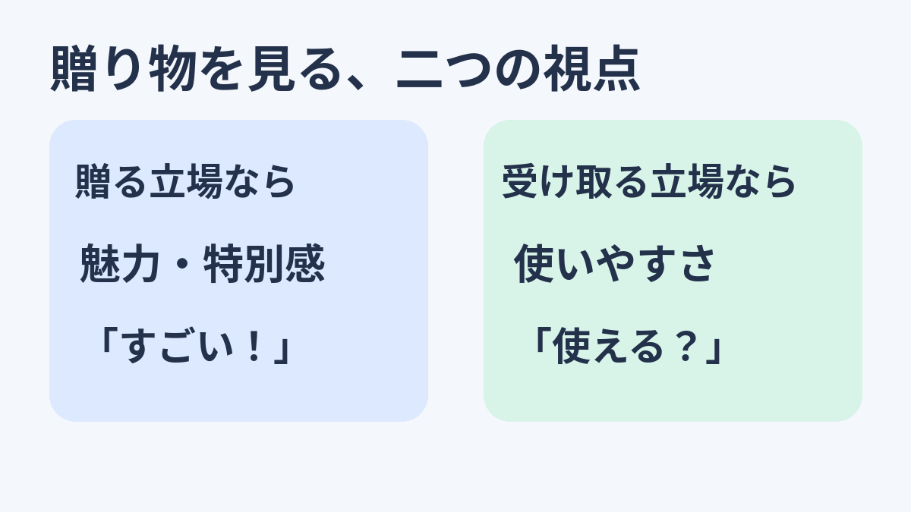
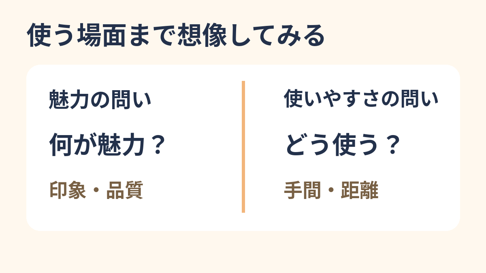

**贈る人と受け取る人は、贈り物の魅力と使いやすさを同じ比重で見るとは限らない。** そんな実験結果があります。純金のバトルアックスを贈られても、持ち上げるだけで一苦労。動画では笑える極端な例ですが、プレゼントを選ぶときの「すごい！」と、受け取ってからの「使えるかな？」は、別の視点かもしれません。

## 贈る前の魅力、受け取った後の使いやすさ

Baskinらの研究は、贈り物の「魅力」と「使いやすさ」がぶつかる選択に注目しました。たとえば、料理は魅力的でも遠いレストランと、少し控えめでも近いレストラン。贈る人は前者に、受け取る人は後者に、相対的に重みを置く傾向が報告されています。

ただし、受け取る人が「必ず実用性を選ぶ」という結果ではありません。[刊行版の最初の実験](https://drive.google.com/file/d/1uVEzfHG-HzfRlpFhpPbyU6iqElFvNSaB/view?usp=sharing)では、オンライン参加者80人がゲームやコーヒーメーカーなど6種類を、贈る側または受け取る側になったつもりで評価しました。贈る側は魅力が高く使いにくい品をより高く評価した一方、受け取る側には二種類の評価の明確な差がありませんでした。大切なのは、**両者が同じ比重で見ているとは限らない**ことです。

## 「相手のため」を考えても、ずれる？

研究者たちは、贈る側は品物を少し離れて捉え、「どんな素敵な体験か」といった大きな特徴に目が向きやすく、受け取る側は使う具体的な場面を考えやすい、と解釈しています。贈る側が相手を考えていない、という話ではありません。

実験には仮想の選択や過去の贈答を思い出す課題が多く、実際に高価な品を渡したときの反応を、全員について予言するものではありません。純金のバトルアックスのような極端な品も実験していません。魅力か使いやすさかの二択に決めつけず、相手が受け取った後にどう使うかも想像してみる。動画のオチは、そんな見方を思い出させます。
