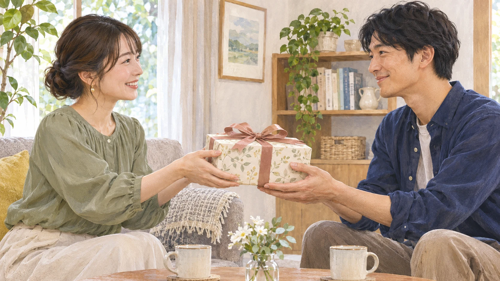
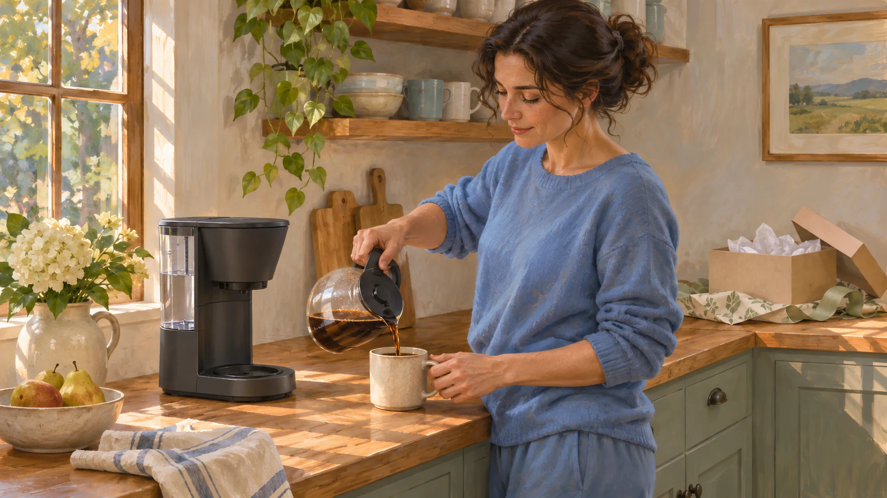

**贈る人と受け取る人では、贈り物の魅力と使いやすさに置く重みが違うことがあります。** 喜んでもらえそうな品を選ぶときの「すごい！」と、受け取ってからの「使えるかな？」。どちらも大切なのに、立場が変わると目に入りやすいものも変わるようです。

## 贈る前の魅力、受け取った後の使いやすさ

Baskinらの研究は、贈り物の「魅力」と「使いやすさ」がぶつかる選択に注目しました。たとえば、料理は魅力的でも遠いレストランと、少し控えめでも近いレストラン。贈る側は料理の魅力を、受け取る側は行きやすさを、相手の立場より重く見る傾向が紹介されています。

贈り物を渡す日常の場面を描いた参考イラストです。実験参加者や実際に測った反応ではありません。

ただし、受け取る人が「必ず実用性を選ぶ」という結果ではありません。[刊行版の最初の実験](https://doi.org/10.1086/675737)では、オンライン参加者80人がゲームやコーヒーメーカーなど6種類を、贈る側または受け取る側になったつもりで評価しました。贈る側は魅力が高く使いにくい品をより高く評価した一方、受け取る側には二種類の評価の明確な差がありませんでした。大切なのは、**両者が同じ比重で見ているとは限らない**ことです。

## 「相手のため」を考えても、ずれる？

研究者たちは、贈る側は品物を少し離れて捉え、「どんな素敵な体験か」といった大きな特徴に目が向きやすく、受け取る側は使う具体的な場面を考えやすい、と解釈しています。贈る側が相手を考えていない、という話ではありません。

受け取った後に使う場面を想像するための参考イラストです。この製品や人が研究に登場したという意味ではありません。

実験には仮想の選択や過去の贈答を思い出す課題が多く、実際に高価な品を渡したときの反応を、全員について予言するものではありません。魅力か使いやすさかの二択に決めつけず、受け取った後の暮らしを想像してみる。「何をあげたら驚くか」だけでなく、「どんな日に使ってもらえそうか」まで考えると、贈り物選びの見え方が少し変わります。
