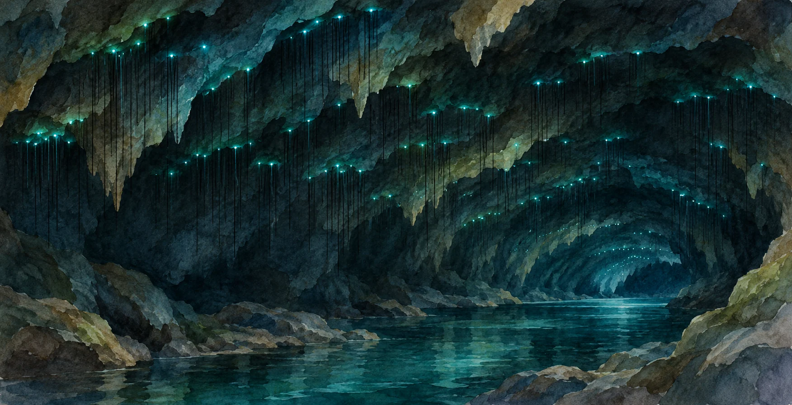
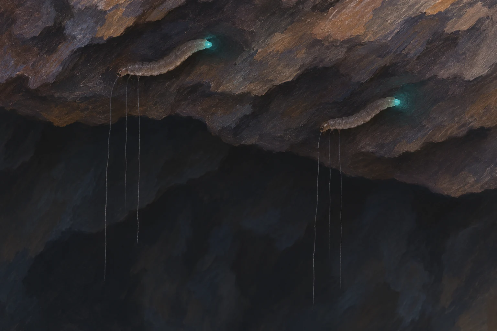

**ニュージーランドの洞窟で星空のように見える光は、ツチボタルの幼虫が出す青緑色の光です。** 光は飾りではなく、餌になる小さな虫を引き寄せる働きがあります。

**光源は幼虫の尾端で、垂れ下がる粘着糸自体は発光しません。** 幼虫の光で虫を引き寄せ、糸で捕らえる仕組みです。

AI生成の概念イラスト。光源は幼虫尾端で、粘着糸そのものは発光しません。実際の洞窟の観測画像や幼虫の精密図ではありません。

## 名前に「ホタル」とあっても、別の仲間

ニュージーランドの[公的百科事典Te Ara](https://teara.govt.nz/en/glow-worms/page-1)によると、現地のツチボタルはキノコバエの仲間の幼虫です。日本で見られる、甲虫のホタルとは別のグループに属します。

代表的な種はArachnocampa luminosa。洞窟の天井や、森の湿った崖の下など、風を避けられる場所に集まって暮らします。たくさんの幼虫の光が並ぶことで、暗い天井が星空のように見えるのです。

## 光の下には、粘る糸がぶら下がっている

幼虫は細い糸を垂らし、その糸には粘りのある液のしずくが付いています。光に引き寄せられた小さな飛ぶ虫が、この糸に捕まります。

AI生成の参考・概念イラスト。幼虫の体形と糸の配置は概略。光源は尾端の発光器で、粘着糸は発光しない。

[Te Araの捕食の解説](https://teara.govt.nz/en/glow-worms/page-2)によると、幼虫は獲物がかかると糸を口で引き上げ、捕らえた虫を食べます。光で近づけ、糸で捕らえるという組み合わせです。

## 洞窟では、長い糸を垂らせる

糸の長さは、幼虫の大きさや住む場所によって変わります。風があると糸が絡まりやすいため、森では短く、空気の動きが少ない洞窟では長い糸を垂らせます。

天井の光の下には粘る糸があり、獲物がかかると幼虫はその糸を口で引き上げます。
